## TL;DR

A **`sync.WaitGroup`** is the standard way to block a function until a specific number of background goroutines have completely finished their work. It acts as a thread-safe counter.

## Mental Model

```mermaid
flowchart TD
    Main["Main Goroutine"]
    WG["WaitGroup (Counter = 0)"]
    
    Main -->|"wg.Add(3)"| WG
    WG -->|Spawns| Worker1["Worker 1"]
    WG -->|Spawns| Worker2["Worker 2"]
    WG -->|Spawns| Worker3["Worker 3"]
    
    Worker1 -->|"wg.Done()"| Dec1["Counter: 2"]
    Worker2 -->|"wg.Done()"| Dec2["Counter: 1"]
    Worker3 -->|"wg.Done()"| Dec3["Counter: 0"]
    
    Dec1 -.-> Dec2 -.-> Dec3
    
    Wait["Main calls wg.Wait()"]
    Wait -.->|"Blocks while Counter > 0"| Dec3
    Dec3 -->|"Counter reaches 0 (Unblocks)"| Finish["Main continues"]
    
    style WG fill:#1e293b,stroke:#3b82f6
    style Wait fill:#1e293b,stroke:#f59e0b
    style Finish fill:#1e293b,stroke:#10b981
```



## How It Works

A WaitGroup maintains an internal counter.
1. **`Add(int)`**: Increases the counter (e.g., call `Add(1)` before starting a goroutine).
2. **`Done()`**: Decreases the counter by 1 (called at the end of the goroutine).
3. **`Wait()`**: Blocks the calling thread completely until the counter hits `0`.

## Example

```go
package main

import (
	"fmt"
	"sync"
	"time"
)

func processTask(id int, wg *sync.WaitGroup) {
	// Defers execution of Done() until the function exits
	defer wg.Done() 

	fmt.Printf("Worker %d starting...\n", id)
	time.Sleep(time.Millisecond * 10) // Simulate work
	fmt.Printf("Worker %d done!\n", id)
}

func main() {
	var wg sync.WaitGroup

	// Start 3 concurrent workers
	for i := 1; i <= 3; i++ {
        // IMPORTANT: Call Add() in the main thread, BEFORE launching the goroutine!
		wg.Add(1) 
		go processTask(i, &wg)
	}

	fmt.Println("Waiting for workers to finish...")
	
	// Block until wg counter hits 0
	wg.Wait() 
	
	fmt.Println("All workers completed successfully.")
}
```

## Common Interview Questions

**Q: What happens if you pass a WaitGroup to a function by value instead of by pointer?**
**A:** This is a massive bug! If you do `func process(wg sync.WaitGroup)`, Go copies the WaitGroup. The worker will call `Done()` on its *copy*, but the main thread's WaitGroup counter will never decrease, resulting in a **Deadlock**. Always pass WaitGroups by pointer (`*sync.WaitGroup`), or use a closure.

**Q: Why must you call `wg.Add()` outside of the goroutine?**
**A:** If you put `wg.Add(1)` *inside* the goroutine, the main thread might reach `wg.Wait()` before the goroutine even has a chance to start and call `Add(1)`. Since the counter is initially `0`, `Wait()` will unblock instantly and the program will exit prematurely.
