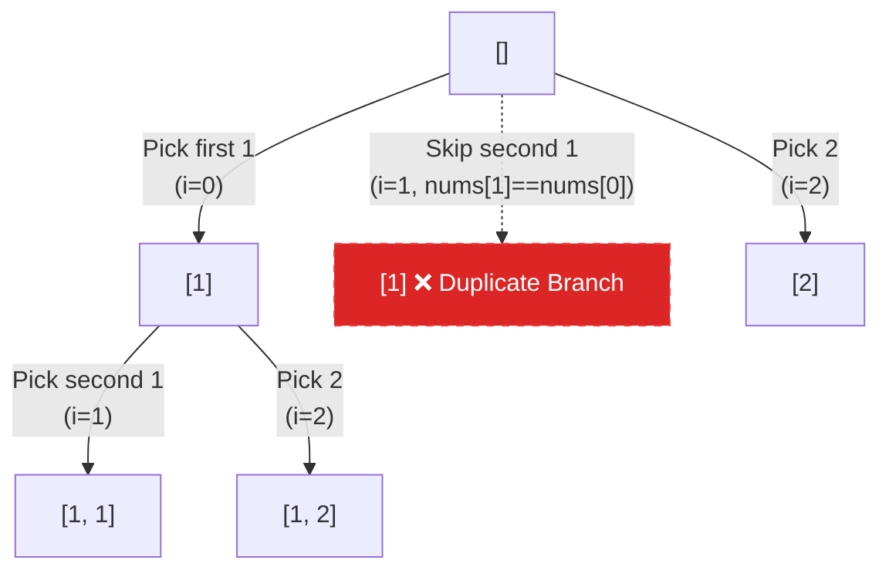

## Problem Statement

Given a collection of candidate numbers `candidates` and a target number `target`, find all unique combinations in `candidates` where the candidate numbers sum to `target`.

Each number in `candidates` may only be used **once** in the combination.
**Note:** The solution set must not contain duplicate combinations.

**Example:**
Input: candidates = [10,1,2,7,6,1,5], target = 8
Output: 
[
  [1,1,6],
  [1,2,5],
  [1,7],
  [2,6]
]

## Approach: Sorting & Skipping Duplicates

To avoid duplicate combinations without having to use a slow `Set` to filter them out later, the trick is to **sort the array first**. 

Once the array is sorted, identical numbers will be adjacent to each other. During our backtracking step, if we are looping through the candidates and we see a number that is exactly the same as the one right before it, we **skip it** (as long as we aren't at the very start of the current loop iteration).

Because the array is sorted, we get a second massive optimization: if our current sum plus the candidate exceeds the target, we can instantly `break` out of the loop because all numbers after it will be even larger!

## Mental Model

Let's trace how sorting helps us avoid duplicate branches for `candidates = [1, 1, 2]`.



*By checking `if (i > start && candidates[i] === candidates[i - 1])`, we prune entire identical subtrees before they even generate!*

## Solution

```javascript
function combinationSum2(candidates, target) {
    const result = [];
    
    // 1. Sort the array to easily handle duplicates and optimize bounds
    candidates.sort((a, b) => a - b);
    
    function backtrack(startIndex, currentSum, currentCombo) {
        if (currentSum === target) {
            result.push([...currentCombo]);
            return;
        }
        
        for (let i = startIndex; i < candidates.length; i++) {
            // Optimization: If this number pushes us over the target, 
            // since the array is sorted, all subsequent numbers will too.
            if (currentSum + candidates[i] > target) {
                break; 
            }
            
            // Core Logic: Skip duplicates at the same tree level
            // i > startIndex ensures we only skip duplicates AFTER picking the first one
            if (i > startIndex && candidates[i] === candidates[i - 1]) {
                continue;
            }
            
            // Make the decision
            currentCombo.push(candidates[i]);
            
            // Move to the next element (i + 1) because we can only use each element once
            backtrack(i + 1, currentSum + candidates[i], currentCombo);
            
            // Undo the decision
            currentCombo.pop();
        }
    }
    
    backtrack(0, 0, []);
    return result;
}
```

## Complexity Analysis

- **Time Complexity:** $O(2^N)$ in the worst case, where $N$ is the length of `candidates`. Sorting takes $O(N \log N)$, but the recursive tree can have up to $2^N$ nodes. However, because we prune duplicates and break early when exceeding the target, it runs much faster than a naive $O(2^N)$ in practice.
- **Space Complexity:** $O(N)$ for the recursion call stack and the `currentCombo` array (ignoring the output array which could store up to $O(2^N)$ elements).
