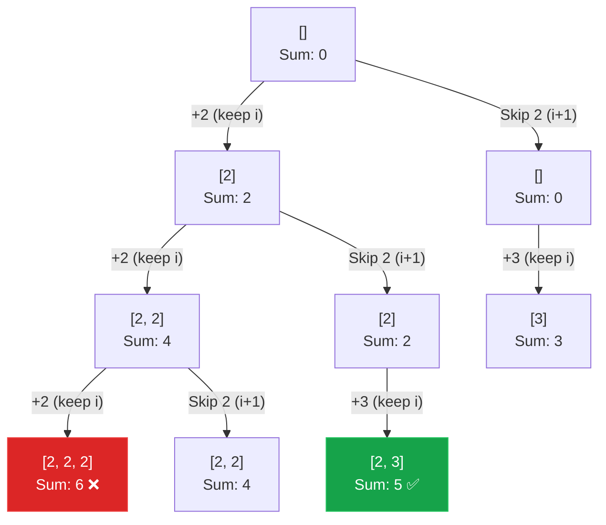

## Problem Statement

Given an array of **distinct** integers `candidates` and a target integer `target`, return a list of all unique combinations of `candidates` where the chosen numbers sum to `target`. You may return the combinations in any order.

The same number may be chosen from `candidates` an **unlimited number of times**. Two combinations are unique if the frequency of at least one of the chosen numbers is different.

**Example:**
Input: candidates = [2,3,6,7], target = 7
Output: [[2,2,3],[7]]
Explanation:
2 and 3 are candidates, and 2 + 2 + 3 = 7. Note that 2 can be used multiple times.
7 is a candidate, and 7 = 7.
These are the only two combinations.

## Approach: Backtracking with a Twist

This is a classic backtracking problem, but since we can reuse the same element multiple times, our decision tree changes slightly. 

At any given point index `i`, we have two choices:
1. **Include** the current candidate `candidates[i]` and **do not increment** `i` (because we are allowed to pick the same number again).
2. **Exclude** the current candidate and **increment** `i` to move on to the next number.

We stop traversing a path when:
- The current sum exactly equals our `target` (we found a valid combination).
- The current sum exceeds our `target`, or we run out of elements (this path is invalid).

## Mental Model

Let's visualize the decision tree for `candidates = [2, 3]`, `target = 5`.



*Notice how taking the left branch means we add the element but stay on the same index, allowing us to keep picking it until we bust.*

## Solution

```javascript
function combinationSum(candidates, target) {
    const result = [];
    const currentCombo = [];
    
    function backtrack(i, currentSum) {
        // Base case 1: Found a valid combination
        if (currentSum === target) {
            result.push([...currentCombo]);
            return;
        }
        
        // Base case 2: Overshot target or ran out of candidates
        if (currentSum > target || i >= candidates.length) {
            return;
        }
        
        // Decision 1: INCLUDE candidates[i] 
        // Notice we pass 'i' (not i + 1) so we can reuse the same element
        currentCombo.push(candidates[i]);
        backtrack(i, currentSum + candidates[i]);
        
        // Decision 2: EXCLUDE candidates[i]
        // Pop the element we just added and move to the next candidate
        currentCombo.pop();
        backtrack(i + 1, currentSum);
    }
    
    backtrack(0, 0);
    return result;
}
```

## Complexity Analysis

- **Time Complexity:** $O(2^{\frac{T}{M}})$ where $T$ is the target value and $M$ is the minimum value in `candidates`. The height of our decision tree can be up to $\frac{T}{M}$ (if we keep picking the smallest element). At each node, we branch 2 ways.
- **Space Complexity:** $O(\frac{T}{M})$ for the recursion call stack and the `currentCombo` array in the worst-case scenario.
