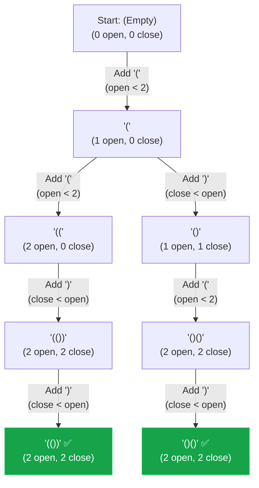

## Problem Statement

Given `n` pairs of parentheses, write a function to generate all combinations of well-formed parentheses.

**Example:**
Input: n = 3
Output: ["((()))","(()())","(())()","()(())","()()()"]

## Approach: Backtracking (Constraint Counting)

We can build valid combinations character by character. At every step, we essentially have two choices:
1. Add an open parenthesis `(`.
2. Add a close parenthesis `)`.

To guarantee that we only generate **valid** combinations, we keep track of how many open and close parentheses we've used so far (`openCount` and `closedCount`). We can prune invalid branches instantly using two simple rules:
1. **Can we add an open parenthesis?** Yes, as long as `openCount < n`.
2. **Can we add a close parenthesis?** Yes, but only if `closedCount < openCount`. (This prevents us from closing a parenthesis that hasn't been opened yet!).

We hit our base case and add the string to our result when `openCount === n` and `closedCount === n`.

## Mental Model

Let's trace the decision tree for `n = 2`. Notice how tracking counts aggressively prunes bad paths like `)(` before they even start!



## Solution

```javascript
function generateParenthesis(n) {
    const result = [];
    
    function backtrack(currentString, openCount, closedCount) {
        // Base case: we've used all n pairs
        if (openCount === n && closedCount === n) {
            result.push(currentString);
            return;
        }
        
        // Decision 1: Add an open parenthesis if we haven't hit the limit
        if (openCount < n) {
            backtrack(currentString + '(', openCount + 1, closedCount);
        }
        
        // Decision 2: Add a close parenthesis if it can match an existing open one
        if (closedCount < openCount) {
            backtrack(currentString + ')', openCount, closedCount + 1);
        }
    }
    
    backtrack("", 0, 0);
    return result;
}
```

*Note: Since JavaScript strings are immutable primitives, doing `currentString + '('` automatically creates a new string for the next recursive call. We don't need to manually `push()` and `pop()` from an array like we do in other backtracking problems, which makes the code wonderfully clean!*

## Complexity Analysis

- **Time Complexity:** $O(\frac{4^n}{\sqrt{n}})$. This is bounded by the $n$-th Catalan number, which represents the total number of valid parenthesis combinations.
- **Space Complexity:** $O(n)$ for the maximum depth of the recursion stack, which will be $2n$ calls deep. *(Excluding the output array which takes $O(\frac{4^n}{\sqrt{n}})$ space).*
