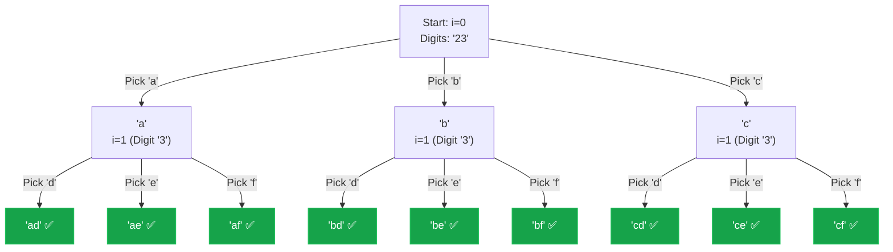

## Problem Statement

Given a string containing digits from `2-9` inclusive, return all possible letter combinations that the number could represent. Return the answer in **any order**.

A mapping of digits to letters (just like on the telephone buttons) is given below. Note that 1 does not map to any letters.

<div className="max-w-[280px] mx-auto my-8 p-3 bg-[#1a1a1a] rounded-3xl border border-white/10 shadow-2xl">
  <div className="grid grid-cols-3 gap-3">
    <div className="flex flex-row items-center justify-center p-1 bg-white/5 rounded-full">
      <span className="text-xl font-medium text-white/40">1</span>
    </div>
    <div className="flex flex-row items-center justify-center p-1 bg-white/10 rounded-full border border-white/5 shadow-inner">
      <span className="text-xl font-medium text-white">2</span>
      <span className="text-[12px] text-white/50 ml-2 tracking-widest h-3 leading-none">abc</span>
    </div>
    <div className="flex flex-row items-center justify-center p-1 bg-white/10 rounded-full border border-white/5 shadow-inner">
      <span className="text-xl font-medium text-white">3</span>
      <span className="text-[12px] text-white/50 ml-2 tracking-widest h-3 leading-none">def</span>
    </div>
    
    <div className="flex flex-row items-center justify-center p-1 bg-white/10 rounded-full border border-white/5 shadow-inner">
      <span className="text-xl font-medium text-white">4</span>
      <span className="text-[12px] text-white/50 ml-2 tracking-widest h-3 leading-none">ghi</span>
    </div>
    <div className="flex flex-row items-center justify-center p-1 bg-white/10 rounded-full border border-white/5 shadow-inner">
      <span className="text-xl font-medium text-white">5</span>
      <span className="text-[12px] text-white/50 ml-2 tracking-widest h-3 leading-none">jkl</span>
    </div>
    <div className="flex flex-row items-center justify-center p-1 bg-white/10 rounded-full border border-white/5 shadow-inner">
      <span className="text-xl font-medium text-white">6</span>
      <span className="text-[12px] text-white/50 ml-2 tracking-widest h-3 leading-none">mno</span>
    </div>
    
    <div className="flex flex-row items-center justify-center p-1 bg-white/10 rounded-full border border-white/5 shadow-inner">
      <span className="text-xl font-medium text-white">7</span>
      <span className="text-[12px] text-white/50 ml-2 tracking-widest h-3 leading-none">pqrs</span>
    </div>
    <div className="flex flex-row items-center justify-center p-1 bg-white/10 rounded-full border border-white/5 shadow-inner">
      <span className="text-xl font-medium text-white">8</span>
      <span className="text-[12px] text-white/50 ml-2 tracking-widest h-3 leading-none">tuv</span>
    </div>
    <div className="flex flex-row items-center justify-center p-1 bg-white/10 rounded-full border border-white/5 shadow-inner">
      <span className="text-xl font-medium text-white">9</span>
      <span className="text-[12px] text-white/50 ml-2 tracking-widest h-3 leading-none">wxyz</span>
    </div>
    
    <div className="flex flex-row items-center justify-center p-1 bg-white/5 rounded-full">
      <span className="text-xl font-medium text-white/40">*</span>
    </div>
    <div className="flex flex-row items-center justify-center p-1 bg-white/5 rounded-full">
      <span className="text-xl font-medium text-white/40">0</span>
    </div>
    <div className="flex flex-row items-center justify-center p-1 bg-white/5 rounded-full">
      <span className="text-xl font-medium text-white/40">#</span>
    </div>
  </div>
</div>

**Example:**
```text
Input: digits = "23"
Output: ["ad","ae","af","bd","be","bf","cd","ce","cf"]
```

## Approach: Backtracking (Mapping Choices)

This problem is a pure combination generator. At each step, we look at the current digit, check our phone keypad mapping to see what letters it can generate, and recursively try every single one of them.

1. Create a `keypad` hash map or array that maps each digit string (`"2"`, `"3"`, etc.) to its corresponding string of characters (`"abc"`, `"def"`, etc.).
2. We pass an index `i` into our backtracking function, which tells us which digit in the `digits` string we are currently processing.
3. We fetch the characters for `digits[i]`, loop through them, and for each character, append it to our ongoing string and recurse to `i + 1`.
4. **Base Case:** When `i === digits.length`, our string is fully built, so we add it to the result array.

*Note: Be sure to handle the edge case where the input string is empty!*

## Mental Model

Let's trace the decision tree for `digits = "23"`. 
- `digits[0] = "2"` gives us the choices: `a, b, c`.
- `digits[1] = "3"` gives us the choices: `d, e, f`.



## Solution

```javascript
function letterCombinations(digits) {
    if (digits.length === 0) return [];
    
    const result = [];
    
    // Map digits to their corresponding letters
    const keypad = {
        "2": "abc",
        "3": "def",
        "4": "ghi",
        "5": "jkl",
        "6": "mno",
        "7": "pqrs",
        "8": "tuv",
        "9": "wxyz"
    };
    
    function backtrack(i, currentString) {
        // Base case: we've processed all digits
        if (i === digits.length) {
            result.push(currentString);
            return;
        }
        
        // Get the characters corresponding to the current digit
        const chars = keypad[digits[i]];
        
        // Try every character for this digit
        for (const char of chars) {
            // Because strings are immutable primitives in JS, 
            // string concatenation creates a new string for the recursive call.
            // No need to manually push/pop from an array!
            backtrack(i + 1, currentString + char);
        }
    }
    
    backtrack(0, "");
    return result;
}
```

## Complexity Analysis

- **Time Complexity:** $O(N \cdot 4^N)$, where $N$ is the length of `digits`. The maximum number of letters mapped to a digit is 4 (for `7` and `9`). In the worst case, we have $4^N$ combinations. Constructing the string and adding it to the result array takes $O(N)$ time.
- **Space Complexity:** $O(N)$ for the recursion call stack, which goes as deep as the number of digits $N$. *(Excluding the $O(N \cdot 4^N)$ space required to hold the output array).*
