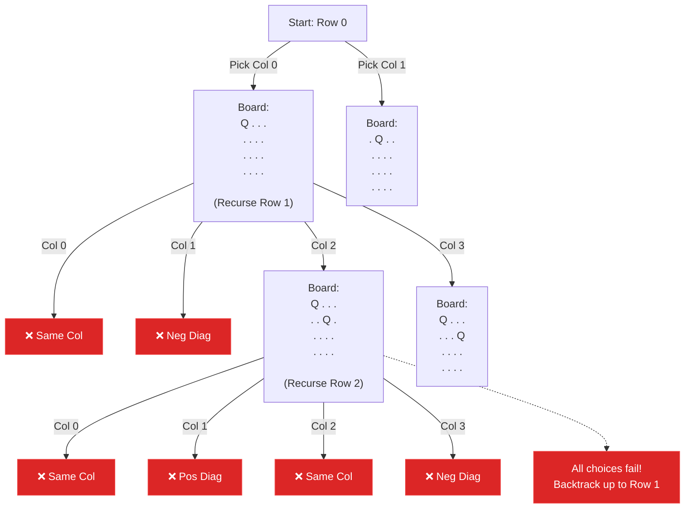

## Problem Statement

The **n-queens** puzzle is the problem of placing `n` queens on an `n x n` chessboard such that no two queens attack each other.

Given an integer `n`, return *all distinct solutions to the **n-queens puzzle***. You may return the answer in **any order**.

Each solution contains a distinct board configuration of the n-queens' placement, where `'Q'` and `'.'` both indicate a queen and an empty space, respectively.

**Example:**
```text
Input: n = 4
Output: [[".Q..","...Q","Q...","..Q."],["..Q.","Q...","...Q",".Q.."]]
```

## Approach: Backtracking with State Sets

Queens attack in straight lines: horizontally, vertically, and diagonally. 

To solve this efficiently, we place exactly **one queen per row**. This means we only need to move top-down, row by row (`r = 0` to `n - 1`), deciding which column (`c`) to place the queen in.

But how do we quickly check if a column is safe? We can track the restricted zones in $O(1)$ time using **three Hash Sets**:
1. `cols`: Tracks columns already occupied.
2. `posDiag`: Tracks positive diagonals (bottom-left to top-right).
3. `negDiag`: Tracks negative diagonals (top-left to bottom-right).

**The Math of Diagonals:**
- Every square on the same **positive diagonal** shares the exact same sum: `r + c`.
- Every square on the same **negative diagonal** shares the exact same difference: `r - c`.

By adding the column index and these calculated diagonal values to our sets when we place a queen, we can instantly validate if the next row's column choices are safe!

## Mental Model

Let's trace placing a queen on a $4 \times 4$ board. Notice how picking Col 0 in Row 0 restricts everything directly below it, and its diagonals.



*By instantly checking our Sets, we skip invalid paths before generating unnecessary boards.*

## Solution

```javascript
function solveNQueens(n) {
    const result = [];
    
    // Create an empty n x n board filled with '.'
    const board = Array.from({ length: n }, () => new Array(n).fill('.'));
    
    // Hash Sets to track attack zones in O(1) time
    const cols = new Set();
    const posDiag = new Set(); // (r + c)
    const negDiag = new Set(); // (r - c)
    
    function backtrack(r) {
        // Base Case: We successfully placed a queen in every row
        if (r === n) {
            // Join the arrays into strings and add to result
            result.push(board.map(row => row.join('')));
            return;
        }
        
        // Try placing a queen in every column of the current row
        for (let c = 0; c < n; c++) {
            // Check if the current position is under attack
            if (cols.has(c) || posDiag.has(r + c) || negDiag.has(r - c)) {
                continue;
            }
            
            // 1. Make the choice (Place Queen & update sets)
            cols.add(c);
            posDiag.add(r + c);
            negDiag.add(r - c);
            board[r][c] = 'Q';
            
            // 2. Recurse down to the next row
            backtrack(r + 1);
            
            // 3. Undo the choice (Backtrack)
            cols.delete(c);
            posDiag.delete(r + c);
            negDiag.delete(r - c);
            board[r][c] = '.';
        }
    }
    
    backtrack(0);
    return result;
}
```

## Complexity Analysis

- **Time Complexity:** $O(N!)$. For the first row, we have $N$ choices. For the second row, we have at most $N-2$ choices, and so on. The number of valid branches decreases drastically, resulting in a time complexity bounded by $N!$. (It is technically faster than $N!$ because we heavily prune branches).
- **Space Complexity:** $O(N^2)$ to store the `board` state. The hash sets and the recursion call stack take $O(N)$ space. *(Excluding the output array which can be quite large depending on valid solutions).*
