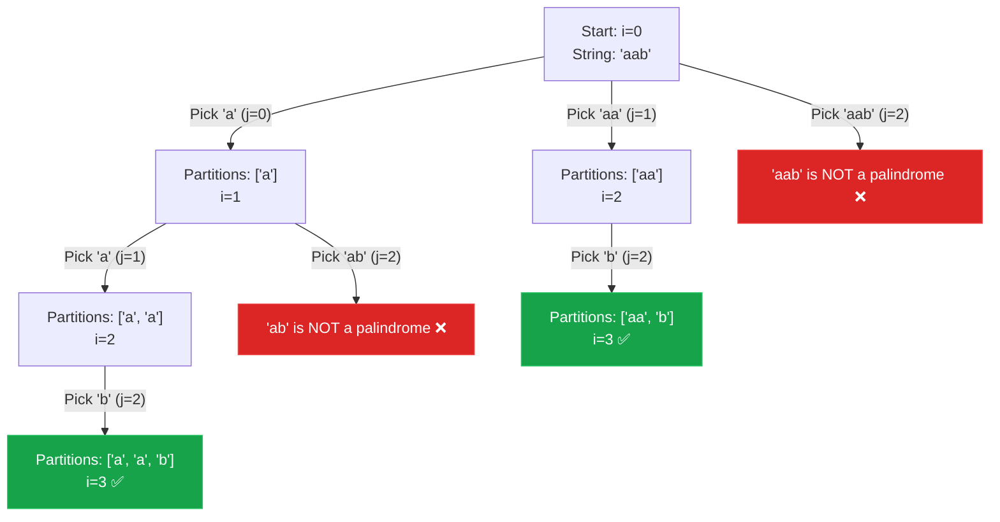

## Problem Statement

Given a string `s`, partition `s` such that every substring of the partition is a palindrome. Return all possible palindrome partitioning of `s`.

A **palindrome** is a string that reads the same backward as forward.

**Example:**
Input: s = "aab"
Output: [["a","a","b"],["aa","b"]]

## Approach: Backtracking (Valid Substring Generation)

This problem asks us to divide a string into valid chunks (palindromes). This means at every step, we are deciding *where to place the partition line*.

For a given starting index `i`, we can place our partition line at any index `j` from `i` to the end of the string.
1. We implicitly extract the substring from `i` to `j`.
2. **If it is a palindrome**, we have found a valid chunk! We add it to our current list of partitions and recursively repeat the process starting from `j + 1`.
3. **If it is NOT a palindrome**, we simply skip this branch and extend `j` further to see if a longer chunk forms a palindrome.

We reach our base case when `i` reaches the end of the string (`i === s.length`), meaning we have successfully partitioned the entire string.

## Mental Model

Let's visualize the decision tree for `s = "aab"`. At each node, we check every possible prefix starting at `i`. If the prefix is a palindrome, we branch.



*Notice how invalid palindromes like `"ab"` and `"aab"` act as dead-ends, instantly pruning those branches.*

## Solution

```javascript
function partition(s) {
    const result = [];
    const currentPartition = [];
    
    // Helper function to check if a string slice is a palindrome
    function isPalindrome(left, right) {
        while (left < right) {
            if (s[left] !== s[right]) return false;
            left++;
            right--;
        }
        return true;
    }
    
    function backtrack(i) {
        // Base case: we have successfully partitioned the entire string
        if (i === s.length) {
            result.push([...currentPartition]);
            return;
        }
        
        // Try every possible substring starting from index i
        for (let j = i; j < s.length; j++) {
            // Only branch if the current substring is a palindrome
            if (isPalindrome(i, j)) {
                // 1. Make the choice
                currentPartition.push(s.substring(i, j + 1));
                
                // 2. Recurse on the remaining string
                backtrack(j + 1);
                
                // 3. Undo the choice (Backtrack)
                currentPartition.pop();
            }
        }
    }
    
    backtrack(0);
    return result;
}
```

## Complexity Analysis

- **Time Complexity:** $O(N \cdot 2^N)$. In the worst case (e.g., a string of all identical characters like `s = "aaaa"`), every possible substring is a palindrome. There are $2^{N-1}$ possible ways to partition a string of length $N$. For each partition, checking palindromes and copying the array to the result takes $O(N)$ time.
- **Space Complexity:** $O(N)$ for the recursion call stack and the `currentPartition` array. *(Excluding the $O(N \cdot 2^N)$ space required to hold the output array).*
