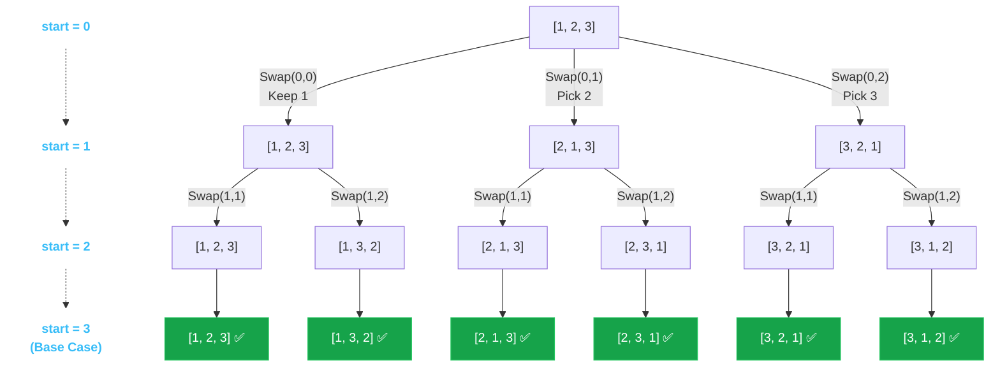

## Problem Statement

Given an array `nums` of **distinct** integers, return all the possible permutations. You can return the answer in **any order**.

**Example:**
Input: nums = [1,2,3]
Output: [[1,2,3],[1,3,2],[2,1,3],[2,3,1],[3,1,2],[3,2,1]]


## Approach: In-Place Swapping (Optimal)

While a standard backtracking approach uses a `used` boolean array or a `Set` to track picked elements, the **most optimal** approach modifies the `nums` array in-place via swapping.

The idea is to use an index `start` to divide the array into two parts:
1. **Locked part** (before `start`): Elements we have already chosen.
2. **Available part** (from `start` to the end): Elements we can still choose.

At each step, we iterate `i` from `start` to the end of the array. We swap `nums[start]` with `nums[i]` (locking it in place), recurse for `start + 1`, and then backtrack by swapping them back! This completely eliminates the need for an extra `used` array or `currentPerm` array.

## Mental Model

Let's visualize the swap tree for `nums = [1, 2, 3]`. At each node, we iterate `i` from `start` to `end` and swap.



*By swapping, we magically mutate the original array into every possible permutation without using any auxiliary space!*

## Solution

```javascript
function permute(nums) {
    const result = [];
    
    function backtrack(start) {
        // Base case: we have locked in all positions
        if (start === nums.length) {
            // Push a COPY of the current state of nums
            result.push([...nums]);
            return;
        }
        
        // Iterate through all remaining available choices
        for (let i = start; i < nums.length; i++) {
            // 1. Make a choice: Swap the chosen element into the 'start' position
            [nums[start], nums[i]] = [nums[i], nums[start]];
            
            // 2. Recurse down, moving the lock boundary forward
            backtrack(start + 1);
            
            // 3. Undo the choice (Backtrack): Swap them back to restore original state
            [nums[start], nums[i]] = [nums[i], nums[start]];
        }
    }
    
    backtrack(0);
    return result;
}
```

## Complexity Analysis

- **Time Complexity:** $O(N \cdot N!)$. We still generate $N!$ permutations, and at each base case we make a copy of the array which takes $O(N)$ time.
- **Space Complexity:** $O(N)$ for the recursion call stack. We completely eliminated the extra `used` array and the `currentPerm` array, making this the absolute most space-optimal solution! *(Ignoring the $O(N \cdot N!)$ space for the output array).*
