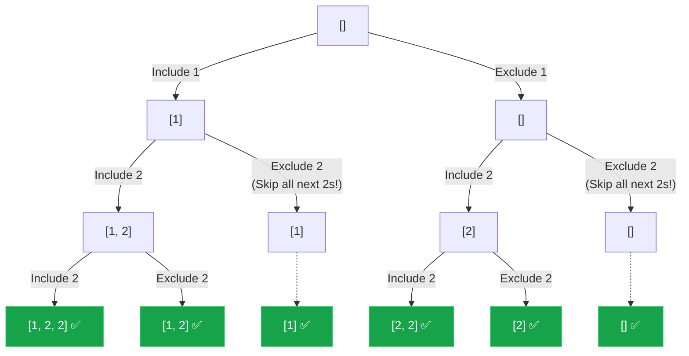

## Problem Statement

Given an integer array `nums` that may contain duplicates, return all possible subsets (the power set).

The solution set **must not** contain duplicate subsets. Return the solution in any order.

**Example:**
Input: nums = [1,2,2]
Output: [[],[1],[1,2],[1,2,2],[2],[2,2]]

## Approach: Sorting & Skipping Branches

This problem is a direct combination of **Subsets** (Include/Exclude pattern) and **Combination Sum II** (Sorting to handle duplicates). 

Because the input array contains duplicates, if we naively generate subsets, we'll end up with duplicate arrays (e.g., picking the first `2` vs picking the second `2`).

The trick:
1. **Sort the array** so duplicates are adjacent.
2. When making our recursive decisions, if we choose to **Exclude** `nums[i]`, we must **skip all subsequent identical numbers** in the array. 

Why? Because if we just decided *not* to include a `2` in this specific slot of the subset, including the *next* `2` in this exact same slot would just create the exact same duplicate subset branch!

## Mental Model

Let's trace `nums = [1, 2, 2]`. Notice how excluding a number aggressively prunes the tree.



*By shifting our pointer past duplicates on the "Exclude" branch, we never generate `[1]` or `[]` twice.*

## Solution

```javascript
function subsetsWithDup(nums) {
    const result = [];
    const currentSubset = [];
    
    // 1. Sort the array so duplicates are adjacent
    nums.sort((a, b) => a - b);
    
    function backtrack(i) {
        // Base case: we've made a decision for every element
        if (i === nums.length) {
            result.push([...currentSubset]);
            return;
        }
        
        // Decision 1: INCLUDE nums[i]
        currentSubset.push(nums[i]);
        backtrack(i + 1);
        
        // Undo the choice
        currentSubset.pop();
        
        // Decision 2: EXCLUDE nums[i]
        // Since we excluded this number, we must skip all identical numbers 
        // to prevent generating duplicate subsets down this path.
        while (i + 1 < nums.length && nums[i] === nums[i + 1]) {
            i++;
        }
        
        // Recurse with the next UNIQUE number
        backtrack(i + 1);
    }
    
    backtrack(0);
    return result;
}
```

## Complexity Analysis

- **Time Complexity:** $O(N \cdot 2^N)$. Sorting takes $O(N \log N)$. In the worst case (all unique elements), there are $2^N$ subsets, and copying each to the result array takes $O(N)$.
- **Space Complexity:** $O(N)$ for the recursion call stack and `currentSubset` array. *(Excluding the $O(N \cdot 2^N)$ space required to hold the output array).*
