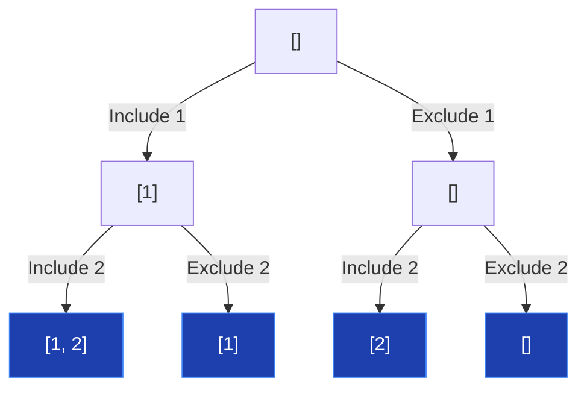

## Problem Statement

Given an integer array `nums` of unique elements, return all possible subsets (the power set). The solution set must not contain duplicate subsets. Return the solution in any order.

**Example:**
Input: nums = [1,2,3]
Output: [[],[1],[2],[1,2],[3],[1,3],[2,3],[1,2,3]]

## Approach: Backtracking (Include/Exclude)

To generate all possible subsets, we can picture a decision tree. For every element in the array, we have exactly two choices:
1. **Include** the element in our current subset.
2. **Exclude** the element from our current subset.

We will use a classic recursive backtracking algorithm to explore every path in this decision tree. 

## Mental Model

Let's look at the decision tree for `nums = [1, 2]`:



*Every leaf node in the tree represents one of the final subsets that gets added to our result.*

## Solution

```javascript
function subsets(nums) {
    const result = [];
    const currentSubset = [];
    
    function backtrack(i) {
        // Base case: we have made a decision for every element
        if (i >= nums.length) {
            // Push a COPY of the current subset, because arrays are passed by reference
            result.push([...currentSubset]);
            return;
        }
        
        // Decision 1: INCLUDE nums[i]
        currentSubset.push(nums[i]);
        backtrack(i + 1);
        
        // Decision 2: EXCLUDE nums[i]
        // We pop the element we just added to "backtrack" to our previous state
        currentSubset.pop();
        backtrack(i + 1);
    }
    
    backtrack(0);
    return result;
}
```

## Complexity Analysis

- **Time Complexity:** $O(N \cdot 2^N)$. There are $2^N$ possible subsets (since every element has 2 choices). At each base case, we make a copy of the subset, which takes up to $O(N)$ time.
- **Space Complexity:** $O(N)$ for the recursion call stack and the `currentSubset` array. *(Note: The space required to hold the output array is $O(N \cdot 2^N)$, but standard auxiliary space complexity doesn't count the output array).*
