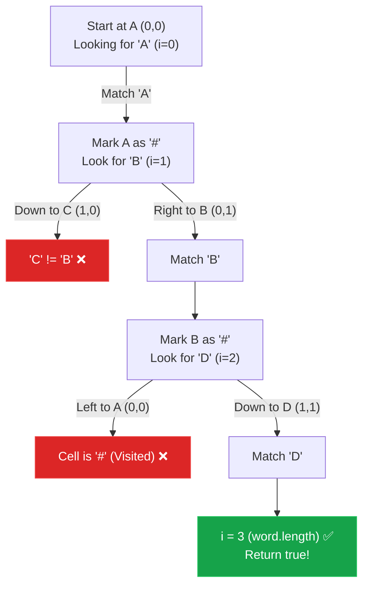

## Problem Statement

Given an `m x n` grid of characters `board` and a string `word`, return `true` if `word` exists in the grid.

The word can be constructed from letters of sequentially adjacent cells, where adjacent cells are horizontally or vertically neighboring. The same letter cell may not be used more than once.

**Example:**
Input: board = [
  ["A","B","C","E"],
  ["S","F","C","S"],
  ["A","D","E","E"]
], word = "ABCCED"
Output: true

## Approach: Backtracking (DFS on Grid)

This is a classic 2D grid traversal problem. We need to find a path that spells out the `word`. 

Since the word could start anywhere, we must iterate through every single cell in the grid. If a cell matches the first letter of our `word`, we kick off a Depth-First Search (DFS) to explore all valid paths starting from that cell.

During the DFS, we need to track:
1. `r` and `c`: Our current row and column on the board.
2. `i`: The index of the character in `word` we are currently looking for.

**The Rules of the Search:**
- **Success:** If `i === word.length`, we've successfully found all characters. Return `true`.
- **Failure:** If we go out of bounds, if the current cell doesn't match `word[i]`, or if the cell has already been visited in our current path, return `false`.
- **Marking Visited:** To prevent reusing the same cell in a single path, we must mark it as visited. To save space, we can temporarily mutate the board cell (e.g., set it to `'#'`).
- **Backtracking:** After we finish exploring all 4 directions from a cell, we *must* reset it back to its original character so it can be used in other completely different paths!

## Mental Model

Let's trace a small `2 x 2` board looking for the word `"ABD"`:
```text
A B
C D
```



*Notice how marking `A` as `#` prevents us from accidentally reusing it when we move right to `B` and check our left neighbor.*

## Solution

```javascript
function exist(board, word) {
    const ROWS = board.length;
    const COLS = board[0].length;
    
    function dfs(r, c, i) {
        // Base Case 1: We found all characters in the word!
        if (i === word.length) {
            return true;
        }
        
        // Base Case 2: Out of bounds, mismatched character, or visited
        if (
            r < 0 || c < 0 || 
            r >= ROWS || c >= COLS || 
            board[r][c] !== word[i]
        ) {
            return false;
        }
        
        // Temporarily mark as visited to prevent loops
        const temp = board[r][c];
        board[r][c] = '#';
        
        // Recurse in all 4 directions (up, down, left, right)
        const res = (
            dfs(r + 1, c, i + 1) ||
            dfs(r - 1, c, i + 1) ||
            dfs(r, c + 1, i + 1) ||
            dfs(r, c - 1, i + 1)
        );
        
        // Undo the choice (Backtrack) so this cell can be used in other paths
        board[r][c] = temp;
        
        return res;
    }
    
    // Check every cell as a potential starting point
    for (let r = 0; r < ROWS; r++) {
        for (let c = 0; c < COLS; c++) {
            // Optimization: Only start DFS if the first letter matches
            if (board[r][c] === word[0]) {
                if (dfs(r, c, 0)) return true;
            }
        }
    }
    
    return false;
}
```

## Complexity Analysis

- **Time Complexity:** $O(m \cdot n \cdot 4^L)$, where $m$ is the number of rows, $n$ is the number of columns, and $L$ is the length of the `word`. In the worst case, we start a DFS from every cell, and each DFS branches in up to 3 directions (excluding the cell we just came from, though mathematically bounded by 4) to a depth of $L$.
- **Space Complexity:** $O(L)$. We don't use any auxiliary data structures like a `Set` for visited elements because we modify the board in-place. The only extra memory used is the recursion call stack, which goes as deep as the length of the word $L$.
