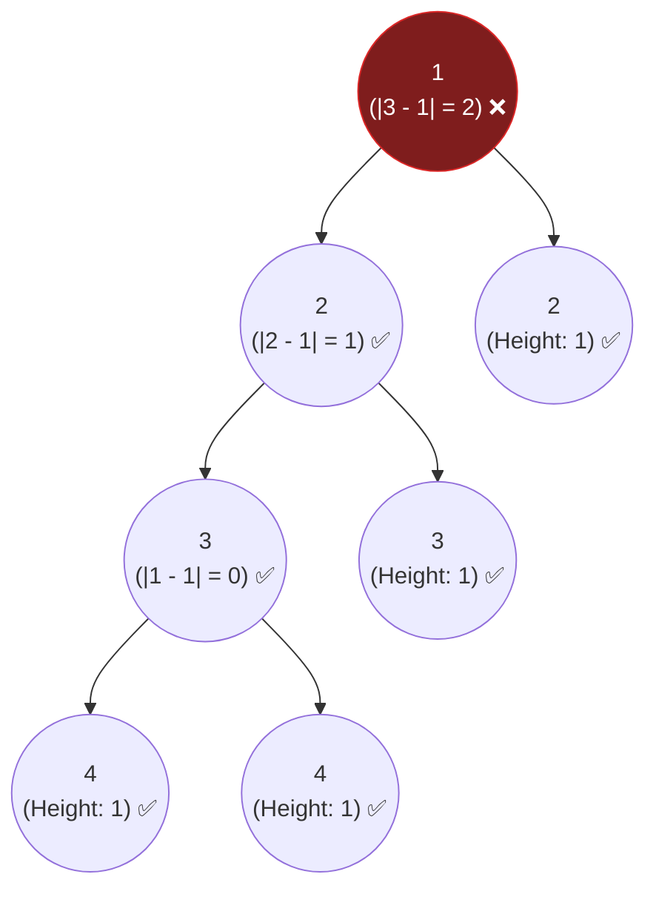

## Problem Statement

Given a binary tree, determine if it is **height-balanced**.

A height-balanced binary tree is a binary tree in which the depth of the two subtrees of *every* node never differs by more than one.

**Example:**
```text
Input: root = [1,2,2,3,3,null,null,4,4]
Output: false
```

## Approach: Depth-First Search (Bottom-Up)

Once again, this problem relies on calculating the **Maximum Depth** of a tree using DFS. 

A naive Top-Down approach would calculate the max depth of the left and right subtrees for every single node independently. However, this recalculates heights repeatedly for the same subtrees, resulting in an incredibly slow $O(N^2)$ time complexity.

Instead, we can use an optimized **Bottom-Up DFS** to compute everything in $O(N)$ time:
1. Write a `dfs(node)` function that calculates the height of the current node.
2. Ask the left child for its height. Ask the right child for its height.
3. Check the difference: `Math.abs(leftHeight - rightHeight)`. 
   - If the difference is `> 1`, the tree is unbalanced! 
   - To instantly bubble this failure up to the top without wasting time finishing the rest of the tree, we can just return a sentinel value like `-1`.
4. If a node sees that any of its children returned `-1`, it immediately returns `-1` to its parent.

## Mental Model

Let's trace an unbalanced tree. Look at the root node `1`. Its left child returns a height of `3`, but its right child returns a height of `1`. The difference is `2`, which triggers the unbalance!



*The unbalance is detected exactly at the root, returning `-1` (or `false`).*

## Solution

```javascript
/**
 * Definition for a binary tree node.
 * function TreeNode(val, left, right) {
 *     this.val = (val===undefined ? 0 : val)
 *     this.left = (left===undefined ? null : left)
 *     this.right = (right===undefined ? null : right)
 * }
 */

function isBalanced(root) {
    // Helper function returns the height of a node, 
    // or -1 if the subtree is unbalanced
    function dfs(node) {
        if (node === null) return 0;
        
        // 1. Check left subtree
        const leftHeight = dfs(node.left);
        if (leftHeight === -1) return -1; // Instantly bubble up failure
        
        // 2. Check right subtree
        const rightHeight = dfs(node.right);
        if (rightHeight === -1) return -1; // Instantly bubble up failure
        
        // 3. Process current node
        if (Math.abs(leftHeight - rightHeight) > 1) {
            return -1; // Trigger failure
        }
        
        // Return height if balanced
        return 1 + Math.max(leftHeight, rightHeight);
    }
    
    // If it returns -1, it's unbalanced. Otherwise, it's true.
    return dfs(root) !== -1;
}
```

## Complexity Analysis

- **Time Complexity:** $O(N)$ where $N$ is the number of nodes. By bubbling up the `-1` failure instantly, we never visit a node more than once, avoiding the $O(N^2)$ trap of a naive Top-Down approach.
- **Space Complexity:** $O(H)$ where $H$ is the height of the tree. This accounts for the recursion call stack memory. In the worst case it is $O(N)$, and in the best case $O(\log N)$.
