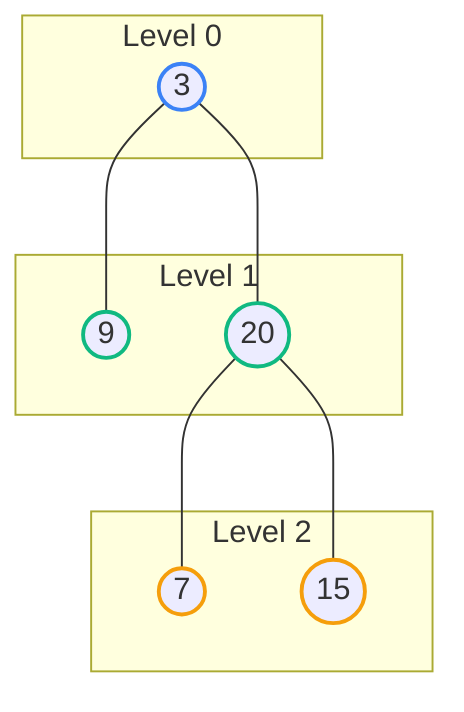

## Problem Statement

Given the `root` of a binary tree, return the **level order traversal** of its nodes' values. (i.e., from left to right, level by level).

**Example:**
```text
Input: root = [3,9,20,null,null,15,7]
Output: [[3],[9,20],[15,7]]
```

## Approach: Breadth-First Search (Queue)

Up until now, most tree problems have relied on Depth-First Search (DFS) using recursion. But when a problem asks us to process a tree *level by level*, we must switch our mental model to **Breadth-First Search (BFS)**.

BFS relies on a **Queue** (First-In, First-Out) data structure instead of a Stack/Recursion.

**The Algorithm:**
1. Initialize a queue and push the `root` node into it.
2. Enter a `while` loop that runs as long as the queue is not empty.
3. At the start of the loop, the size of the queue represents **exactly how many nodes are on the current level**. 
4. Lock in that `levelSize`. Loop exactly `levelSize` times:
   - Dequeue a node.
   - Add its value to a temporary `currentLevel` array.
   - If it has a `left` child, enqueue it.
   - If it has a `right` child, enqueue it.
5. After the inner loop finishes, push the `currentLevel` array into the final `result` array, and repeat for the next level!

## Mental Model

Notice how we process the tree horizontally. The queue acts as a waiting room; while we process Level 1, we push all of their children (Level 2) into the back of the line to be processed on the next iteration.



## Solution

```javascript
/**
 * Definition for a binary tree node.
 * function TreeNode(val, left, right) {
 *     this.val = (val===undefined ? 0 : val)
 *     this.left = (left===undefined ? null : left)
 *     this.right = (right===undefined ? null : right)
 * }
 */
function levelOrder(root) {
    if (root === null) return [];
    
    const result = [];
    const queue = [root];
    
    while (queue.length > 0) {
        // Lock in the number of nodes currently in the queue
        // This prevents us from accidentally processing the next level's nodes early!
        const levelSize = queue.length;
        const currentLevel = [];
        
        for (let i = 0; i < levelSize; i++) {
            // Dequeue the front node
            const node = queue.shift();
            
            // Add its value to the current level array
            currentLevel.push(node.val);
            
            // Enqueue its children for the NEXT level
            if (node.left !== null) queue.push(node.left);
            if (node.right !== null) queue.push(node.right);
        }
        
        // Push the completed level to the final result
        result.push(currentLevel);
    }
    
    return result;
}
```

*Note: In JavaScript, `Array.shift()` takes $O(N)$ time because it has to re-index the array. In a strict interview setting, you could mention that a real Queue class (using a Linked List or a two-pointer array approach) would make dequeueing $O(1)$. However, for LeetCode's constraints, `shift()` is perfectly acceptable and passes easily.*

## Complexity Analysis

- **Time Complexity:** $O(N)$ where $N$ is the number of nodes in the tree. We enqueue and dequeue every node exactly once. *(Note: If strictly analyzing JS `shift()`, it is mathematically $O(N^2)$, but it is realistically treated as $O(N)$ in JS interview contexts unless explicitly asked to optimize it).*
- **Space Complexity:** $O(N)$. At the bottom of a perfectly balanced binary tree, the final level contains roughly $\frac{N}{2}$ nodes. Therefore, the maximum size of our queue at any given time scales linearly with $O(N)$.
