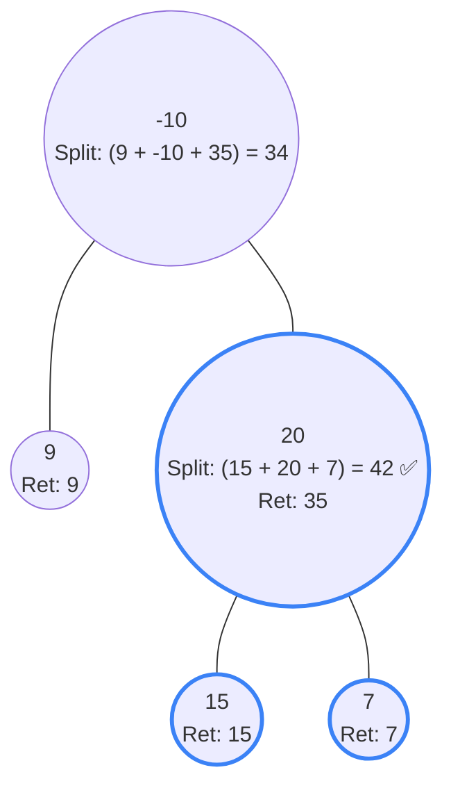

## Problem Statement

A **path** in a binary tree is a sequence of nodes where each pair of adjacent nodes has an edge connecting them. A node can only appear in the sequence at most once. Note that the path does not need to pass through the root.

The **path sum** of a path is the sum of the node's values in the path.

Given the `root` of a binary tree, return the maximum **path sum** of any non-empty path.

**Example:**
```text
Input: root = [-10,9,20,null,null,15,7]
Output: 42
Explanation: The optimal path is 15 -> 20 -> 7 with a path sum of 15 + 20 + 7 = 42.
```

## Approach: DFS (Bottom-Up with Global Max)

This is a "Hard" problem, but if you look closely, its structure is practically identical to **Diameter of Binary Tree**.

At any given node, a path can do one of two things:
1. **The "Split" (Arch):** The path goes from the left child, through the current node, and down into the right child. *Crucially, if a path splits like this, it CANNOT be extended up to the parent!*
2. **The "Straight Line":** The path comes from *either* the left child or the right child, goes through the current node, and continues up to the parent.

**The Strategy:**
- We write a `dfs(node)` function that *returns* the **Straight Line** max sum. This is exactly what the parent node needs to calculate its own paths.
- However, *inside* the function, before returning, we calculate the **Split** sum (`left + right + node.val`) and update a global `globalMax` variable! This is because the absolute largest path in the tree might be a split arch that never reaches the main root.
- **The Negative Trap:** If a child returns a negative path sum, it actively hurts our total! We should completely ignore it. We can do this by clamping the child's return value to 0: `Math.max(0, dfs(child))`.

## Mental Model

Let's trace `[-10, 9, 20, null, null, 15, 7]`. Look at node `20`. Its "Split" calculates `15 + 20 + 7 = 42`, which permanently updates the `globalMax`. But what does it *return* to its parent `-10`? It can only return a straight line, so it returns `20 + max(15, 7) = 35`.



*The global max is successfully captured at node `20`. When `-10` tries to calculate its own split later on, it only gets `34`, which is ignored because `42` is bigger.*

## Solution

```javascript
/**
 * Definition for a binary tree node.
 * function TreeNode(val, left, right) {
 *     this.val = (val===undefined ? 0 : val)
 *     this.left = (left===undefined ? null : left)
 *     this.right = (right===undefined ? null : right)
 * }
 */
function maxPathSum(root) {
    // Initialize to the lowest possible number 
    // in case the tree is entirely negative nodes!
    let globalMax = -Infinity;
    
    function dfs(node) {
        if (node === null) return 0;
        
        // 1. Get max straight paths from children. 
        // We use Math.max(0, ...) to completely ignore negative paths!
        const leftMax = Math.max(0, dfs(node.left));
        const rightMax = Math.max(0, dfs(node.right));
        
        // 2. Calculate the "Split" path sum (Left + Node + Right)
        // Update the global max if it's the biggest we've seen.
        globalMax = Math.max(globalMax, leftMax + rightMax + node.val);
        
        // 3. Return the "Straight Line" path sum to the parent
        return node.val + Math.max(leftMax, rightMax);
    }
    
    dfs(root);
    return globalMax;
}
```

## Complexity Analysis

- **Time Complexity:** $O(N)$ where $N$ is the number of nodes in the tree. We visit every single node exactly once during our post-order DFS traversal.
- **Space Complexity:** $O(H)$ where $H$ is the height of the tree, representing the memory used by the recursion call stack. In the worst case (a completely skewed tree), this takes $O(N)$ space. In a perfectly balanced tree, it takes $O(\log N)$ space.
