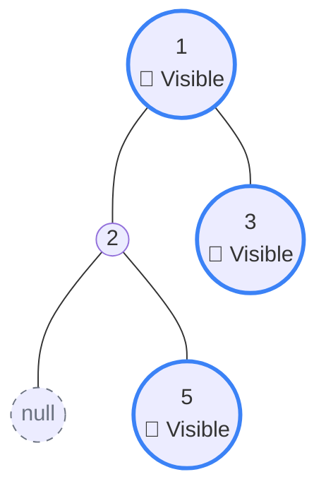

## Problem Statement

Given the `root` of a binary tree, imagine yourself standing on the **right side** of it, return the values of the nodes you can see ordered from top to bottom.

**Example:**
```text
Input: root = [1,2,3,null,5,null,4]
Output: [1,3,4]
```

## Approach: Breadth-First Search (Queue)

A common beginner mistake is to simply write a Depth-First Search (DFS) that only recurses down the `root.right` path. However, this fails when a left branch extends *deeper* than the right branch! If the right branch stops early, you would actually be able to see the deeper nodes of the left branch poking out from underneath it.

Because of this, the safest and most intuitive approach is to use **Breadth-First Search (Level Order Traversal)**.

If we process the tree level by level (from left to right), the "right side view" is literally just the **very last node processed on every level**.

**The Algorithm:**
1. This is identical to standard Level Order Traversal (using a Queue).
2. For each level, we loop `levelSize` times.
3. If our current index in the loop is the very last one (`i === levelSize - 1`), it means we are looking at the right-most node of this level! We push its value into our `result` array.
4. Enqueue the left and right children for the next level as normal.

## Mental Model

Consider the tricky edge case `root = [1,2,3,null,5,null,null]`. 

If you just blindly walked down the right side (`1 -> 3`), you would miss `5`! But by processing it level by level, we see that `5` is the final (and only) node on Level 3, meaning it successfully pokes out and becomes visible on the right side.



## Solution

```javascript
/**
 * Definition for a binary tree node.
 * function TreeNode(val, left, right) {
 *     this.val = (val===undefined ? 0 : val)
 *     this.left = (left===undefined ? null : left)
 *     this.right = (right===undefined ? null : right)
 * }
 */
function rightSideView(root) {
    if (root === null) return [];
    
    const result = [];
    const queue = [root];
    
    while (queue.length > 0) {
        const levelSize = queue.length;
        
        for (let i = 0; i < levelSize; i++) {
            const node = queue.shift();
            
            // If this is the absolute last node in the current level's loop,
            // it means it's the right-most node!
            if (i === levelSize - 1) {
                result.push(node.val);
            }
            
            // Standard BFS child enqueueing
            if (node.left !== null) queue.push(node.left);
            if (node.right !== null) queue.push(node.right);
        }
    }
    
    return result;
}
```

*Note: You can also solve this recursively using DFS by always visiting the `right` child before the `left` child, and only adding to the result array when `depth === result.length`. However, BFS maps to the "level by level" visual intuition much cleaner!*

## Complexity Analysis

- **Time Complexity:** $O(N)$ where $N$ is the number of nodes in the tree. We enqueue and dequeue every node exactly once. *(Note: JS `shift()` is technically $O(N^2)$ strictly speaking, but is treated as $O(N)$ in standard interview settings).*
- **Space Complexity:** $O(N)$. The maximum size of our queue is bounded by the widest level of the tree, which can be up to $\frac{N}{2}$ nodes in a completely balanced tree.
