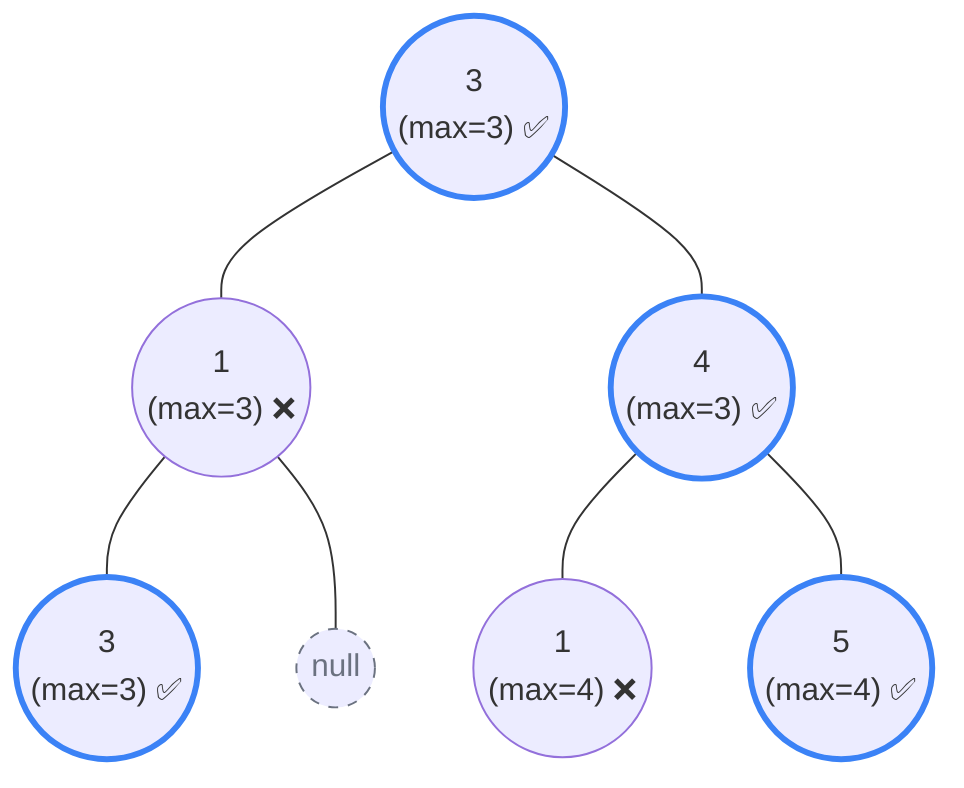

## Problem Statement

Given a binary tree `root`, a node `X` in the tree is named **good** if in the path from root to `X` there are no nodes with a value *greater than* `X`.

Return the number of **good** nodes in the binary tree. *(Note: The root is always considered a good node).*

**Example:**
```text
Input: root = [3,1,4,3,null,1,5]
Output: 4
Explanation:
- Root (3) is always good.
- Node (4) is good because max path so far is 3 (4 >= 3).
- Node (5) is good because max path so far is 4 (5 >= 4).
- Node (3) is good because max path so far is 3 (3 >= 3).
```

## Approach: Depth-First Search (Passing State Down)

Many tree problems (like Maximum Depth) require us to process the children first and bubble data *up* (Post-order traversal). 

However, to know if a node is "good", we need to know the maximum value encountered on the path *above* it. This means we must use a **Pre-order DFS traversal** where we pass state **down** the tree from parent to child!

**The Algorithm:**
1. Create a `dfs(node, maxVal)` function. The `maxVal` represents the absolute highest value we've seen on the path from the root down to this specific node.
2. If `node` is `null`, return `0`.
3. Check if the current node is "good": is `node.val >= maxVal`? If so, count it as `1`. Otherwise, it's `0`.
4. Calculate the *new* `maxVal` to pass to the children: `Math.max(maxVal, node.val)`.
5. Recurse down the left and right subtrees passing the new `maxVal`.
6. Add up the counts (current node + left subtree + right subtree) and return it.

## Mental Model

Let's trace the example `[3,1,4,3,null,1,5]`. Notice how the `maxVal` strictly increases or stays the same as it gets passed down the branches.



*When traversing `3 -> 4 -> 1`, the `max` passed down to the `1` node is `4`. Since `1` is not `>= 4`, it fails the check.*

## Solution

```javascript
/**
 * Definition for a binary tree node.
 * function TreeNode(val, left, right) {
 *     this.val = (val===undefined ? 0 : val)
 *     this.left = (left===undefined ? null : left)
 *     this.right = (right===undefined ? null : right)
 * }
 */
function goodNodes(root) {
    function dfs(node, maxVal) {
        if (node === null) return 0;
        
        // 1. Determine if current node is "good"
        let res = node.val >= maxVal ? 1 : 0;
        
        // 2. Update the max value for the children
        const newMax = Math.max(maxVal, node.val);
        
        // 3. Recurse down and add the counts from both subtrees
        res += dfs(node.left, newMax);
        res += dfs(node.right, newMax);
        
        return res;
    }
    
    // The root starts with its own value as the max
    return dfs(root, root.val);
}
```

## Complexity Analysis

- **Time Complexity:** $O(N)$ where $N$ is the number of nodes in the tree. We visit every single node exactly once during our DFS traversal.
- **Space Complexity:** $O(H)$ where $H$ is the height of the tree. This is the memory used by the recursion call stack. In the worst case (a completely skewed tree), this takes $O(N)$ space. In a perfectly balanced tree, it takes $O(\log N)$ space.
