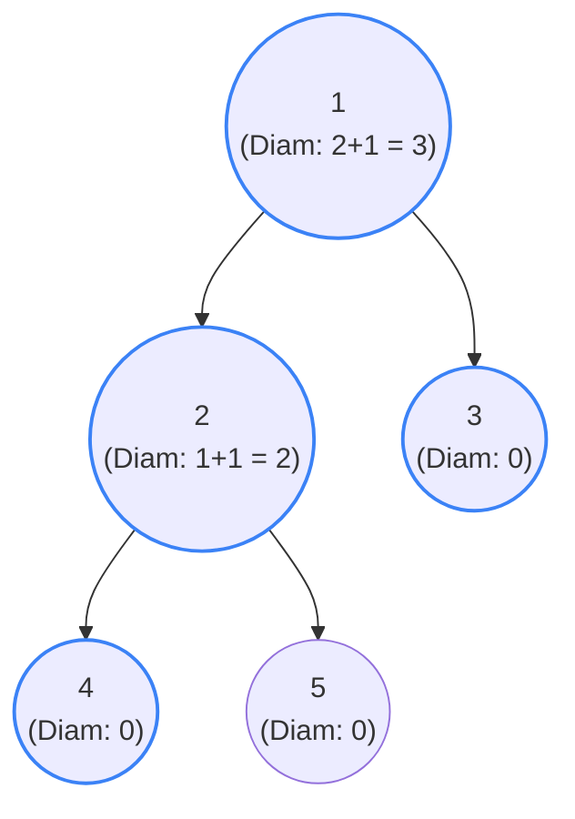

## Problem Statement

Given the `root` of a binary tree, return the length of the **diameter** of the tree.

The diameter of a binary tree is the length of the **longest path between any two nodes** in a tree. This path may or may not pass through the root.

The length of a path between two nodes is represented by the **number of edges** between them.

**Example:**
```text
Input: root = [1,2,3,4,5]
Output: 3
Explanation: 3 is the length of the path [4,2,1,3] or [5,2,1,3].
```

## Approach: Depth-First Search (Bottom-Up)

This problem builds directly upon finding the **Maximum Depth** of a binary tree. 

If you look at any node in the tree, the longest path that passes *through* that specific node is simply the **maximum depth of its left subtree + the maximum depth of its right subtree**. 

However, the tricky part is that the absolute longest path in the entire tree might *not* pass through the main `root` node! It could be entirely contained deep within a massive left subtree.

**The Strategy:**
1. Keep a running tally of the `maxDiameter` we've seen so far (initialized to `0`).
2. Write a recursive `dfs()` function that returns the height (maximum depth) of the current node.
3. *Before* returning the height to the parent, internally calculate the diameter passing through the current node (`leftHeight + rightHeight`) and update `maxDiameter` if it's the largest we've seen.

## Mental Model

Let's trace `root = [1,2,3,4,5]`. Notice how we bubble the heights back up to the parents, but sneakily calculate the diameter at every single stop!



*The longest path is highlighted in blue: `4 -> 2 -> 1 -> 3`. It contains 4 nodes, which means it has `4 - 1 = 3` edges!*

## Solution

```javascript
/**
 * Definition for a binary tree node.
 * function TreeNode(val, left, right) {
 *     this.val = (val===undefined ? 0 : val)
 *     this.left = (left===undefined ? null : left)
 *     this.right = (right===undefined ? null : right)
 * }
 */

function diameterOfBinaryTree(root) {
    let maxDiameter = 0;
    
    // Helper function returns the height (max depth) of the node
    function dfs(node) {
        if (node === null) {
            return 0;
        }
        
        // Post-order traversal: calculate children first
        const leftHeight = dfs(node.left);
        const rightHeight = dfs(node.right);
        
        // Calculate the diameter passing through THIS node
        // (number of edges in left path + number of edges in right path)
        maxDiameter = Math.max(maxDiameter, leftHeight + rightHeight);
        
        // Return the height of this node up to its parent
        return 1 + Math.max(leftHeight, rightHeight);
    }
    
    dfs(root);
    return maxDiameter;
}
```

## Complexity Analysis

- **Time Complexity:** $O(N)$ where $N$ is the number of nodes. We visit every single node in the tree exactly once during our DFS traversal.
- **Space Complexity:** $O(H)$ where $H$ is the height of the tree. This is the memory used by the recursion call stack. In the worst case (a skewed tree), this is $O(N)$. In the best case (a perfectly balanced tree), it is $O(\log N)$.
