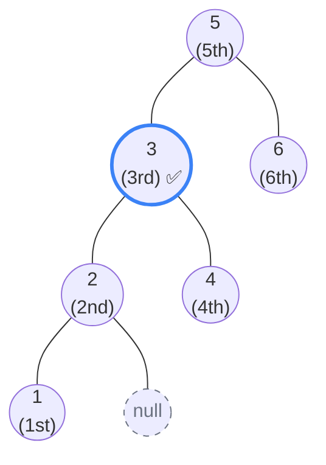

## Problem Statement

Given the `root` of a binary search tree, and an integer `k`, return the `k`th smallest value (**1-indexed**) of all the values of the nodes in the tree.

**Example:**
```text
Input: root = [5,3,6,2,4,null,null,1], k = 3
Output: 3
```

## Approach: Depth-First Search (In-Order Traversal)

This problem is a direct test of the most important property of Binary Search Trees: **An In-Order Traversal (`Left -> Node -> Right`) visits every single node in perfectly sorted, ascending order!**

Instead of collecting all the nodes into an array and pulling the `k`th element (which requires $O(N)$ space), we can simply keep a running counter. 

**The Algorithm:**
1. We write a standard recursive `inOrder(node)` traversal function.
2. We keep a tracking variable `count` initialized to `0`.
3. Inside the traversal, after returning from the `left` child, we process the current node by incrementing our `count`.
4. If `count === k`, we have found our target! We save it to a `result` variable.
5. We also add a short-circuit check (`if (result !== null) return;`) at the top of our function so we don't waste time traversing the rest of the right side of the tree once we've already found our answer.

## Mental Model

Let's trace the example `k = 3`. Notice how the `In-Order Traversal` hits the nodes starting from the absolute bottom-left, incrementing the counter perfectly in ascending order. 



*The traversal visits `1`, then `2`, and finally hits `3`. The counter reaches `3`, matching our `k`, so we save `3` as the result and instantly stop exploring the right side!*

## Solution

```javascript
/**
 * Definition for a binary tree node.
 * function TreeNode(val, left, right) {
 *     this.val = (val===undefined ? 0 : val)
 *     this.left = (left===undefined ? null : left)
 *     this.right = (right===undefined ? null : right)
 * }
 */

function kthSmallest(root, k) {
    let count = 0;
    let result = null;
    
    function inOrder(node) {
        // Base case: if node is null OR we already found the answer, stop!
        if (node === null || result !== null) {
            return;
        }
        
        // 1. Go Left
        inOrder(node.left);
        
        // 2. Process Node
        count++;
        if (count === k) {
            result = node.val;
            return;
        }
        
        // 3. Go Right
        inOrder(node.right);
    }
    
    inOrder(root);
    return result;
}
```

*Note: You can also solve this iteratively using an explicit `Stack`. An iterative approach allows you to literally `return` the value the exact moment `count === k`, meaning you don't even have to unwind the recursion call stack.*

## Complexity Analysis

- **Time Complexity:** $O(H + k)$ where $H$ is the height of the tree. To reach the 1st smallest element, we must traverse all the way down the left side ($O(H)$). Then we process exactly $k$ nodes. In the worst case (e.g., $k=N$), this is bounded by $O(N)$.
- **Space Complexity:** $O(H)$ where $H$ is the height of the tree. This is the memory used by the recursion call stack to traverse down to the left-most leaf. In the worst case, this is $O(N)$.
