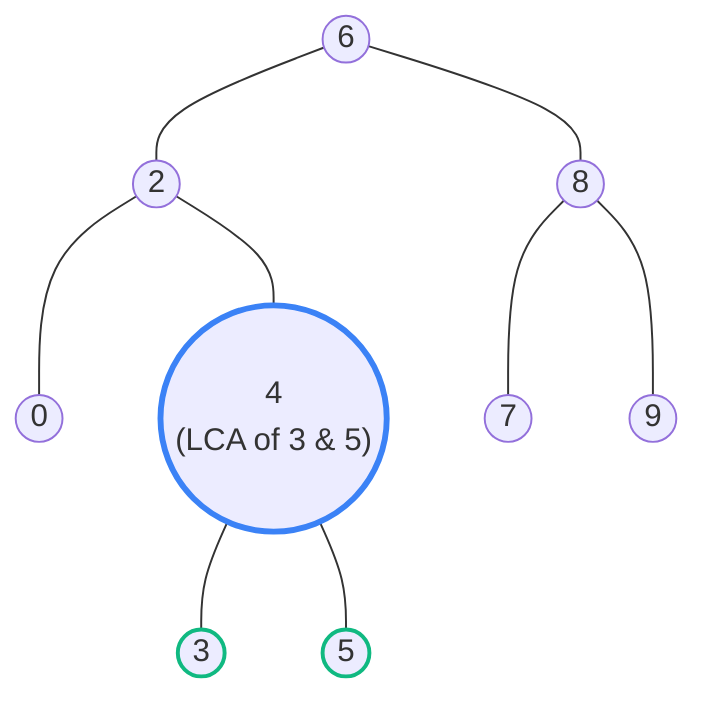

## Problem Statement

Given a **Binary Search Tree (BST)**, find the lowest common ancestor (LCA) node of two given nodes `p` and `q` in the BST.

According to the definition of LCA on Wikipedia: "The lowest common ancestor is defined between two nodes `p` and `q` as the lowest node in `T` that has both `p` and `q` as descendants (where we allow a node to be a descendant of itself)."

**Example:**
```text
Input: root = [6,2,8,0,4,7,9,null,null,3,5], p = 2, q = 8
Output: 6
Explanation: The LCA of nodes 2 and 8 is 6.
```

## Approach: BST Properties (Iterative Traversal)

The fact that this is a **Binary Search Tree** (and not just a regular Binary Tree) gives us a massive advantage. In a BST, all nodes to the left of a parent are smaller, and all nodes to the right are larger.

Because of this property, finding the LCA is simply a matter of finding **the split point**:
- If both `p` and `q` are strictly **less** than the current node, they must both be deep in the left subtree. Move left.
- If both `p` and `q` are strictly **greater** than the current node, they must both be deep in the right subtree. Move right.
- If one is less and one is greater (or one is exactly equal to the current node), a split has occurred! This means the current node is the lowest common ancestor.

Since we only ever go down a single path (left or right), we don't even need recursion! We can just use a `while` loop to achieve $O(1)$ space complexity.

## Mental Model

Let's trace two different examples on the same tree.

**Example 1 (`p=2`, `q=8`):**
- Start at `6`. `2 < 6` and `8 > 6`.
- A split occurs immediately! `6` is the LCA.

**Example 2 (`p=3`, `q=5`):**
- Start at `6`. Both are `< 6`. Move left to `2`.
- At `2`. Both are `> 2`. Move right to `4`.
- At `4`. `3 < 4` and `5 > 4`.
- A split occurs! `4` is the LCA.



## Solution

```javascript
/**
 * Definition for a binary tree node.
 * function TreeNode(val) {
 *     this.val = val;
 *     this.left = this.right = null;
 * }
 */

function lowestCommonAncestor(root, p, q) {
    let curr = root;
    
    while (curr !== null) {
        // Both p and q are greater than curr, so the LCA must be to the right
        if (p.val > curr.val && q.val > curr.val) {
            curr = curr.right;
        } 
        // Both p and q are less than curr, so the LCA must be to the left
        else if (p.val < curr.val && q.val < curr.val) {
            curr = curr.left;
        } 
        // A split occurred, OR one of the nodes is equal to curr
        // We have found the LCA!
        else {
            return curr;
        }
    }
    
    return null;
}
```

## Complexity Analysis

- **Time Complexity:** $O(H)$ where $H$ is the height of the BST. We are simply traversing a single path down the tree until we find the split point. In the worst case (a skewed tree), this takes $O(N)$ time. In the best case (a balanced BST), it takes $O(\log N)$ time.
- **Space Complexity:** $O(1)$. By using an iterative `while` loop instead of recursion, we don't use any extra memory on the call stack!
