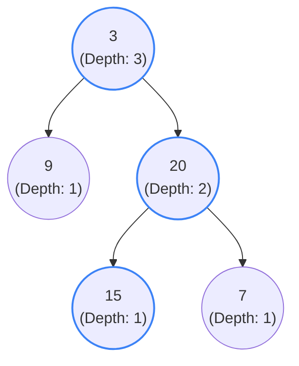

## Problem Statement

Given the `root` of a binary tree, return its maximum depth.

A binary tree's **maximum depth** is the number of nodes along the longest path from the root node down to the farthest leaf node.

**Example:**
```text
Input: root = [3,9,20,null,null,15,7]
Output: 3
```

## Approach: Depth-First Search (Recursive)

The easiest way to find the maximum depth of a tree is to ask its left and right subtrees how deep they are, and then add `1` for the current node. This translates perfectly to a recursive Depth-First Search (DFS).

1. **Base Case:** If the current node is `null`, its depth is `0`.
2. **Recursive Step:** Find the maximum depth of the left subtree and the right subtree.
3. **Return:** Take the maximum of those two values, add `1` (to account for the current node itself), and return it to the parent.

## Mental Model

Let's trace the DFS logic from the bottom up on this tree. The leaf nodes return `1` to their parents, the parents compare the left/right depths, add `1`, and pass it up.



*The longest path is highlighted in blue: `3 -> 20 -> 15` (or `3 -> 20 -> 7`). Both paths have 3 nodes, so the maximum depth is 3.*

## Solution

```javascript
/**
 * Definition for a binary tree node.
 * function TreeNode(val, left, right) {
 *     this.val = (val===undefined ? 0 : val)
 *     this.left = (left===undefined ? null : left)
 *     this.right = (right===undefined ? null : right)
 * }
 */

function maxDepth(root) {
    // Base Case: An empty tree has a depth of 0
    if (root === null) {
        return 0;
    }
    
    // Get the maximum depth of the left and right subtrees
    const leftDepth = maxDepth(root.left);
    const rightDepth = maxDepth(root.right);
    
    // The depth of the current node is 1 + the deepest of its children
    return 1 + Math.max(leftDepth, rightDepth);
}
```

*Note: You can condense the entire function body into a single elegant line: `return root === null ? 0 : 1 + Math.max(maxDepth(root.left), maxDepth(root.right));`*

## Complexity Analysis

- **Time Complexity:** $O(N)$ where $N$ is the number of nodes in the tree. We must visit every single node exactly once to calculate its depth.
- **Space Complexity:** $O(H)$ where $H$ is the height of the tree. This is the memory used by the recursion call stack. In the worst case (a completely unbalanced tree resembling a linked list), this is $O(N)$. In the best case (a perfectly balanced tree), it is $O(\log N)$.
