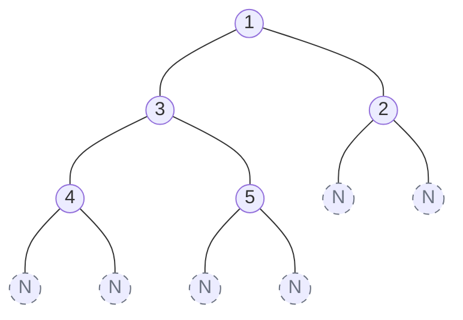

## Problem Statement

Serialization is the process of converting a data structure into a sequence of bits (or a string) so that it can be stored in a file or memory buffer. 

Design an algorithm to **serialize** and **deserialize** a binary tree. There is no restriction on how your algorithm should work. You just need to ensure that a binary tree can be serialized to a string, and this string can be deserialized back into the exact original tree structure.

**Example:**
```text
Input: root = [1,2,3,null,null,4,5]
Output: [1,2,3,null,null,4,5]
```

## Approach: Pre-order DFS with Null Markers

If you just write down the values of a tree in a list, you lose the structural information. To perfectly preserve the exact shape of a binary tree, we must **explicitly record the `null` leaf nodes**.

A **Pre-order DFS (`Root -> Left -> Right`)** is the absolute best traversal for this problem. Why? Because when we are deserializing the string later, the very first value we read is guaranteed to be the Root, allowing us to build the tree efficiently top-down!

**The Algorithm:**

1. **Serialization:**
   - Run a Pre-order DFS. 
   - If the node is `null`, append a special marker like `"N"` to our string.
   - If the node has a value, append the value (e.g., `"1"`).
   - Join everything with a delimiter like a comma `","`.
2. **Deserialization:**
   - Split the string by commas into an array.
   - Run a matching Pre-order DFS to rebuild the tree.
   - Pop the first element off the array. 
   - If it's `"N"`, return `null`.
   - Otherwise, create a `new TreeNode(val)`. 
   - Recursively assign its `left` child, then its `right` child.

## Mental Model

Notice how the `null` pointers (represented as `N`) act as "stop signs" during the deserialization process. When the recursive builder hits two `N`s in a row, it knows that specific branch is finished and it can step back up to the parent!



**Serialized String Output:**
`"1,2,N,N,3,4,N,N,5,N,N"`

## Solution

```javascript
/**
 * Definition for a binary tree node.
 * function TreeNode(val) {
 *     this.val = val;
 *     this.left = this.right = null;
 * }
 */

/**
 * Encodes a tree to a single string.
 */
function serialize(root) {
    const res = [];
    
    function dfs(node) {
        if (node === null) {
            res.push("N");
            return;
        }
        res.push(node.val.toString());
        dfs(node.left);
        dfs(node.right);
    }
    
    dfs(root);
    return res.join(",");
}

/**
 * Decodes your encoded data to tree.
 */
function deserialize(data) {
    const values = data.split(",");
    let i = 0; // Pointer to track our position in the array
    
    function dfs() {
        if (values[i] === "N") {
            i++;
            return null;
        }
        
        // Read the value and advance the pointer
        const node = new TreeNode(Number(values[i]));
        i++;
        
        // Build the left subtree, then the right subtree
        node.left = dfs();
        node.right = dfs();
        
        return node;
    }
    
    return dfs();
}
```

*Note: In the deserialization function, using an index pointer `i` is highly optimized because advancing a pointer takes $O(1)$ time. If we had used `values.shift()`, it would technically cost $O(N)$ for every single node in JavaScript because `shift()` triggers a full array re-index!*

## Complexity Analysis

- **Time Complexity:** $O(N)$ for both Serialization and Deserialization. We visit every single node exactly once. String joining and splitting also take linear time relative to the number of nodes.
- **Space Complexity:** $O(N)$ for both algorithms. 
  - In Serialization, we store $O(N)$ elements in the array/string. 
  - In Deserialization, we store $O(N)$ elements in the split array. 
  - The recursion call stack also takes $O(H)$ space, which is bounded by $O(N)$.
