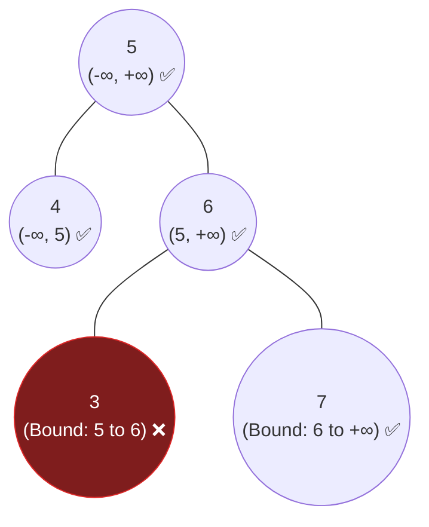

## Problem Statement

Given the `root` of a binary tree, determine if it is a **valid binary search tree (BST)**.

A valid BST is defined as follows:
- The left subtree of a node contains only nodes with keys **strictly less** than the node's key.
- The right subtree of a node contains only nodes with keys **strictly greater** than the node's key.
- Both the left and right subtrees must also be binary search trees.

**Example:**
```text
Input: root = [5,1,4,null,null,3,6]
Output: false
Explanation: The root node's value is 5 but its right child's value is 4.
```

## Approach: Depth-First Search (Passing Boundaries)

A very common beginner trap is to write a recursive function that only checks if `node.left.val < node.val` and `node.right.val > node.val`. 

**Why does that fail?** Because a node deep down in the right subtree might technically be greater than its immediate parent, but accidentally be *smaller* than the very top root node! In a BST, *all* descendants on the right side must be strictly greater than the root.

To solve this, we use a **Pre-order DFS** to pass a strictly valid `(min, max)` boundary down the tree:
1. Initialize the boundaries for the root as `(-Infinity, Infinity)`.
2. As you move **left**, the current node's value becomes the new **maximum ceiling**. (Everything to the left must be smaller).
3. As you move **right**, the current node's value becomes the new **minimum floor**. (Everything to the right must be larger).
4. If any node's value steps outside of its allowed `(min, max)` boundary, the tree is instantly invalid!

## Mental Model

Look at node `3` below. It passes the naive local check because `3 < 6`. However, because it is nested in the right subtree of the main root `5`, its absolute lower bound is `5`. Since `3` is not strictly between `(5, 6)`, it triggers a boundary failure!



## Solution

```javascript
/**
 * Definition for a binary tree node.
 * function TreeNode(val, left, right) {
 *     this.val = (val===undefined ? 0 : val)
 *     this.left = (left===undefined ? null : left)
 *     this.right = (right===undefined ? null : right)
 * }
 */

function isValidBST(root) {
    function dfs(node, minBound, maxBound) {
        // Base case: reaching a leaf's child means we never violated a boundary
        if (node === null) {
            return true;
        }
        
        // If the current node violates the boundary, it's not a valid BST!
        if (node.val <= minBound || node.val >= maxBound) {
            return false;
        }
        
        // Recurse left: update the MAX boundary
        const leftIsValid = dfs(node.left, minBound, node.val);
        
        // Recurse right: update the MIN boundary
        const rightIsValid = dfs(node.right, node.val, maxBound);
        
        // Both sides must be valid
        return leftIsValid && rightIsValid;
    }
    
    // Start the root with infinite boundaries
    return dfs(root, -Infinity, Infinity);
}
```

## Complexity Analysis

- **Time Complexity:** $O(N)$ where $N$ is the number of nodes. We visit each node exactly once, and because of short-circuit boolean evaluation, the algorithm stops early if it finds a violation.
- **Space Complexity:** $O(H)$ where $H$ is the height of the tree, representing the memory used by the recursion call stack. This is $O(\log N)$ in the best case (a perfectly balanced BST) and $O(N)$ in the worst case (a completely skewed tree).
