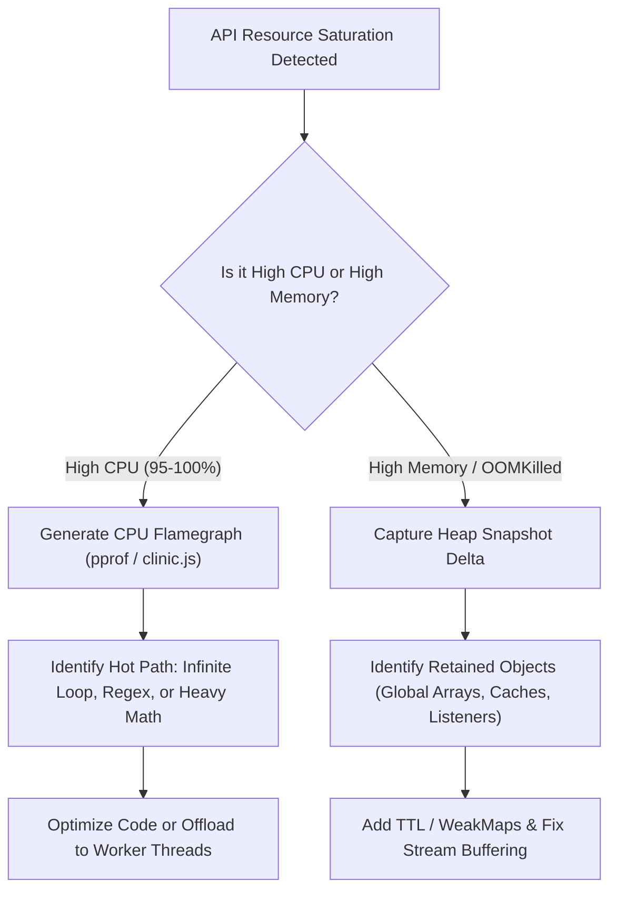

## Scenario

> **What would you do if an API consumes too much CPU or memory?**

High CPU or memory consumption will cause pod evictions, process crashes (`OOMKilled`), and unresponsive services. Interviewers ask this to test your **runtime profiling, memory heap analysis, and concurrency knowledge**.


## Fast Revision (10-Second Recall)

- **Differentiating CPU vs. Memory:**
  - **High CPU:** Infinite loops, catastrophic regex backtracking (ReDoS), unindexed in-memory data processing, or heavy synchronous hashing (bcrypt).
  - **High Memory:** Memory leaks (unbounded arrays/caches, uncleaned event listeners, closures), buffering huge files in RAM, or memory fragmentation.
- **Top 4 Investigative Steps:**
  1. Generate a **CPU Flamegraph** to identify the exact functions consuming CPU cycles.
  2. Take **Heap Snapshots** at 10-minute intervals and compare them to find retaining object paths (memory leaks).
  3. Move CPU-bound work (cryptography, image resizing, heavy JSON) to **Worker Threads** or dedicated microservices.
  4. Stream large I/O payloads directly rather than reading entire files into RAM.
- **Key Tools:** Chrome DevTools / `clinic.js` (Node.js), `pprof` (Go), `jcmd` / VisualVM (Java), `top` / `htop`.


## The 30-Second Spoken Script

If asked this in an interview, deliver this structured response:

> *First, I bifurcate the problem: is it CPU-bound or Memory-bound?*
>
> *If CPU is at 100%, I capture a CPU Flamegraph using tools like `pprof` in Go or Chrome DevTools in Node.js. This reveals the exact hot function paths. High CPU is usually caused by unoptimized loops, catastrophic regex backtracking, or synchronous cryptography like bcrypt. I optimize the algorithm or offload the compute to Worker Threads so the main event loop remains free.*
>
> *If Memory is steadily growing until the container crashes with `OOMKilled`, it's a memory leak. I take two heap snapshots 15 minutes apart and compare their deltas. I look for retaining trees—such as global cache dictionaries with no eviction policy, unremoved event listeners, or unclosed database cursors.*
>
> *For immediate production stability, I increase container memory limits and configure automated pod restarts while deploying the targeted fix.*


## Diagnostic Lifecycle



### 1. High CPU Diagnosis (The Hot Path)
Run profiling tools to generate a Flamegraph. Wider bars indicate functions spending more on-CPU time:
- **Catastrophic Regex (ReDoS):** A regex like `/(a+)+b/` tested against `aaaa...` consumes exponential CPU.
- **Synchronous Cryptography:** Running `bcrypt.hashSync()` on the main event loop freezes the thread for hundreds of milliseconds per request.

### 2. High Memory Diagnosis (The Retaining Path)
- **The Sawtooth Profile:** Memory rises, Garbage Collection drops it back down $\rightarrow$ **Healthy normal operation**.
- **The Ramp Profile:** Memory rises steadily and GC cannot reclaim it $\rightarrow$ **True Memory Leak**.
- Common culprits: Global objects used as ad-hoc caches without max size limits, closures holding large parent scopes, unremoved WebSocket event listeners.


## Root Causes & Solutions Matrix

| Resource Symptom | Root Cause | Immediate Remediation |
| :--- | :--- | :--- |
| **CPU: 100% on Single Core** | Catastrophic Regex Backtracking (ReDoS). | Replace regex with string parser or safe non-backtracking engine (`re2`). |
| **CPU: Blocked Event Loop** | Synchronous CPU-intensive operations (image processing, hashing). | Offload to Worker Threads (`worker_threads` / Go routines) or background workers. |
| **Memory: Steady Linear Rise** | Global in-memory cache without TTL or maximum key limit. | Replace with bounded LRU cache (e.g., `lru-cache`) or Redis. |
| **Memory: Sudden OOM Spike** | Buffering a 200MB file upload into memory as a `Buffer`. | Stream uploads directly to disk or S3 using chunked streams (`busboy`). |
| **Memory: Unremoved Listeners** | Event emitters registered on every request without `.removeListener()`. | Ensure cleanup in `req.on('close')` or use single-use listeners (`.once()`). |


## Practical Debugging Commands & Code

### 1. Profiling CPU on a Running Node.js Process
```bash
# Start Node.js with the V8 inspector enabled
node --inspect=0.0.0.0:9229 server.js

# Or generate a CPU profile automatically under load
node --prof server.js
# Process the isolate log into readable text
node --prof-process isolate-*.log > cpu-profile.txt
```

### 2. Preventing Memory Leaks with Bounded LRU Cache
Never use a naked JavaScript object `{}` as a cache:
```typescript
import { LRUCache } from 'lru-cache';

// GOOD: Bounded in-memory cache with eviction policy
const userCache = new LRUCache<string, any>({
  max: 5000,                  // Maximum 5,000 items in RAM
  ttl: 1000 * 60 * 10,        // Max age: 10 minutes
  allowStale: false,
});

export function getCachedUser(id: string) {
  return userCache.get(id);
}
```

### 3. Offloading CPU-Bound Work to Worker Threads
```typescript
import { Worker } from 'worker_threads';

export function runCpuHeavyTask(data: any): Promise<any> {
  return new Promise((resolve, reject) => {
    // Executes on a separate OS thread without blocking the main event loop
    const worker = new Worker('./workers/heavy-computation.js', {
      workerData: data,
    });

    worker.on('message', resolve);
    worker.on('error', reject);
    worker.on('exit', (code) => {
      if (code !== 0) reject(new Error(`Worker stopped with exit code ${code}`));
    });
  });
}
```


## Prevention & Senior Best Practices

1. **Set Kubernetes Resource Requests & Limits:** Always define both `requests` (for scheduling) and `limits` (to prevent a single rogue pod from destabilizing the entire node).
2. **Automate OOM Heap Snapshots:** Configure the Node.js flag `--heapsnapshot-near-heap-limit=3` or JVM `-XX:+HeapDumpOnOutOfMemoryError` to automatically write heap dumps right before an OOM crash.
3. **Load Test with Profiling Active:** Regularly subject microservices to sustained load tests while monitoring memory retention curves.

