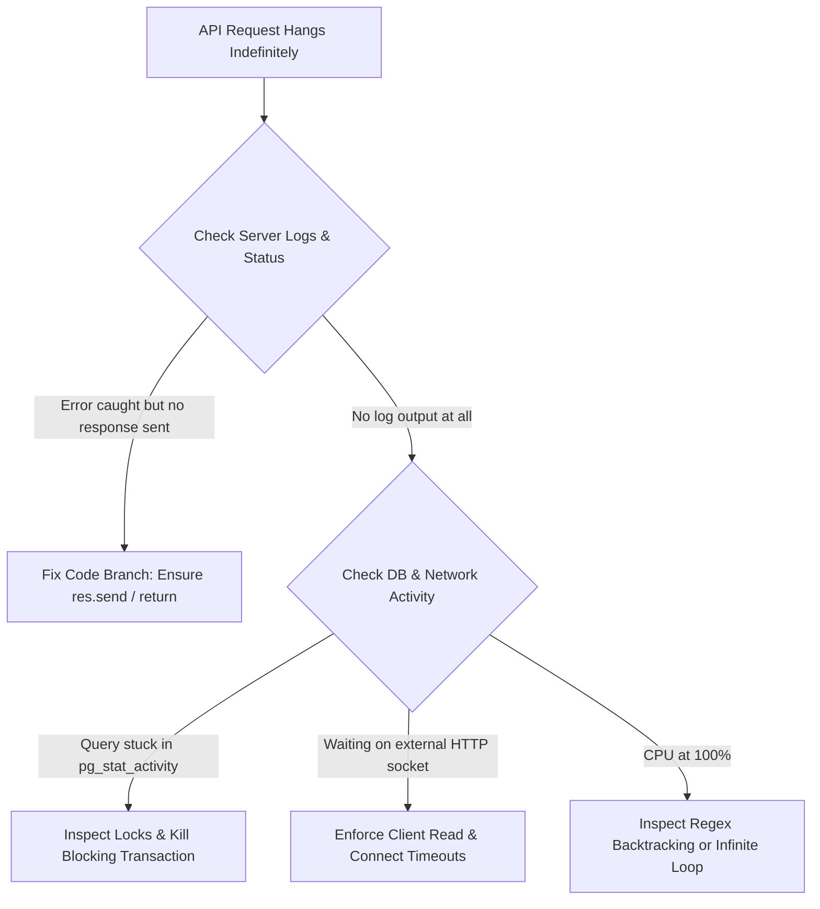

## Scenario

> **What would you do if an API request gets stuck and never returns a response?**

A hanging request is worse than a 500 error. An error fails fast, while a hanging connection ties up client threads, exhausts server sockets, and leaves the user staring at an infinite loading spinner until the reverse proxy eventually gives up with a `504 Gateway Timeout`.


## Fast Revision (10-Second Recall)

- **First Move:** Check if the reverse proxy returns a `504 Gateway Timeout` after 60 seconds (proves server accepted the connection but never completed it).
- **Top 5 Reasons an API Never Returns:**
  1. **Missing Callback / Return Statement:** Forgetting `res.send()` / `next(err)` in an async middleware or error handler.
  2. **Unbounded Third-Party Socket:** External HTTP or database call with no connection/read timeout hanging on an unresponsive remote host.
  3. **Database Deadlock / Exclusive Lock:** Query blocked indefinitely waiting on another transaction holding an uncommitted lock.
  4. **Thread Pool / Connection Starvation:** Request waiting in queue to acquire a database connection that never becomes free.
  5. **Infinite Loop / Event Loop Freeze:** CPU pegged at 100% processing an infinite loop or catastrophic regex backtracking.
- **Key Tools:** Thread dump (`jstack` for Java), `gcore` / Node.js inspector, `pg_stat_activity` for active locks, NGINX `proxy_read_timeout`.


## The 30-Second Spoken Script

If asked this in an interview, deliver this structured response:

> *When an API hangs indefinitely, it means the server opened a socket connection but never wrote a response or terminated the stream.*
>
> *I immediately check two things: server process state and database locks.*
>
> *In the application layer, the most common bug in asynchronous runtimes like Node.js or Go is a code branch where an error is caught, but `res.send()` or `return` was omitted, leaving the client connection dangling.*
>
> *The second common cause is an unbounded external I/O call without a read timeout. If an upstream service or payment gateway hangs, the backend thread waits forever.*
>
> *At the database layer, I query `pg_stat_activity` to check if the query is stuck in an exclusive lock or waiting for an available connection from a saturated pool.*
>
> *To fix and prevent this, every outbound call and database query must have a strict timeout, and the reverse proxy must enforce a maximum execution ceiling like `proxy_read_timeout 30s`.*


## Diagnostic Lifecycle



### 1. Check for Missing Response in Error Handler
The classic async bug:
```typescript
// DANGEROUS BUG: Request hangs forever on error!
app.get('/user', async (req, res, next) => {
  try {
    const user = await fetchUser();
    res.json(user);
  } catch (err) {
    logger.error(err);
    // BUG: Forgot `res.status(500).json(...)` or `next(err)`!
    // The HTTP connection stays open until gateway times out!
  }
});
```

### 2. Inspect Active Database Connections
Check if the request is waiting on a lock:
```sql
SELECT pid, now() - query_start AS duration, state, wait_event_type, wait_event, query
FROM pg_stat_activity
WHERE state != 'idle' AND (now() - query_start) > interval '10 seconds';
```


## Root Causes & Solutions Matrix

| Root Cause | Evidence | Resolution |
| :--- | :--- | :--- |
| **Missing Terminal Response** | Route completes async logic but forgets `res.send()`. | Audit error handlers; use linting rules (`consistent-return`). |
| **Unbounded HTTP Client Call** | Thread blocked in socket read; third party silent. | Enforce socket connect and read timeouts (e.g., 5,000ms max). |
| **Database Lock Wait** | `wait_event_type = 'Lock'` in `pg_stat_activity`. | Set `lock_timeout = '3s'` in database; commit or abort blocking transactions. |
| **Exhausted Connection Pool** | Request hangs before entering controller handler. | Increase pool size; audit connection leaks (`connection.release()`). |
| **Catastrophic Regex (ReDoS)** | 100% CPU on single core; event loop unresponsive. | Safe regex validation; avoid nested quantifiers like `(a+)+$`. |


## Practical Debugging Commands & Code

### 1. Enforce Gateway-Level Timeout Guardrails (NGINX)
Ensure the proxy cuts off unresponsive backend servers:
```nginx
location /api/ {
    proxy_pass http://backend_upstream;
    proxy_connect_timeout 5s;
    proxy_send_timeout 15s;
    proxy_read_timeout 15s; # Terminate with 504 if backend doesn't reply in 15s
}
```

### 2. Global Request Timeout Middleware (Express / Node.js)
```typescript
import connectTimeout from 'connect-timeout';

// Abort request and return 503 if handler takes longer than 10s
app.use(connectTimeout('10s'));

app.use((req, res, next) => {
  if (!req.timedout) next();
});
```

### 3. Kill a Hanging Blocking PostgreSQL Process
```sql
-- Gracefully cancel the query
SELECT pg_cancel_backend(pid);

-- If unresponsive, forcefully terminate the backend connection
SELECT pg_terminate_backend(pid);
```


## Prevention & Senior Best Practices

1. **Global Request Timeouts:** Configure strict timeout middleware in your application framework and reverse proxy.
2. **Database Lock Timeouts:** Set database connection parameters: `SET statement_timeout = '10s';` and `SET lock_timeout = '3s';`.
3. **Mandatory Linter Rules:** Enforce static analysis rules that detect missing returns or forgotten `next(err)` calls inside async catch blocks.

