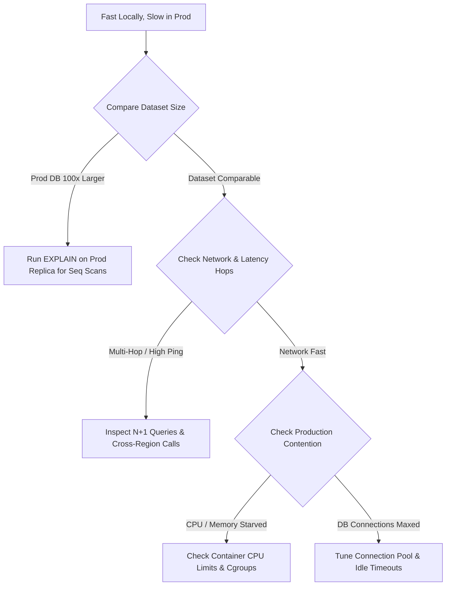

## Scenario

> **An API works perfectly in local development but is very slow in production. What would you check?**

This question tests your understanding of **environmental disparities**—why code that benchmarks at 5ms on a developer laptop degrades to 3,000ms under real-world production conditions.


## Fast Revision (10-Second Recall)

- **First Move:** Check **Data Volume differences** between local SQLite/Docker (100 rows) and production database (10,000,000 rows).
- **Core Disparity Vectors:**
  1. **Data Scale & Missing Indexes:** Full table scan takes 2ms on 50 local records, but 4,000ms on 2M production rows.
  2. **Network Topology & Hops:** Localhost network round-trip is 0.05ms; production cross-AZ/cross-region round-trip is 2–15ms per hop (amplified heavily by N+1 loops).
  3. **Concurrency & Resource Contention:** Local runs with 1 user; production handles thousands of concurrent threads competing for CPU and connection pools.
  4. **Configuration & Throttling:** Debug mode, missing production cache, cloud egress limits, or CPU quota throttling (e.g., Kubernetes cgroups CPU limits).
- **Key Tools:** `EXPLAIN ANALYZE` on staging/prod read replica, Network latency ping (`mtr` / `traceroute`), Kubernetes CPU throttling metrics.


## The 30-Second Spoken Script

If asked this in an interview, deliver this structured response:

> *When an API is fast locally but crawls in production, the disparity almost always boils down to data volume, network topology, or resource contention.*
>
> *First, I compare data scale. On local laptops, developers usually test with a few hundred records where unindexed queries and N+1 ORM calls execute in milliseconds. In production with millions of rows, that same missing index forces a massive sequential disk scan.*
>
> *Second, I check network round-trips. Localhost latency is virtually zero, but in production, if an endpoint makes 50 serial database or microservice calls across cloud availability zones, the 3ms network hop per query adds up to seconds.*
>
> *Third, I check resource constraints like container CPU throttling, database connection pool exhaustion under concurrent load, and differences in configuration such as missing Redis caching or stricter logging levels.*


## Diagnostic Lifecycle



### 1. Data Scale & Execution Plan Analysis
A query like `SELECT * FROM orders WHERE status = 'PENDING'` will execute in 1ms on a local machine with 50 rows even with no index. In production with 5,000,000 rows, it triggers a multi-gigabyte disk read.

### 2. Network Latency Multiplier (The N+1 Trap)
- Localhost network latency: $\approx 0.05\text{ms}$.
  - $100 \text{ queries} \times 0.05\text{ms} = 5\text{ms}$ (Imperceptible).
- Production cloud cross-AZ latency: $\approx 2.0\text{ms}$.
  - $100 \text{ queries} \times 2.0\text{ms} = 200\text{ms}$ network overhead alone, excluding query processing.

### 3. Container Resource Limits & CPU Throttling
In production, your pod might have strict Kubernetes CPU limits (`limits.cpu: 500m`). Under load, the Linux CFS (Completely Fair Scheduler) throttles the container, causing severe latency spikes even when total node CPU seems fine.


## Root Causes & Solutions Matrix

| Difference Vector | Local Development | Production Environment | Immediate Resolution |
| :--- | :--- | :--- | :--- |
| **Data Volume** | 200 seed records in SQLite/Docker. | 5,000,000 records on RDS/Cloud SQL. | Run `EXPLAIN` against production replica; add missing composite indexes. |
| **Network Round Trips** | Loopback interface (`127.0.0.1`, 0.05ms). | Cross-AZ / VPC Peering (2–10ms per query). | Batch queries using `JOIN`, GraphQL DataLoader, or ORM eager loading (`include`). |
| **CPU Throttling** | Uncapped laptop CPU (8–16 cores). | Container CPU quota (`cpu: 500m`). | Check `container_cpu_cfs_throttled_periods_total`; raise CPU limits or remove limits. |
| **Caching Layer** | Mocked in-memory or bypassed. | Distributed Redis cluster across network. | Ensure caching is enabled and warm; fix cache key mismatches. |
| **Connection Pooling** | 1 user using 1 local connection. | 500 concurrent users fighting for 20 pooled connections. | Increase DB connection pool size and configure a pooler like PgBouncer. |
| **Log Verbosity** | Minimal terminal logging. | Synchronous disk writes for verbose debug logs. | Lower log level to `INFO` or `WARN`; use asynchronous, buffered loggers. |


## Practical Debugging Commands & Code

### 1. Detect Kubernetes CPU Quota Throttling
```promql
# Prometheus query: Percentage of CPU periods throttled
sum(rate(container_cpu_cfs_throttled_periods_total{container="api"}[5m])) 
/ 
sum(rate(container_cpu_cfs_periods_total{container="api"}[5m])) * 100
```

### 2. Measure Network Latency Between App and Database
```bash
# Run from inside the application pod/container to DB host
nc -zv production-db.internal 5432
# Measure actual packet round-trip time
mtr --report -c 10 production-db.internal
```

### 3. Check for ORM N+1 Query Multipliers
Ensure queries are batched rather than issued inside iteration loops:
```typescript
// BAD (Fast locally on 5 items, disastrous on 5,000 items in prod):
const users = await db.user.findMany();
for (const user of users) {
  user.orders = await db.order.findMany({ where: { userId: user.id } }); // N queries!
}

// GOOD (1 query with join/eager load):
const usersWithOrders = await db.user.findMany({
  include: { orders: true }
});
```


## Prevention & Senior Best Practices

1. **Use Production-Scale Staging Data:** Anonymize and sample 10–20% of production data into staging so query performance and execution plans reflect reality before deployment.
2. **Benchmark with Realistic Network Emulation:** Use tools like `tc` (Traffic Control) or Toxiproxy in development to simulate 5–10ms network latency to external databases.
3. **Guard Against CPU Limits Pitfalls:** Avoid setting overly restrictive CPU limits on microservices unless strictly necessary; use requests for scheduling and allow burstable CPU where appropriate.

