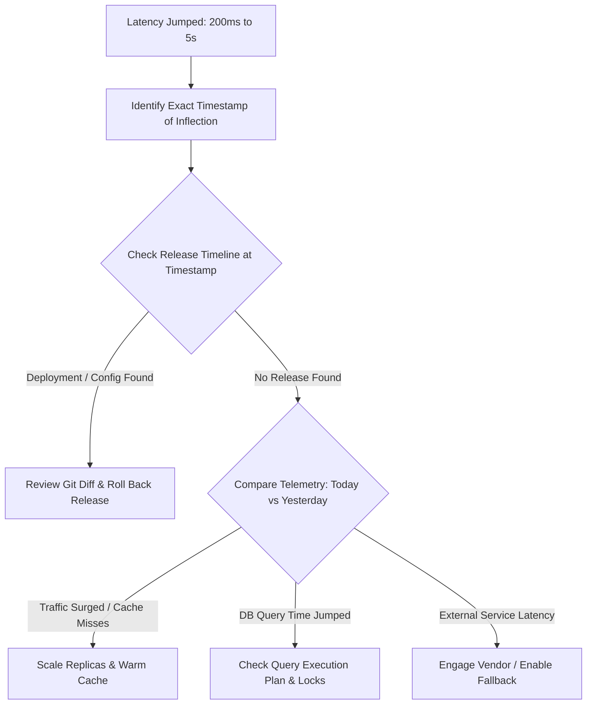

## Scenario

> **Your API was responding in 200ms yesterday, but today it takes 5 seconds. How would you investigate?**

This scenario tests your ability to investigate **deltas (what changed?)** between two points in time rather than debugging the system from scratch in isolation.


## Fast Revision (10-Second Recall)

- **First Move:** Check **Deployment History & Git Log** for recent releases, configuration toggles, or schema migrations in the last 24 hours.
- **Top 4 Deltas to Check:**
  1. **Code/Config Release:** New deployment, feature flag flipped, or dependency bump.
  2. **Database Changes:** Data volume milestone crossed (index invalidation, full table scan triggered), missing DB maintenance (`ANALYZE`/`VACUUM`), or lock contention.
  3. **Traffic Shift:** Concurrency surge, sudden bot attack, or cache invalidation wave (cache stampede).
  4. **Downstream/Third-Party:** Upstream vendor degraded, cloud provider region throttling, or DNS resolution latency.
- **Key Tools:** Git blame/release tags, CI/CD deployment logs, APM latency distribution overlay (Today vs Yesterday), CloudWatch/Datadog metrics.


## The 30-Second Spoken Script

If asked this in an interview, deliver this structured response:

> *When latency jumps from 200ms to 5s overnight, my primary assumption is that something changed in the environment rather than a random baseline shift.*
>
> *First, I pull up our APM and overlay today's latency graph with yesterday's. I look at the exact inflection point timestamp where the spike began.*
>
> *I cross-reference that timestamp against three systems: our CI/CD deployment history for new code or config changes, database migration logs, and infrastructure events like auto-scaling or pod restarts.*
>
> *Next, I inspect the APM service map: did the extra 4.8 seconds accumulate in application execution, database queries, or a downstream vendor?*
>
> *If a release caused it, I trigger an immediate rollback. If it's traffic or cache degradation, I analyze query plans and cache hit ratios.*


## Diagnostic Lifecycle



### 1. Pinpoint the Exact Inflection Timestamp
Do not guess. Open the APM dashboard (Datadog/New Relic) and identify the precise minute the median or p95 response time deviated from 200ms.

### 2. Correlate with Recent Events
- **Code Deployments:** Check GitHub/GitLab releases or Kubernetes deployment events within $\pm 30$ minutes of the inflection.
- **Environment Variables & Feature Flags:** Check LaunchDarkly, ConfigMaps, or secret rotations.
- **Database Maintenance:** Did an automated cron job run? Was a table truncated, re-indexed, or locked?

### 3. Compare Request Metrics (A/B Profiling)
Compare spans between a **200ms baseline trace from yesterday** and a **5000ms trace from today**:
- Which specific span grew?
  - If `db.query` span jumped from 15ms $\rightarrow$ 4800ms $\rightarrow$ Database execution plan changed.
  - If `http.client` span jumped from 50ms $\rightarrow$ 4900ms $\rightarrow$ Downstream dependency timeout.
  - If `app.cpu` jumped $\rightarrow$ Infinite loop, excessive regex backtracking, or synchronous processing.


## Root Causes & Solutions Matrix

| Suspected Cause | Symptoms & Signals | Immediate Resolution |
| :--- | :--- | :--- |
| **Faulty Code Deployment** | Latency spiked immediately following a commit/deploy event. | **Roll back immediately** to yesterday's stable build; debug the diff in staging. |
| **Cache Invalidation / Cold Cache** | Cache hit ratio plummeted from 95% to 5%; database query volume skyrocketed. | Warm the cache proactively; increase TTLs; check Redis memory evictions. |
| **Table Growth Tipping Point** | Sequential scan was fast on 10k rows yesterday, but crossed 100k rows today without an index. | Add the missing index concurrently (`CREATE INDEX CONCURRENTLY`). |
| **Stale Query Optimizer Stats** | PostgreSQL optimizer chose a sequential scan over an index scan due to stale statistics. | Run `ANALYZE <table_name>;` to refresh database planner statistics. |
| **Downstream Partner Degradation** | Third-party payment/verification provider experiencing an outage or slowdown. | Enable fallback mechanisms; shorten connection/read timeouts; trigger circuit breaker. |
| **Connection Leak** | Connection pool active count hit maximum threshold; requests queue waiting for free sockets. | Restart application pods to free leaked connections; fix missing `connection.release()` calls. |


## Practical Debugging Commands & Code

### 1. Correlate Deployment Timestamps in Kubernetes
```bash
# Check recent deployment rollouts and image change history
kubectl rollout history deployment/backend-api

# Check events around the time of the latency jump
kubectl get events --sort-by='.metadata.creationTimestamp' | tail -n 25
```

### 2. Identify Stale Statistics and Missing Indexes (PostgreSQL)
```sql
-- Check last vacuum and analyze timestamps for suspected table
SELECT relname, last_vacuum, last_autovacuum, last_analyze, last_autoanalyze 
FROM pg_stat_user_tables 
WHERE relname = 'orders';

-- Refresh table statistics immediately if optimizer estimates are skewed
ANALYZE orders;
```

### 3. Check Redis Cache Evictions and Memory Pressure
```bash
# Connect to Redis CLI and check eviction stats
redis-cli info stats | grep -E 'evicted_keys|keyspace_misses|keyspace_hits'
redis-cli info memory | grep -E 'used_memory_human|maxmemory_human'
```


## Prevention & Senior Best Practices

1. **Automated Canary Deployments:** Deploy new versions to 5% of traffic first. Automatically abort and roll back if p95 latency exceeds 500ms over 5 minutes.
2. **Track Releases as APM Markers:** Inject git commit SHAs into your monitoring tools (Datadog deployment markers) so releases appear as vertical lines on all latency graphs.
3. **Database Health Safeguards:** Monitor `n_dead_tup` (dead tuples) and ensure autovacuum runs regularly before query planner statistics decay.

