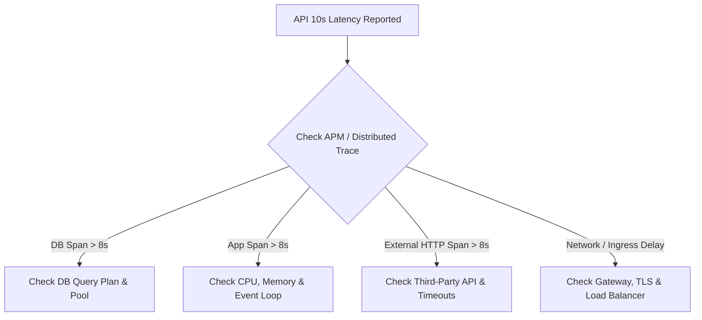

## Scenario

> **Your API is taking 10 seconds to respond. How would you identify the root cause?**

This is one of the most common backend interview questions. The interviewer wants to verify that you have a **systematic, multi-tier diagnostic methodology** rather than immediately guessing random fixes like "I'll add Redis caching."


## Fast Revision (10-Second Recall)

- **First Move:** Check **Distributed Tracing (APM)** to isolate the bottleneck span (App vs. DB vs. External HTTP).
- **Primary Suspects:**
  1. **Database:** Missing index, N+1 queries, table lock, connection pool exhaustion.
  2. **Application:** Event loop blocking (Node.js), CPU throttling, garbage collection pauses, thread pool starvation.
  3. **Downstream:** Blocking synchronous calls to external third-party APIs without timeouts.
  4. **Payload:** Unpaginated bulk data serialization (e.g., returning 50,000 JSON records).
- **Key Tools:** Datadog / OpenTelemetry, `EXPLAIN (ANALYZE, BUFFERS)`, `pg_stat_activity`, Node/Go runtime profilers.


## The 30-Second Spoken Script

If asked this in an interview, deliver this structured response:

> *I approach API latency systematically by peeling back the request lifecycle layer by layer.*
>
> *First, I check our APM tool (such as Datadog or OpenTelemetry) to inspect distributed traces for that endpoint. That immediately isolates whether the 10 seconds are spent in application CPU time, waiting on database I/O, or blocked on external HTTP dependencies.*
>
> *If the database span dominates, I inspect slow query logs and run `EXPLAIN ANALYZE` to check for missing indexes, locks, or connection pool saturation.*
>
> *If application compute dominates, I look for CPU starvation, event loop lag, or unpaginated bulk JSON serialization.*
>
> *If an external dependency is stalling, I look for missing timeouts or circuit breakers. Once the bottleneck is remediated, I enforce strict p95/p99 alerts and query timeouts to prevent recurrence.*


## Diagnostic Lifecycle



### 1. Scope & Isolation
Before jumping into logs, narrow down the blast radius:
- **Single Endpoint vs. System-Wide:** Is only `POST /checkout` slow, or are all routes (`GET /health`) degraded?
  - *If all routes:* Check infrastructure (CPU spikes, memory swapping, DB connection pool depletion).
  - *If single route:* Focus on the specific controller, query, or external dependency.
- **Uniform vs. Intermittent:** Does it happen on every request, or only under peak concurrency?

### 2. Distributed Traces (APM)
Break down the 10,000ms span into constituent child spans:
- `Database Span`: e.g., 9,100ms $\rightarrow$ The database is the bottleneck.
- `HTTP Call (e.g., Payment Gateway)`: e.g., 9,400ms $\rightarrow$ External network call blocked without a timeout.
- `Application Span`: e.g., 9,800ms $\rightarrow$ CPU-bound code, infinite regex backtracking, or synchronous file I/O.


## Root Causes & Solutions Matrix

| Suspected Layer | Symptoms & Evidence | Immediate Resolution |
| :--- | :--- | :--- |
| **Missing DB Index** | Sequential table scan on millions of rows; high DB CPU. | Run `EXPLAIN (ANALYZE, BUFFERS)` and add targeted B-tree or composite index. |
| **N+1 Query Pattern** | APM trace shows hundreds of sequential DB queries for one request. | Use eager loading (`JOIN FETCH`, ORM `include`, or DataLoader) to batch into a single query. |
| **DB Connection Pool Starvation** | Requests spend 9s waiting for a free connection from the pool. | Increase pool size, shorten idle timeouts, and ensure connections are released in `finally` blocks. |
| **Slow External API** | Blocking synchronous call to an external vendor without a client timeout. | Set strict HTTP client timeouts (e.g., 2s), add circuit breakers, or make the task asynchronous. |
| **Massive Payload Serialization** | High memory spike, node event loop blocked serializing 50MB JSON. | Implement cursor-based pagination (`LIMIT 50`) and project only necessary fields. |
| **Database Row Locking** | Concurrent transactions contending on the same rows (`pg_stat_activity` shows `ExclusiveLock`). | Optimize transaction boundaries; commit transactions promptly; avoid locking across external calls. |


## Practical Debugging Commands & Code

### 1. Identify Slow PostgreSQL Queries
```sql
-- Find queries currently running longer than 2 seconds
SELECT pid, now() - query_start AS duration, state, query 
FROM pg_stat_activity 
WHERE (now() - query_start) > interval '2 seconds' 
  AND state != 'idle';
```

### 2. Analyze the Query Execution Plan
```sql
-- Look for "Seq Scan" on large tables vs "Index Scan"
EXPLAIN (ANALYZE, BUFFERS, VERBOSE)
SELECT * FROM orders WHERE user_id = 94821 AND status = 'COMPLETED';
```

### 3. Implement Strict HTTP Client Timeout (Node.js Example)
Never allow external calls to wait indefinitely:
```typescript
import axios from 'axios';

// Abort if downstream does not respond within 2.5 seconds
const client = axios.create({
  timeout: 2500,
});

try {
  const response = await client.get('https://partner-api.com/verify');
} catch (error) {
  if (error.code === 'ECONNABORTED') {
    // Handle graceful degradation or return cached response
    throw new Error('Downstream service timeout');
  }
}
```


## Prevention & Senior Best Practices

1. **Enforce Statement Timeouts:** Set database-level guardrails (e.g., `SET statement_timeout = '3s';`) so rogue queries are killed before monopolizing the pool.
2. **Monitor Percentiles, Not Averages:** Set up alerts on **p95** (> 800ms) and **p99** (> 2000ms). An average latency of 200ms often hides a disastrous 10s tail latency.
3. **Decouple Heavy Work:** Move long-running tasks (> 500ms) like PDF generation, webhook dispatches, and emails out of the request/response cycle into background worker queues (BullMQ, Celery, SQS).

