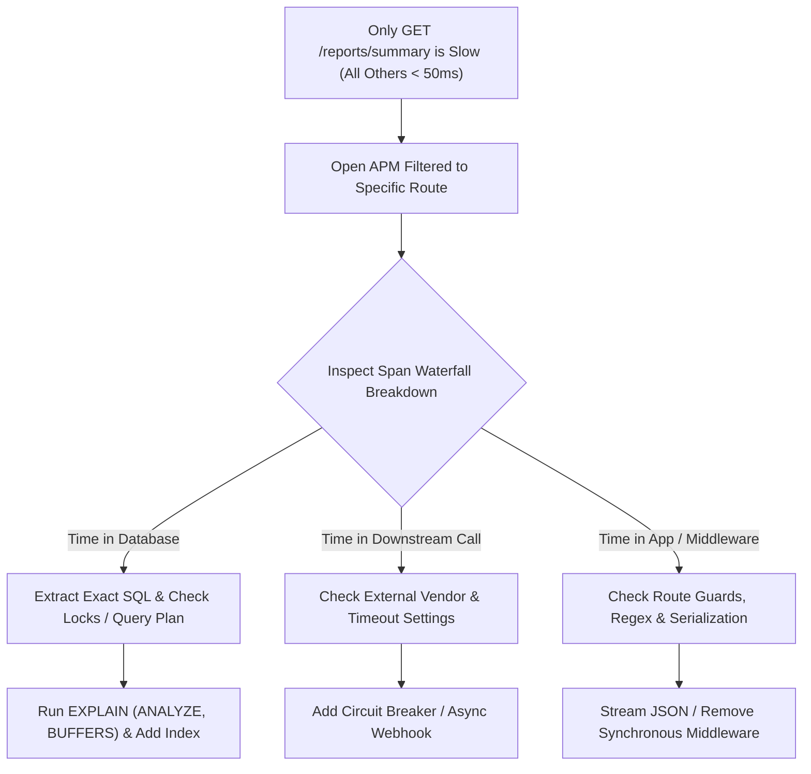

## Scenario

> **One particular API is slow, but all other APIs are working fine. How would you debug it?**

When only a single endpoint suffers while the rest of the application responds quickly, you can immediately **rule out general infrastructure issues** (like host CPU exhaustion, network outages, or broad database crashes) and zoom straight into route-specific mechanics.


## Fast Revision (10-Second Recall)

- **Ruling Out:** Not a cluster-wide issue, not high host CPU, not network partition, not total database failure.
- **Top 5 Localized Culprits:**
  1. **Route-Specific Query:** An unindexed query or sequential scan executed only by this controller.
  2. **Row / Table Lock Contention:** This endpoint is waiting on an uncommitted exclusive lock held by another transaction.
  3. **Unique Downstream Dependency:** Endpoint calls a slow external API (e.g., credit check or legacy ERP) that no other route calls.
  4. **Route Middleware:** Heavy token parsing, unmemoized permission checks, or synchronous disk I/O in route-specific middleware.
  5. **Large Response Serialization:** Returning massive nested relational trees without projection or pagination.
- **Key Tools:** APM trace for the specific route, `pg_stat_statements` / SQL Slow Query Log, Route Flamegraph / CPU Profiler.


## The 30-Second Spoken Script

If asked this in an interview, deliver this structured response:

> *Since only one API is slow and others are healthy, I immediately rule out platform-wide problems like host CPU starvation or database downtime.*
>
> *I focus exclusively on that endpoint's request-response path. First, I inspect distributed traces in our APM filtered specifically to that URI.*
>
> *I examine the span waterfall: is the time spent inside route-specific middleware, a dedicated database query, or an external third-party integration that only this endpoint touches?*
>
> *If it's the database, I inspect the exact SQL query with `EXPLAIN ANALYZE` and check for row-level lock contention. If it's application code, I inspect the serialization overhead and check whether the handler is performing synchronous CPU-intensive operations.*
>
> *Once identified, I fix the isolated bottleneck with targeted indexing, query optimization, or asynchronous decoupling.*


## Diagnostic Lifecycle



### 1. Step 1: APM Route Breakdown
Filter APM (Datadog/Dynatrace/New Relic) to the slow URI (e.g., `POST /api/v1/checkout`):
- Look at the **p95 span breakdown**:
  - `middleware.auth`: 15ms
  - `handler.validate`: 5ms
  - `postgres.query`: 4,200ms $\rightarrow$ Bottleneck isolated to SQL.
  - `json.stringify`: 800ms $\rightarrow$ Bottleneck isolated to payload serialization.

### 2. Step 2: Database Lock & Query Investigation
- Check whether this endpoint touches a table frequently updated by background workers.
- Run `pg_blocking_pids()` in PostgreSQL to see if the slow query is waiting behind another transaction's row lock.


## Root Causes & Solutions Matrix

| Root Cause Category | Symptoms & Evidence | Resolution |
| :--- | :--- | :--- |
| **Route-Specific Slow Query** | High time in `db.query` span; table scan on millions of rows. | Optimize query, create targeted composite index, or rewrite subqueries into joins. |
| **Row-Level Lock Contention** | Query runs fast in isolation, but hangs when run concurrently with updates. | Shorten transaction window; use `SELECT ... FOR UPDATE SKIP LOCKED` or optimistic locking. |
| **Exclusive Downstream Dependency** | Endpoint calls an external partner API (e.g., tax calculation service). | Add caching, shorten connection timeouts, or offload processing to a background job. |
| **Inefficient Route Middleware** | Route has a custom permission guard executing 10 recursive database lookups. | Cache user permissions in JWT claims or Redis session store. |
| **Massive In-Memory Mapping** | Handler loads 20,000 entities and executes `.filter()` and `.sort()` in JavaScript memory. | Push filtering and sorting down to SQL (`WHERE ... ORDER BY ... LIMIT`). |


## Practical Debugging Commands & Code

### 1. Find the Slowest Query for a Specific Endpoint
```sql
-- Query pg_stat_statements for queries matching this endpoint's table
SELECT query, calls, total_exec_time / calls AS avg_time_ms, rows / calls AS avg_rows
FROM pg_stat_statements
WHERE query ILIKE '%orders%'
ORDER BY avg_time_ms DESC
LIMIT 5;
```

### 2. Detect Transaction Lock Blocking
```sql
-- Find blocked queries and the blocking process PID
SELECT 
    blocked_locks.pid AS blocked_pid,
    blocked_activity.usename AS blocked_user,
    blocking_locks.pid AS blocking_pid,
    blocking_activity.usename AS blocking_user,
    blocked_activity.query AS blocked_statement,
    blocking_activity.query AS current_statement_in_blocking_process
FROM pg_catalog.pg_locks blocked_locks
JOIN pg_catalog.pg_stat_activity blocked_activity ON blocked_activity.pid = blocked_locks.pid
JOIN pg_catalog.pg_locks blocking_locks 
    ON blocking_locks.locktype = blocked_locks.locktype
    AND blocking_locks.database IS NOT DISTINCT FROM blocked_locks.database
    AND blocking_locks.relation IS NOT DISTINCT FROM blocked_locks.relation
    AND blocking_locks.page IS NOT DISTINCT FROM blocked_locks.page
    AND blocking_locks.tuple IS NOT DISTINCT FROM blocked_locks.tuple
    AND blocking_locks.virtualxid IS NOT DISTINCT FROM blocked_locks.virtualxid
    AND blocking_locks.transactionid IS NOT DISTINCT FROM blocked_locks.transactionid
    AND blocking_locks.classid IS NOT DISTINCT FROM blocked_locks.classid
    AND blocking_locks.objid IS NOT DISTINCT FROM blocked_locks.objid
    AND blocking_locks.objsubid IS NOT DISTINCT FROM blocked_locks.objsubid
    AND blocking_locks.pid != blocked_locks.pid
JOIN pg_catalog.pg_stat_activity blocking_activity ON blocking_activity.pid = blocking_locks.pid
WHERE NOT blocked_locks.granted;
```


## Prevention & Senior Best Practices

1. **Per-Route Latency Service Level Objectives (SLOs):** Set granular latency alerts per critical route rather than monitoring global application latency alone.
2. **Push Data Filtering to the Database Engine:** Never fetch unconstrained records into application memory to perform application-level filtering or joins.
3. **Guard External API Calls:** Ensure any single route making outbound network requests is strictly wrapped in a circuit breaker with an explicit fallback mechanism.

