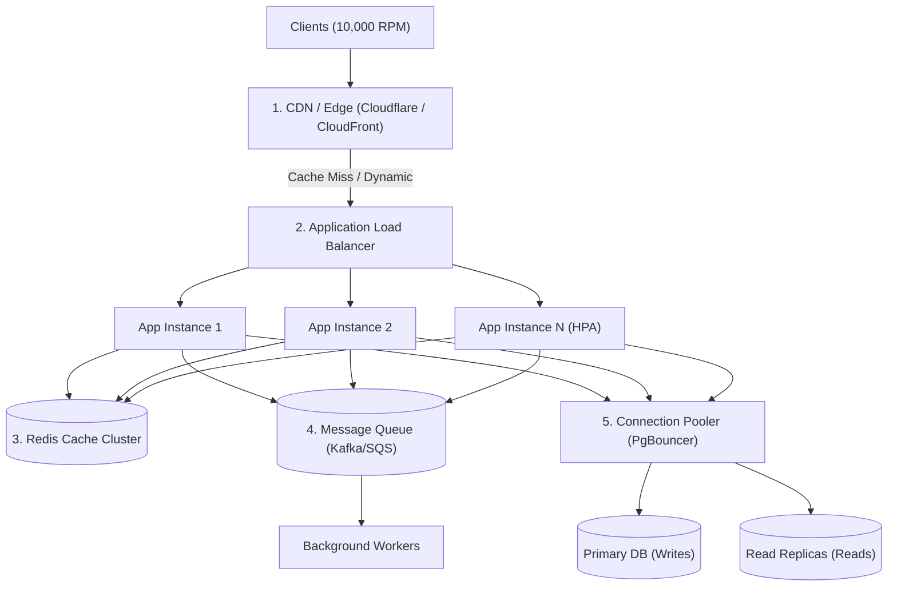

## Scenario

> **Your API is receiving 10,000 requests per minute. How would you handle the traffic?**

$10,000\text{ requests per minute} \approx 167\text{ requests per second (RPS)}$. While modest for lightweight I/O, this load will crash unoptimized monoliths if every request touches relational databases, performs heavy serialization, or initiates synchronous external calls.


## Fast Revision (10-Second Recall)

- **Quick Math:** $10,000\text{ RPM} \approx 167\text{ RPS}$ average, with peak surges hitting $500\text{--}1,000\text{ RPS}$.
- **Core 5-Pillar Architecture:**
  1. **Edge CDN Caching:** Offload static and cacheable `GET` endpoints before traffic reaches application origin.
  2. **Stateless Horizontal Scaling:** Run behind an Application Load Balancer (ALB) with Kubernetes HPA (Horizontal Pod Autoscaler).
  3. **Read/Write Splitting & Caching:** Redis Cache-Aside for hot keys; route read queries to Read Replicas.
  4. **Async Message Queuing:** Offload write-heavy, non-critical paths to Kafka/RabbitMQ/BullMQ.
  5. **Rate Limiting & Shedding:** Token bucket rate limiting at API Gateway (NGINX / Cloudflare / Envoy) to protect downstream services.
- **Key Tools:** Kubernetes HPA, Redis Cluster, AWS ALB / Cloudflare, PgBouncer, BullMQ / Celery.


## The 30-Second Spoken Script

If asked this in an interview, deliver this structured response:

> *10,000 requests per minute translates to roughly 170 requests per second, with peak bursts likely reaching 500+ RPS.*
>
> *I handle this load using a layered defense strategy across the stack.*
>
> *At the edge, I terminate SSL and serve cacheable read requests using Cloudflare or CloudFront CDN. For authenticated dynamic reads, I place a Redis caching layer in front of the database using the Cache-Aside pattern.*
>
> *At the application tier, services must be completely stateless. I deploy them across multiple pods or containers behind an Application Load Balancer with Horizontal Pod Autoscaling configured on CPU and request latency.*
>
> *At the database tier, I use connection pooling via PgBouncer and route reads to read replicas. Any heavy write or processing logic is decoupled asynchronously into message queues like SQS or Kafka to guarantee high ingestion throughput.*


## Diagnostic Lifecycle



### 1. Layer 1: Edge & Gateway (Filter & Cache)
- **CDN Caching:** High-traffic endpoints that return public or semi-static data (catalogs, configurations) should have `Cache-Control: public, max-age=60, s-maxage=300`. This absorbs 70–80% of read traffic.
- **Rate Limiting:** Enforce per-IP and per-API-key rate limits at Cloudflare or NGINX (e.g., 100 requests/minute per client).

### 2. Layer 2: Stateless Application Tier (Auto-Scale)
- No sessions in container memory! Store tokens in JWT or distributed Redis sessions.
- Configure Kubernetes Horizontal Pod Autoscaler (HPA) target:
  - Metric: CPU utilization > 70% or incoming RPS > 50 per pod.
  - Scale out from 3 pods baseline to 15 pods during traffic spikes.

### 3. Layer 3: Database & Asynchronous Decoupling
- **Connection Saturation Prevention:** 10 pods with 20 connections each = 200 connections. Use PgBouncer in transaction pooling mode to multiplex 2,000 application requests over 50 actual database connections.
- **Async Ingestion:** If an API endpoint is `POST /log-event` or `POST /place-order`, write immediately to an append-only queue (Kafka / RabbitMQ) and respond with `202 Accepted`.


## Root Causes & Solutions Matrix

| Bottleneck Layer | Risk Under 10k RPM | Architectural Solution |
| :--- | :--- | :--- |
| **API Server Memory** | Node.js / Python single process runs out of event loop or memory. | Scale horizontally with multi-replica deployments; run clustering (PM2 / Go Goroutines). |
| **Database Connections** | `too many connections` error (PostgreSQL/MySQL max connection ceiling reached). | Introduce connection pooler (PgBouncer / ProxySQL); use short-lived connections. |
| **Read Contention** | Primary database CPU maxes out on heavy `SELECT` queries. | Implement Redis Cache-Aside; provision 2 read replicas with read/write splitting. |
| **Write Latency** | Slow disk writes stall synchronous HTTP responses. | Buffer writes into background queues; batch insert records into the database. |
| **DDoS / Rogue Script** | Single malicious IP exhausts thread pool with 2,000 rapid requests. | Implement Token Bucket rate limiting at the API Gateway / WAF layer. |


## Practical Debugging Commands & Code

### 1. NGINX Rate Limiting Configuration
```nginx
# Rate limit by client IP: 20 requests per second with burst capacity of 10
limit_req_zone $binary_remote_addr zone=api_limit:10m rate=20r/s;

server {
    location /api/ {
        limit_req zone=api_limit burst=10 nodelay;
        proxy_pass http://backend_upstream;
    }
}
```

### 2. Kubernetes Horizontal Pod Autoscaler (HPA) Spec
```yaml
apiVersion: autoscaling/v2
kind: HorizontalPodAutoscaler
metadata:
  name: api-autoscaler
spec:
  scaleTargetRef:
    apiVersion: apps/v1
    kind: Deployment
    name: backend-api
  minReplicas: 3
  maxReplicas: 20
  metrics:
  - type: Resource
    resource:
      name: cpu
      target:
        type: Utilization
        averageUtilization: 70
```

### 3. Asynchronous Task Decoupling (Fast 202 Response)
```typescript
import { Queue } from 'bullmq';

const orderQueue = new Queue('order-processing', { connection: redisOptions });

export async function handleOrder(req, res) {
  // Validate payload in-memory
  const orderData = req.body;

  // Enqueue job immediately (< 5ms response time)
  const job = await orderQueue.add('process-payment', orderData, {
    attempts: 3,
    backoff: { type: 'exponential', delay: 1000 },
  });

  // Return 202 Accepted with tracking ID
  return res.status(202).json({
    status: 'Queued',
    jobId: job.id,
    message: 'Order received and processing in background'
  });
}
```


## Prevention & Senior Best Practices

1. **Load Testing with Realistic Thresholds:** Run regular stress tests using k6, Locust, or Artillery at $2\times$ expected peak (20,000 RPM) to identify breakpoints before sales events.
2. **Implement Graceful Degradation & Circuit Breaking:** If downstream payment or recommendation microservices degrade, serve cached fallbacks or disable non-essential UI features instead of failing entire requests.
3. **Set Up Load Shedding:** Configure Envoy or your API Gateway to shed excess low-priority traffic with HTTP 429 / 503 when host CPU exceeds 90%.

