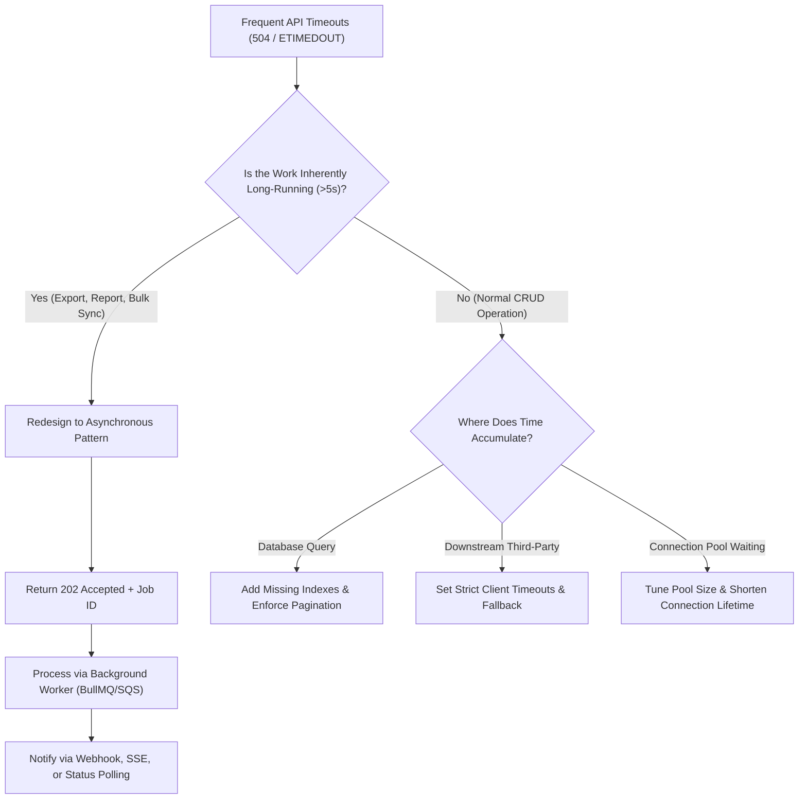

## Scenario

> **How would you handle an API that frequently times out?**

Timeouts (HTTP `504 Gateway Timeout` or client-side `ETIMEDOUT`) indicate an architectural mismatch: the client expects an immediate synchronous response, but the server is attempting work that exceeds the network timeout window (usually 30–60 seconds).


## Fast Revision (10-Second Recall)

- **The Golden Architectural Rule:** Synchronous HTTP requests must finish in **< 1–2 seconds**. Any task taking > 5 seconds must be asynchronous.
- **Top 4 Remediation Strategies:**
  1. **Asynchronous Redesign:** Convert synchronous endpoints to `202 Accepted` + Background Job + Webhook / Polling.
  2. **Query Optimization:** Fix missing indexes or unpaginated full table scans causing database statement timeouts.
  3. **Strict Downstream Timeouts:** Abort slow external microservices early and return cached or degraded fallbacks.
  4. **Cursor-Based Pagination:** Limit database fetches to 50–100 items per request instead of scanning thousands.
- **Key Tools:** Background queues (BullMQ, Celery, SQS), Redis status tracking, `202 Accepted` HTTP pattern.


## The 30-Second Spoken Script

If asked this in an interview, deliver this structured response:

> *Frequent timeouts are an architectural signal that we are treating an asynchronous batch process as a synchronous HTTP request.*
>
> *First, I identify which timeout boundary is tripping: is it the database query timeout, the downstream HTTP client timeout, or the reverse proxy gateway timeout?*
>
> *If the endpoint is legitimately heavy—like report generation, CSV export, or batch email dispatch—I immediately redesign the API into an asynchronous pattern. The endpoint validates input, writes a job to a message queue like BullMQ or SQS, and returns an immediate `202 Accepted` with a job ID.*
>
> *The client then either listens for a webhook, connects via WebSocket, or polls a lightweight `/jobs/:id` status endpoint.*
>
> *If the endpoint is supposed to be fast, I inspect slow query logs for unindexed full-table scans, connection pool saturation, and missing timeouts on downstream third-party calls.*


## Diagnostic Lifecycle



### 1. Step 1: Differentiate Fast vs Inherently Slow APIs
- **Inherently Heavy Work:** Generating a 50-page PDF, calculating payroll, exporting 200,000 Excel records. These **must never be synchronous**.
- **Accidentally Slow Work:** `GET /users` running an unindexed query across 5 million rows. This needs **indexing and pagination**.


## Root Causes & Solutions Matrix

| Root Cause | Diagnostic Pattern | Architectural Solution |
| :--- | :--- | :--- |
| **Heavy Processing in Request** | Request takes 45 seconds to generate an invoice. | Offload to background worker; return `202 Accepted` immediately. |
| **Full Table Scan on Growing Data** | Latency crept up slowly over 3 months until hitting 30s timeout. | Run `EXPLAIN ANALYZE` and create the required index. |
| **Hanging Third-Party Service** | Outbound call has no timeout; waits 60s until NGINX terminates it. | Set `timeout: 3000` (3 seconds) on external HTTP client. |
| **Unbounded Query Result Set** | Query returns 50,000 records; payload transfer times out. | Enforce keyset or cursor pagination (`LIMIT 50`). |
| **DB Connection Starvation** | Request spends 30s waiting to acquire a connection from pool. | Increase DB pool capacity; optimize query hold duration. |


## Practical Debugging Commands & Code

### 1. The Asynchronous `202 Accepted` Pattern Implementation
```typescript
import { Queue } from 'bullmq';
import { Router } from 'express';

const reportQueue = new Queue('reports');
const router = Router();

// 1. Submit Job (Fast response: < 10ms)
router.post('/reports/export', async (req, res) => {
  const { userId, dateRange } = req.body;

  const job = await reportQueue.add('generate-csv', { userId, dateRange });

  return res.status(202).json({
    status: 'ACCEPTED',
    jobId: job.id,
    checkStatusUrl: `/api/reports/status/${job.id}`,
  });
});

// 2. Poll Job Status
router.get('/reports/status/:jobId', async (req, res) => {
  const job = await reportQueue.getJob(req.params.jobId);

  if (!job) return res.status(404).json({ error: 'Job not found' });

  const state = await job.getState(); // completed, failed, active, waiting
  if (state === 'completed') {
    return res.json({ status: 'COMPLETED', downloadUrl: job.returnvalue.url });
  }

  return res.json({ status: state.toUpperCase(), progress: job.progress });
});
```


## Prevention & Senior Best Practices

1. **Keep Request Times Under 2 Seconds:** Enforce an architectural rule that any synchronous HTTP route must target a p95 latency under 500ms.
2. **Implement Hard Gateway Timeouts:** Never allow NGINX or ALB to wait longer than 30 seconds for an upstream backend.
3. **Use Webhooks for Downstream Integrations:** Whenever interacting with external services that might take seconds or minutes, consume results via incoming webhooks instead of holding open long-lived HTTP sockets.

