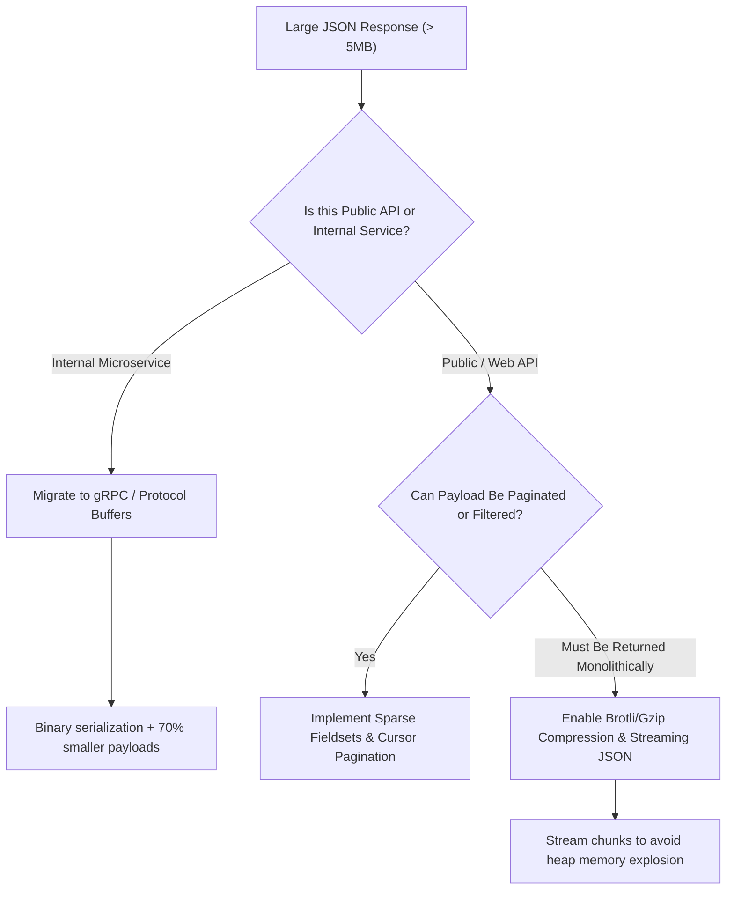

## Scenario

> **How would you handle a large JSON response?**

A large JSON response (e.g., 10MB to 50MB) degrades the entire system: it saturates network bandwidth, triggers high memory usage during stringification and parsing, blocks the single-threaded JavaScript event loop, and causes mobile browsers to stutter or crash.


## Fast Revision (10-Second Recall)

- **The Problem:** Serializing and parsing large JSON strings is synchronous and CPU-bound ($O(N)$ string operations).
- **Core 5-Step Solution:**
  1. **HTTP Compression:** Use Brotli or Gzip (`Accept-Encoding: br, gzip`) to reduce payload transfer size by up to 85%.
  2. **Sparse Fieldsets (Field Filtering):** Allow clients to request only needed attributes (`?fields=id,name,avatar`).
  3. **Streaming Parser / Serializer:** Use streaming JSON parsers (`JSONStream` / SAX parsers) to avoid holding multi-megabyte strings in RAM.
  4. **Binary Serialization (Protobuf / FlatBuffers):** Replace verbose text JSON with compact binary protocols for internal service-to-service communication.
  5. **Pagination & Lazy Loading:** Split monolithic JSON payloads into paginated chunks or on-demand sub-resource fetches.
- **Key Tools:** Brotli/Gzip compression, Protocol Buffers (Protobuf), `stream-json` (Node.js), GraphQL / Sparse Fieldsets.


## The 30-Second Spoken Script

If asked this in an interview, deliver this structured response:

> *Handling large JSON responses requires optimizing both data volume and serialization overhead.*
>
> *First, at the transport layer, I ensure Brotli or Gzip compression is enabled on the gateway. Since JSON is repetitive plain text, compression usually cuts bandwidth consumption by 80 to 90 percent.*
>
> *Second, I reduce the payload at the source by implementing Sparse Fieldsets, allowing clients to request only the specific keys they need rather than returning entire database entities.*
>
> *Third, if the large payload is unavoidable, I avoid buffering the entire object in memory. In Node.js or Go, stringifying a 40MB object freezes the event loop. Instead, I stream the JSON response chunk-by-chunk.*
>
> *Finally, if this is for high-throughput internal microservice communication, I move away from JSON entirely in favor of Protocol Buffers (gRPC), which provides compact binary encoding and schema safety.*


## Diagnostic Lifecycle



### 1. The Cost of `JSON.stringify()` and `JSON.parse()`
In Node.js, `JSON.stringify(largeObject)` runs synchronously on the main thread:
- A 25MB object takes **150ms to 400ms of synchronous CPU time**.
- During those 400ms, the entire event loop is blocked: no other incoming requests, timers, or I/O callbacks can be processed!

### 2. Compression Ratio Realities
- **Uncompressed JSON:** 12.4 MB.
- **Gzip (Level 6):** 1.8 MB (85% reduction).
- **Brotli (Level 11):** 1.3 MB (89% reduction).


## Root Causes & Solutions Matrix

| Bottleneck | Impact | Optimization |
| :--- | :--- | :--- |
| **High Bandwidth / Egress Cost** | Network latency spikes; mobile users experience slow downloads. | Enable Brotli / Gzip compression on NGINX or Cloudflare CDN. |
| **Event Loop Blocking** | Server freezes during `JSON.stringify()`. | Stream JSON using generator functions or streaming JSON serializers. |
| **Over-Fetching** | API returns 40 fields when the client only displays 3. | Implement sparse fieldsets (`?fields=id,title,price`). |
| **Client Memory OOM** | Mobile app crashes during `JSON.parse()`. | Paginate data; use client-side streaming SAX parsers. |
| **Microservice CPU Overhead** | High CPU serialization cost between internal services. | Switch from JSON REST to gRPC / Protobuf. |


## Practical Debugging Commands & Code

### 1. Enabling Brotli and Gzip in NGINX
```nginx
# Enable Gzip and Brotli for JSON responses
gzip on;
gzip_types application/json;
gzip_min_length 1024;
gzip_comp_level 6;

# If ngx_brotli module is installed
brotli on;
brotli_types application/json;
brotli_comp_level 6;
```

### 2. Sparse Fieldsets (Field Projection) Implementation
```typescript
import { Request, Response } from 'express';

export async function getUsers(req: Request, res: Response) {
  const fieldsParam = req.query.fields as string;
  
  // Parse requested fields: ?fields=id,name,email
  let selectFields: Record<string, boolean> | undefined;
  if (fieldsParam) {
    selectFields = {};
    fieldsParam.split(',').forEach((field) => {
      selectFields![field.trim()] = true;
    });
  }

  // Push field projection down to the database query
  const users = await db.user.findMany({
    select: selectFields || { id: true, name: true, email: true }, // Default safe projection
    take: 50,
  });

  return res.json(users);
}
```

### 3. Comparing Protobuf vs JSON Payload Size
```protobuf
// User.proto: Highly compact binary representation
syntax = "proto3";

message UserList {
  message User {
    int32 id = 1;
    string name = 2;
    string email = 3;
    string status = 4;
  }
  repeated User users = 1;
}
```


## Prevention & Senior Best Practices

1. **Mandate Response Compression:** Ensure reverse proxies and CDNs automatically compress all `application/json` payloads larger than 1KB.
2. **Never Return Full Database Models:** Always serialize through explicit Data Transfer Objects (DTOs) to avoid leaking internal or unnecessary fields.
3. **Use Content-Encoding Headers Correctly:** Ensure client requests send `Accept-Encoding: gzip, br` and verify the server replies with matching `Content-Encoding`.

