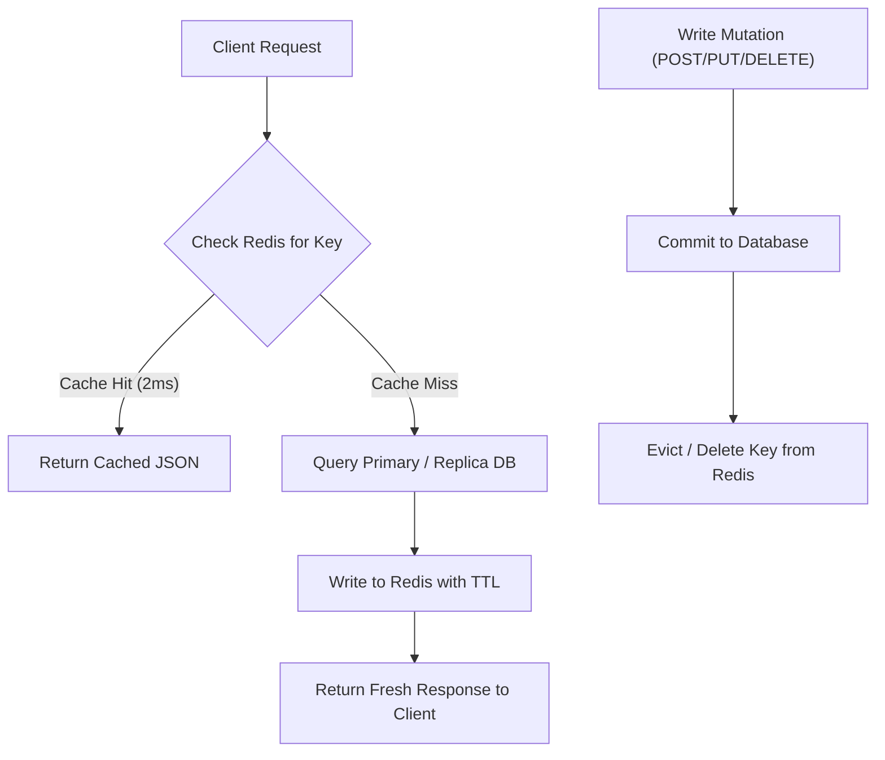

## Scenario

> **How would you implement API response caching?**

Caching is the single most effective way to multiply API throughput and slash latency. However, naive caching introduces subtle production pitfalls: **stale data, cache penetration, memory leaks, and invalidation bugs**.


## Fast Revision (10-Second Recall)

- **Two Primary Tiers:**
  1. **Edge/Client HTTP Caching:** Using `Cache-Control`, `ETag`, and `Last-Modified` headers for CDN and browser caching.
  2. **Server-Side Application Caching:** Using Redis or Memcached with the **Cache-Aside (Lazy Loading)** pattern.
- **Cache Key Formula:** $\text{Key} = \text{Namespace} : \text{Resource} : \text{Identifier} : \text{Hash(QueryParams)}$.
- **Three Golden Rules:**
  1. Never cache authenticated sensitive data without `Cache-Control: private`.
  2. Always set a Time-To-Live (TTL) on every key to prevent permanent memory leaks.
  3. Delete (invalidate) cache keys on mutation (`POST`/`PUT`/`DELETE`) rather than attempting in-place updates.
- **Key Tools:** Redis, Cloudflare CDN, HTTP `ETag` headers, Stale-While-Revalidate.


## The 30-Second Spoken Script

If asked this in an interview, deliver this structured response:

> *I implement API response caching at two complementary levels: at the HTTP Edge using standard headers, and at the Application Tier using Redis.*
>
> *For public, semi-static endpoints—like product catalogs or FAQs—I leverage HTTP caching via CDN using `Cache-Control: public, max-age=60, s-maxage=300` alongside `ETag` headers for 304 Not Modified validation.*
>
> *For authenticated, personalized APIs, I use the Cache-Aside pattern with Redis. When a GET request arrives, the app checks Redis using a normalized key based on the user ID, route, and sorted query parameters.*
>
> *If found, it returns the cached JSON in 2ms. On a cache miss, it reads from the DB, saves the result with an explicit TTL, and returns.*
>
> *For cache invalidation, whenever a mutating operation like `PUT` or `DELETE` executes, I explicitly evict the corresponding cache key to guarantee data consistency.*


## Diagnostic Lifecycle



### 1. Designing the Cache Key
Cache keys must be deterministic and collision-free:
$$\text{key} = \text{api:v1:products:page=2\&sort=asc\&category=electronics}$$
Always normalize and sort query parameters alphabetically so `?sort=asc&page=2` and `?page=2&sort=asc` generate the identical cache key.

### 2. The Cache-Aside Pattern Mechanics
- **Read Path:** `App` $\rightarrow$ `Redis` $\rightarrow$ (Miss) $\rightarrow$ `DB` $\rightarrow$ Store in `Redis` with TTL $\rightarrow$ Return.
- **Write Path:** `App` $\rightarrow$ Update `DB` $\rightarrow$ **Delete Key from Redis**.
- *Why delete instead of update?* Deleting avoids race conditions where two concurrent writes overwrite the cache in the wrong order.


## Root Causes & Solutions Matrix

| Caching Challenge | Risk | Best-Practice Solution |
| :--- | :--- | :--- |
| **Data Inconsistency** | User updates profile but still sees old data for 10 minutes. | Evict key on update; use event-driven cache invalidation (CDC / Webhooks). |
| **Cache Stampede (Thundering Herd)** | Hot key expires; hundreds of requests hit the DB simultaneously. | Use mutex locks on cache miss or probabilistic early expiration (`stale-while-revalidate`). |
| **Cache Penetration** | Attackers query non-existent IDs (`id=-9999`), bypassing cache and hitting DB. | Cache `null` values with a short TTL (e.g., 30s) or use a Bloom filter. |
| **Cache Avalanche** | Thousands of keys set with the identical 3600s TTL expire at the exact same second. | Add a random jitter to TTLs: $\text{TTL} = 3600 \pm \text{random}(1, 300)\text{s}$. |
| **Memory Exhaustion** | Redis runs out of RAM and crashes. | Configure Redis `maxmemory` and an LRU eviction policy (`allkeys-lru`). |


## Practical Debugging Commands & Code

### 1. Robust Cache-Aside Middleware Implementation
```typescript
import { Request, Response, NextFunction } from 'express';
import Redis from 'ioredis';

const redis = new Redis();

export function cacheMiddleware(ttlSeconds: number = 300) {
  return async (req: Request, res: Response, next: NextFunction) => {
    // Only cache safe GET requests
    if (req.method !== 'GET') return next();

    // Normalize query params for deterministic key
    const sortedQuery = Object.keys(req.query)
      .sort()
      .map(k => `${k}=${req.query[k]}`)
      .join('&');
    const cacheKey = `cache:${req.baseUrl}${req.path}:${sortedQuery}`;

    try {
      const cachedResponse = await redis.get(cacheKey);
      if (cachedResponse) {
        res.setHeader('X-Cache', 'HIT');
        return res.json(JSON.parse(cachedResponse));
      }

      // Intercept res.json to populate cache on miss
      const originalJson = res.json.bind(res);
      res.json = (body: any) => {
        // Add random jitter (+/- 30s) to prevent Cache Avalanche
        const jitter = Math.floor(Math.random() * 60) - 30;
        redis.set(cacheKey, JSON.stringify(body), 'EX', Math.max(10, ttlSeconds + jitter));
        res.setHeader('X-Cache', 'MISS');
        return originalJson(body);
      };

      next();
    } catch (err) {
      // Fail open: If Redis fails, continue to DB without crashing request
      next();
    }
  };
}
```

### 2. HTTP ETag Conditional Caching Headers
```typescript
// Generate hash of response body for 304 Not Modified support
import crypto from 'crypto';

export function sendWithETag(req: Request, res: Response, data: any) {
  const jsonString = JSON.stringify(data);
  const etag = crypto.createHash('md5').update(jsonString).digest('hex');

  if (req.headers['if-none-match'] === etag) {
    return res.status(304).end(); // 304 Not Modified: 0 payload transfer!
  }

  res.setHeader('ETag', etag);
  res.setHeader('Cache-Control', 'private, no-cache');
  return res.send(jsonString);
}
```


## Prevention & Senior Best Practices

1. **Always Set TTLs:** Never insert a key into Redis without an explicit expiration time (`EX`).
2. **Fail Open:** Wrap caching logic in `try/catch`. If Redis goes down, your application must transparently fall back to querying the database rather than throwing 500 errors.
3. **Monitor Cache Hit Ratios:** Track `keyspace_hits / (keyspace_hits + keyspace_misses)`. A healthy production cache should consistently achieve > 85% hit ratio.

