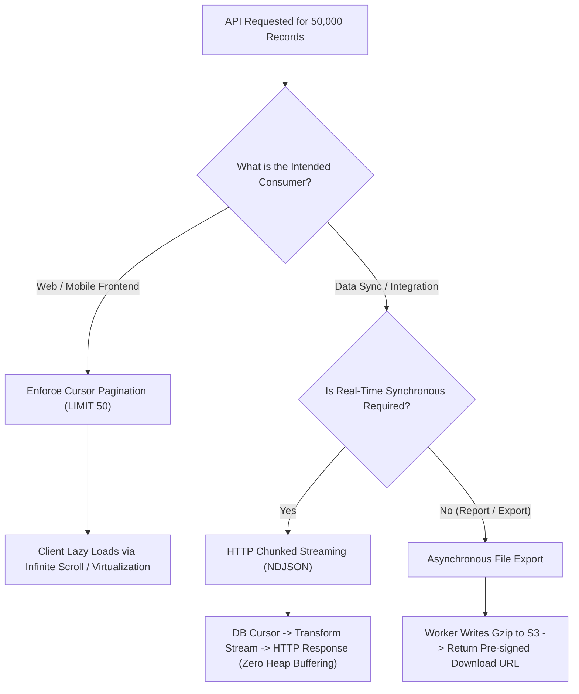

## Scenario

> **How would you optimize an API returning 50,000 records?**

Returning 50,000 records in a single synchronous JSON payload will cripple your application: the database executes a massive memory buffer scan, the Node/Java process runs out of heap memory while serializing a 60MB JSON string, and the client browser freezes trying to parse the array.


## Fast Revision (10-Second Recall)

- **The Problem:** 50,000 records $\approx 50\text{MB}$ JSON. Causes DB buffer bloat, server Out-Of-Memory (OOM), event loop freeze, and network transfer lag.
- **Top 5 Optimization Strategies:**
  1. **Cursor / Keyset Pagination:** Replace `OFFSET` with `WHERE id > last_seen_id LIMIT 100`.
  2. **Streaming Response:** Stream chunks directly from the DB cursor to the HTTP response using `Transfer-Encoding: chunked` (NDJSON or CSV). Zero memory buffering!
  3. **Field Projection (Sparse Fieldsets):** `SELECT id, name` instead of `SELECT *` (dropping heavy metadata and text columns).
  4. **Data Compression:** Enable Gzip / Brotli on API Gateway (compresses JSON payloads by 80–90%).
  5. **Asynchronous File Export:** If the client wants the data for offline analysis, generate a CSV/Parquet file in the background and return a pre-signed S3 download URL.
- **Key Tools:** PostgreSQL Cursor / Knex Stream, NDJSON (Newline Delimited JSON), Pre-signed S3 URLs, Gzip compression.


## The 30-Second Spoken Script

If asked this in an interview, deliver this structured response:

> *First, I challenge the premise: no human user or UI component can consume 50,000 records simultaneously on a screen.*
>
> *If this is for UI consumption, I enforce Keyset or Cursor-based pagination with a strict page limit of 50 to 100 records. This prevents memory bloat and keeps response times under 50ms.*
>
> *If this is for an export or automated data sync, loading 50,000 records into memory all at once will trigger Out-Of-Memory crashes. Instead, I use Database Cursors and stream the response chunk-by-chunk using NDJSON or CSV with `Transfer-Encoding: chunked`.*
>
> *Finally, if the export takes more than a few seconds, I decouple it completely: a background worker generates a compressed Gzip file in S3, and the API returns a pre-signed download link.*


## Diagnostic Lifecycle



### 1. The OFFSET Pagination Disaster
- `LIMIT 50 OFFSET 49950` forces the database to read 50,000 rows from disk, discard 49,950 of them, and return the last 50. Performance degrades linearly ($O(N)$).
- **Keyset / Cursor Pagination:** `WHERE id > 49950 ORDER BY id ASC LIMIT 50`. Uses the B-tree index directly ($O(\log N)$) regardless of page depth!

### 2. The Streaming vs Buffering Architecture
- **Buffered (Anti-pattern):** DB reads 50k rows into server RAM $\rightarrow$ server builds 50MB string $\rightarrow$ writes to socket. Memory usage: $200\text{MB}+$.
- **Streamed (Optimal):** DB reads 100 rows at a time $\rightarrow$ pipes directly through HTTP chunked stream $\rightarrow$ client receives bytes immediately. Constant memory usage: $< 5\text{MB}$.


## Root Causes & Solutions Matrix

| Vector | Naive Approach | Optimized Architecture |
| :--- | :--- | :--- |
| **Pagination** | `OFFSET 50000` (Disk scan of 50k rows). | Cursor pagination (`WHERE id > :lastId LIMIT 50`). |
| **Server Memory** | Load all 50k records into array before `res.json()`. | Stream database cursor chunk-by-chunk using `TransformStream`. |
| **Payload Size** | `SELECT *` returning 30 columns (60MB payload). | Field projection (`SELECT id, name, price`) + Gzip compression (cuts to 4MB). |
| **Format** | Single massive JSON array `[...]`. | Newline-Delimited JSON (NDJSON) or CSV. |
| **Bulk Data Export** | Synchronous 45-second HTTP request. | Asynchronous S3 export with pre-signed download link. |


## Practical Debugging Commands & Code

### 1. Keyset (Cursor-Based) Pagination Query
```sql
-- Fast regardless of how deep the pagination is (O(log N))
SELECT id, order_number, total_amount, created_at
FROM orders
WHERE id > 948201
ORDER BY id ASC
LIMIT 50;
```

### 2. Streaming 50,000 Records without Memory Buffering (Node.js)
```typescript
import { pipeline } from 'stream/promises';
import QueryStream from 'pg-query-stream';
import { Transform } from 'stream';

app.get('/api/orders/export-stream', async (req, res) => {
  res.setHeader('Content-Type', 'application/x-ndjson');
  res.setHeader('Transfer-Encoding', 'chunked');

  const client = await dbPool.connect();
  try {
    // 1. Create DB Query Stream (Batch size: 500 rows)
    const query = new QueryStream('SELECT id, customer_id, total, status FROM orders', [], { batchSize: 500 });
    const stream = client.query(query);

    // 2. Transform each row to a line of NDJSON
    const jsonTransformer = new Transform({
      objectMode: true,
      transform(row, encoding, callback) {
        callback(null, JSON.stringify(row) + '\n');
      },
    });

    // 3. Pipe directly from DB to HTTP response
    await pipeline(stream, jsonTransformer, res);
  } finally {
    client.release();
  }
});
```


## Prevention & Senior Best Practices

1. **Enforce Hard Pagination Limits:** Never allow an API consumer to pass `?limit=50000`. Set an application-level ceiling (e.g., `Math.min(requestedLimit, 100)`).
2. **Compress All API Traffic:** Ensure Gzip or Brotli compression is enabled on your API Gateway or reverse proxy.
3. **Use Virtualized Lists on Frontend:** When rendering large lists on client interfaces, use windowing libraries (like `react-virtualized` or `@tanstack/virtual`) to render only the DOM nodes currently visible in the viewport.

