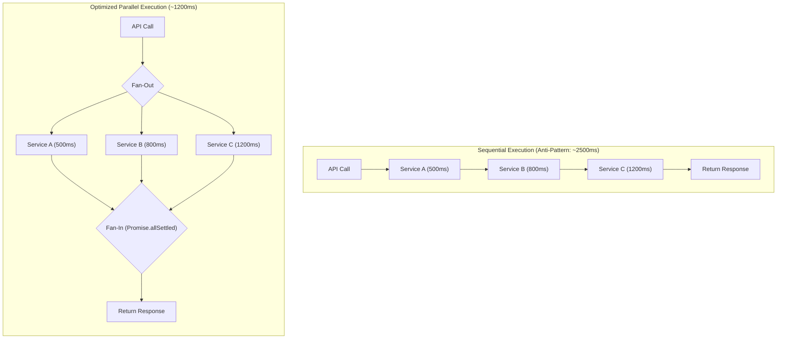

## Scenario

> **Your API is taking too long because it calls multiple external APIs. How would you optimize it?**

When a single endpoint calls 3 or 4 external vendor APIs sequentially, response time degrades to the **sum of all downstream latencies** plus cumulative network overhead.


## Fast Revision (10-Second Recall)

- **The Serial Trap:** Calling Service A (500ms) + Service B (800ms) + Service C (1200ms) = **2,500ms minimum latency**.
- **Top 5 Optimization Strategies:**
  1. **Parallel Execution:** Execute independent network requests concurrently (`Promise.allSettled`, Goroutines, or CompletableFuture). Max latency drops to $\max(A, B, C) = 1,200\text{ms}$.
  2. **Aggressive Response Caching:** Cache non-personalized third-party responses in Redis with realistic TTLs or stale-while-revalidate.
  3. **Strict Timeouts & Fallbacks:** Set per-request timeouts (e.g., 800ms); return degraded/default data if an optional external call times out.
  4. **Asynchronous Webhook / Event Decoupling:** Move slow non-blocking calls (e.g., notifications, CRM sync) into background workers.
  5. **BFF / Gateway Aggregation:** Use a Backends-for-Frontends pattern or GraphQL federation to aggregate upstream calls closer to the services.
- **Key Tools:** `Promise.allSettled` / Go `sync.WaitGroup`, Redis Caching, Resilience4j / Opossum (Circuit Breakers), BullMQ.


## The 30-Second Spoken Script

If asked this in an interview, deliver this structured response:

> *When an API is slow due to external dependencies, the first step is analyzing dependencies between those calls.*
>
> *If the calls are independent, I immediately convert them from sequential to parallel execution using constructs like `Promise.all` or Goroutines. This cuts latency from the sum of all calls down to just the single slowest call.*
>
> *Next, I categorize which calls are mission-critical versus optional. For optional calls, like recommendation widgets or fraud scores, I enforce tight timeouts with graceful fallbacks so a slow vendor doesn't block the core response.*
>
> *Third, for repetitive third-party data, I introduce a Redis cache with a stale-while-revalidate pattern.*
>
> *Finally, any side-effect calls—such as logging to a CRM or dispatching analytics—are moved out of the request lifecycle into an asynchronous message queue.*


## Diagnostic Lifecycle



### 1. Identify Dependency Graph
Map out which calls actually depend on previous results:
- Does Service B require data from Service A? $\rightarrow$ Must execute sequentially.
- Are Services A, B, and C independent? $\rightarrow$ Must execute in parallel.

### 2. Differentiate Critical vs Non-Critical Data
- **Critical:** Payment authorization. If this fails, the request must fail.
- **Non-Critical:** Loyalty points calculation, user avatar lookup. If this takes longer than 400ms, abort and return a default value or calculate in background.


## Root Causes & Solutions Matrix

| Scenario Pattern | Problem | Architectural Fix |
| :--- | :--- | :--- |
| **Serial HTTP Requests** | Each call blocks the next; latency is additive. | Run in parallel using `Promise.allSettled()` or Go Goroutines. |
| **Vendor Rate Limiting / Latency** | External service throttles requests or spikes to 5s. | Wrap client in a Circuit Breaker with cached fallback responses. |
| **Repetitive Third-Party Queries** | Fetching identical exchange rates or tax rates repeatedly. | Cache in Redis with a 5–15 minute TTL or stale-while-revalidate. |
| **Non-Essential Side Effects** | Sending welcome email or syncing HubSpot synchronously inside HTTP handler. | Offload side-effects to background workers via message queues (SQS/BullMQ). |
| **Unbounded Network Wait** | Third-party hung socket hangs the entire client connection. | Enforce strict connect and read timeouts (e.g., 1.5s max). |


## Practical Debugging Commands & Code

### 1. Parallelizing External Calls with `Promise.allSettled`
Avoid failing all calls if one non-critical service fails:
```typescript
interface ServiceData {
  userProfile?: any;
  creditScore?: any;
  recommendations?: any;
}

export async function aggregateUserData(userId: string): Promise<ServiceData> {
  // Execute calls concurrently
  const [profileResult, creditResult, recsResult] = await Promise.allSettled([
    fetchUserProfile(userId),       // Critical
    fetchCreditScore(userId),       // Semi-critical
    fetchRecommendations(userId),   // Optional
  ]);

  // Profile is required: throw if failed
  if (profileResult.status === 'rejected') {
    throw new Error('Critical service failed: Profile unavailable');
  }

  return {
    userProfile: profileResult.value,
    creditScore: creditResult.status === 'fulfilled' ? creditResult.value : null,
    recommendations: recsResult.status === 'fulfilled' ? recsResult.value : [], // Safe fallback
  };
}
```

### 2. Resilience with Circuit Breaker (Opossum Example)
```typescript
import CircuitBreaker from 'opossum';

const options = {
  timeout: 1000,              // Trigger timeout if call exceeds 1s
  errorThresholdPercentage: 50, // Trip breaker if 50% of requests fail
  resetTimeout: 10000,         // Wait 10s before attempting recovery
};

const breaker = new CircuitBreaker(externalVendorCall, options);

// Provide immediate fallback when circuit is open
breaker.fallback(() => ({ status: 'DEGRADED', data: cachedDefaultData }));
```


## Prevention & Senior Best Practices

1. **Never Make Unbounded External Calls:** Every external HTTP client must have strict connect, read, and write timeouts configured.
2. **Monitor External Vendor SLAs:** Track p95 latency and error rates for every third-party vendor individually on dedicated dashboards.
3. **Favor Asynchronous Ingestion:** Design APIs around event-driven architectures (webhooks and polling/websockets) rather than synchronous blocking orchestration.

