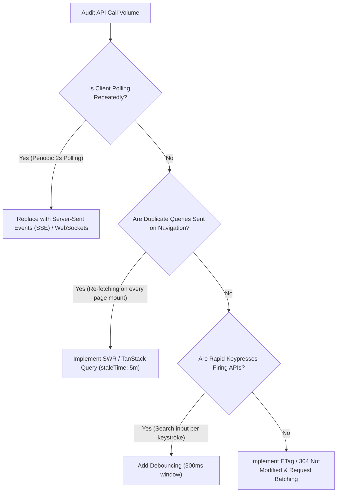

## Scenario

> **How would you reduce unnecessary API calls?**

Excessive, redundant API calls drain battery and data on mobile clients, overwhelm backend server capacity, and cause self-inflicted DDoS incidents during peak hours. Eliminating wasted calls is the highest-ROI optimization an engineering team can make.


## Fast Revision (10-Second Recall)

- **The Big 5 Techniques:**
  1. **Debouncing & Throttling (Frontend):** Debounce search inputs (300ms delay) and throttle rapid button clicks / scroll events.
  2. **Client-Side Cache Layer (TanStack Query / SWR):** Stale-while-revalidate caching so navigating back to a page doesn't refetch instantly.
  3. **Conditional HTTP Requests:** Use `ETag` and `If-None-Match` to return lightweight `304 Not Modified` responses.
  4. **Request Batching & GraphQL:** Merge 10 separate item queries into a single batch request (`POST /api/batch`).
  5. **Push over Polling:** Replace aggressive 2-second HTTP polling loops with WebSockets or Server-Sent Events (SSE).
- **Key Tools:** TanStack Query / RTK Query, Lodash `debounce`, HTTP `304 Not Modified`, SSE (Server-Sent Events).


## The 30-Second Spoken Script

If asked this in an interview, deliver this structured response:

> *I reduce unnecessary API calls by tackling both client-side trigger behavior and network transport efficiency.*
>
> *On the client, the biggest offender is uncontrolled UI events. I enforce debouncing on search and filter inputs with a 300ms window, and throttle double-clicks on submission forms.*
>
> *Next, I adopt modern client-side caching libraries like TanStack Query. By configuring `staleTime`, navigating between views reuses existing in-memory cache instead of triggering redundant network requests.*
>
> *At the protocol level, I replace short HTTP polling loops with Server-Sent Events (SSE) or WebSockets so the server pushes updates only when state actually changes.*
>
> *Finally, for relational data, I combine multiple micro-requests into batched endpoints or GraphQL queries to prevent chatty round-trips.*


## Diagnostic Lifecycle



### 1. Identify Client Calling Anti-Patterns
- **Keystroke Floods:** Typing "headphones" fires 10 requests (`h`, `he`, `hea`...) without debouncing.
- **Aggressive Polling:** 10,000 active browser tabs querying `GET /api/notifications` every 3 seconds = **3,333 RPS of mostly empty responses**.
- **Component Mount Redundancy:** Switching back and forth between two tabs causes full re-fetch loops.

### 2. Replace Polling with Event-Driven Push
- **HTTP Polling:** Client sends 1,000 requests; 995 return empty array `[]`.
- **Server-Sent Events (SSE):** Client opens 1 persistent connection; server pushes only when a real event occurs. 99.5% reduction in request volume!


## Root Causes & Solutions Matrix

| Root Cause | Symptoms | Architectural Fix |
| :--- | :--- | :--- |
| **Search-as-you-type flood** | 10 requests per user typing a single word. | Apply `debounce(fn, 300)` on input changes. |
| **Rapid Double Clicking** | Duplicate records or redundant `POST` requests. | Disable button on submit; enforce client-side throttling and backend idempotency keys. |
| **Frequent Polling Loops** | Massive traffic on `/status` or `/notifications`. | Migrate from polling to Server-Sent Events (SSE) or WebSockets. |
| **Mount/Unmount Re-fetching** | Navigating between UI screens triggers identical queries. | Configure TanStack Query / SWR with `staleTime: 1000 * 60 * 5` (5 minutes). |
| **Chatty Micro-Endpoints** | Screen fires 12 separate `GET` calls to render one page. | Implement Backends-for-Frontends (BFF) or Batch endpoints (`POST /batch`). |


## Practical Debugging Commands & Code

### 1. Debounce Search Input (TypeScript / React)
```typescript
import { useState, useEffect } from 'react';

export function useDebounce<T>(value: T, delayMs: number = 300): T {
  const [debouncedValue, setDebouncedValue] = useState<T>(value);

  useEffect(() => {
    const handler = setTimeout(() => {
      setDebouncedValue(value);
    }, delayMs);

    return () => clearTimeout(handler);
  }, [value, delayMs]);

  return debouncedValue;
}
```

### 2. TanStack Query Configuration to Prevent Redundant Fetches
```typescript
import { QueryClient } from '@tanstack/react-query';

export const queryClient = new QueryClient({
  defaultOptions: {
    queries: {
      staleTime: 1000 * 60 * 5,       // Data considered fresh for 5 minutes (no background refetch)
      gcTime: 1000 * 60 * 30,          // Keep unused cache in memory for 30 minutes
      refetchOnWindowFocus: false,     // Do not spam API every time user tabs back into browser
      retry: 1,                        // Avoid infinite retry storms on network errors
    },
  },
});
```

### 3. Replace Polling with Server-Sent Events (SSE)
```typescript
// Backend (Express.js): Push updates only when they exist
app.get('/api/live-updates', (req, res) => {
  res.setHeader('Content-Type', 'text/event-stream');
  res.setHeader('Cache-Control', 'no-cache');
  res.setHeader('Connection', 'keep-alive');

  const onUpdate = (data: any) => {
    res.write(`data: ${JSON.stringify(data)}\n\n`);
  };

  eventEmitter.on('data-changed', onUpdate);
  req.on('close', () => eventEmitter.off('data-changed', onUpdate));
});
```


## Prevention & Senior Best Practices

1. **Establish Client Caching Guidelines:** Mandate that all GET queries must declare explicit stale times rather than querying naked `fetch()` in `useEffect`.
2. **Implement Backend Idempotency Keys:** Protect all mutating endpoints with an `Idempotency-Key` header so repeated clicks do not create duplicate records.
3. **Analyze Client Request Distribution:** Monitor the ratio of total requests to unique data changes. A high ratio indicates excessive polling.

