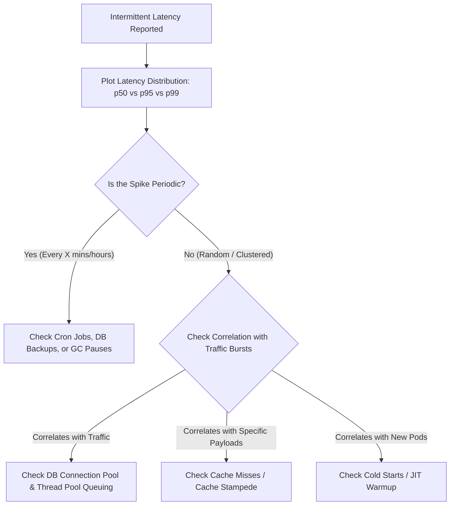

## Scenario

> **Your API sometimes responds quickly and sometimes slowly. How would you troubleshoot intermittent latency?**

Intermittent latency (spikes where 95% of requests take 50ms, but 5% take 4,000ms) is the most challenging type of performance bug. It usually stems from **asymmetric workloads, periodic background events, or resource contention**.


## Fast Revision (10-Second Recall)

- **Do Not Look at Averages:** Averages hide spikes ($p50 = 45\text{ms}$, but $p99 = 4,200\text{ms}$).
- **Top 6 Causes of Intermittent Latency:**
  1. **Garbage Collection (GC) Pauses:** Stop-the-world GC cycles freezing runtime threads periodically (Java JVM, Go, Node.js).
  2. **Cache Miss Spikes:** Requests hitting a cold cache or suffering a Cache Stampede.
  3. **Database Lock Contention:** Queries occasionally queuing behind periodic `UPDATE`/`DELETE` background jobs.
  4. **Connection Pool Exhaustion:** Requests occasionally waiting for an available DB socket during concurrency bursts.
  5. **Serverless Cold Starts / Auto-scaling Delays:** Spin-up latency when new pods/lambdas are provisioned.
  6. **Noisy Neighbor / CPU Throttling:** Cloud VMs or Kubernetes nodes intermittently starved of CPU.
- **Key Tools:** APM p95/p99 latency distribution histogram, JVM GC logs / Go execution tracer, `pg_stat_activity`.


## The 30-Second Spoken Script

If asked this in an interview, deliver this structured response:

> *Intermittent latency is classic tail latency behavior, so looking at averages is useless. I focus directly on the p95 and p99 distributions.*
>
> *First, I check the timing pattern: is the latency periodic (e.g., every 5 minutes or top of the hour) or concurrency-driven?*
>
> *If periodic, I correlate it with background cron jobs, scheduled database maintenance, or runtime Garbage Collection pauses.*
>
> *If concurrency-driven, I look for resource queuing: requests waiting for a free database connection pool socket, thread pool saturation, or serverless cold starts during autoscaling.*
>
> *Finally, I isolate cache behavior. An intermittent 3-second spike often happens when a high-traffic cache key expires, forcing 50 concurrent requests to hit the database simultaneously—a classic Cache Stampede. I fix that using probabilistic early expiration or mutex locks.*


## Diagnostic Lifecycle



### 1. Identify the Temporal Pattern
Plot a scatter plot of request durations over 24 hours:
- **Sawtooth Pattern:** Memory accumulates until a Major Stop-the-World GC kicks in $\rightarrow$ **Memory leak / GC tuning**.
- **Every 60 Minutes (Hourly):** Coincides with an analytics aggregation script or backup job $\rightarrow$ **Database contention**.
- **Bursty Clustered:** Random 5-second clusters under high concurrent load $\rightarrow$ **Connection pool starvation**.

### 2. Correlate with Payload Size & Cache Status
Compare fast traces against slow traces for the exact same URI:
- Is `cache_hit == false` on all slow requests?
- Did the slow request query an unusually large tenant or ID?


## Root Causes & Solutions Matrix

| Pattern | Root Cause | Solution |
| :--- | :--- | :--- |
| **Periodic 2–5s Spike** | JVM / Node.js Stop-the-World Garbage Collection pause. | Tune GC parameters (e.g., switch to ZGC/Shenandoah in Java, inspect memory allocation). |
| **Hourly Latency Burst** | Background ETL or data backup locking tables. | Run heavy batch jobs against Read Replicas; run during off-peak hours. |
| **Sudden Multi-User Spike** | **Cache Stampede (Thundering Herd):** Hot key expired; 100 requests hit DB simultaneously. | Implement Mutex Locking on cache miss or probabilistic early expiration (XFetch). |
| **High Concurrency Spikes** | DB connection pool size too small; requests block waiting for a socket. | Increase pool size; lower connection idle timeout; introduce PgBouncer. |
| **New Instance Scaling** | Cold start latency when Kubernetes HPA spins up new pods (JIT warmup). | Configure Kubernetes `readinessProbe` with initial delay; warm up caches before routing traffic. |


## Practical Debugging Commands & Code

### 1. Inspect Java JVM Garbage Collection Pauses
```bash
# Enable unified GC logging in Java 11+
-Xlog:gc*,gc+phases=debug:file=/var/log/app/gc.log:time,uptime,pid:filecount=5,filesize=100M

# Check for Stop-the-World pauses exceeding 500ms
grep -E 'Pause (Young|Full)' /var/log/app/gc.log | awk '{if ($NF > 500) print $0}'
```

### 2. Prevent Cache Stampede with Singleflight / Mutex
Prevent 100 concurrent requests from executing the slow DB query simultaneously:
```typescript
import { Mutex } from 'async-mutex';

const cacheMutex = new Mutex();

export async function getCachedProduct(productId: string) {
  // 1. Check Redis
  let data = await redis.get(`product:${productId}`);
  if (data) return JSON.parse(data);

  // 2. Acquire lock so only ONE request queries the DB
  const release = await cacheMutex.acquire();
  try {
    // Double check cache in case another thread just populated it
    data = await redis.get(`product:${productId}`);
    if (data) return JSON.parse(data);

    // Query DB and populate cache
    const freshData = await db.product.findById(productId);
    await redis.set(`product:${productId}`, JSON.stringify(freshData), 'EX', 300);
    return freshData;
  } finally {
    release();
  }
}
```


## Prevention & Senior Best Practices

1. **Monitor p99 and p99.9 Metrics:** Never judge system health by mean or median latency; establish SLO alerts strictly based on p95 and p99 thresholds.
2. **Implement Connection Pool Sizing Math:** Size connection pools deliberately based on database core count: $\text{Pool Size} = (\text{Core Count} \times 2) + \text{Effective Spindle Count}$.
3. **Use JIT and Cache Warmup Hooks:** Warm up newly provisioned application instances with synthetic traffic before the load balancer marks them as healthy.

