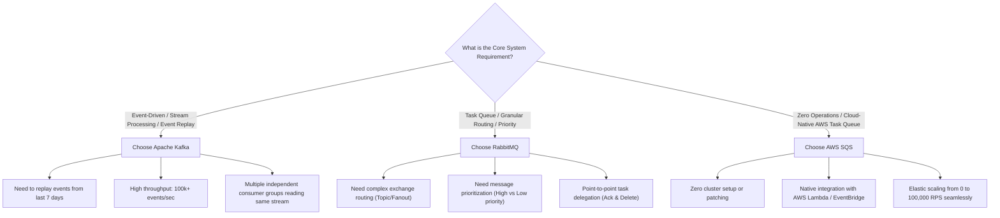

## Scenario

> **When would you use Kafka, RabbitMQ, or a message queue?**

Engineers often treat message technologies interchangeably, assuming Kafka is simply "a faster RabbitMQ". In reality, they are fundamentally different architectural beasts: **Kafka is an append-only distributed event log with replayability, RabbitMQ is a smart message broker with complex routing, and SQS is a serverless, zero-maintenance task queue**. The interviewer wants to test your **system trade-off evaluation**.


## Fast Revision (10-Second Recall)

- **The One-Sentence Breakdown:**
  - **RabbitMQ (Smart Broker, Dumb Consumer):** Best for **Task Queues & Complex Routing**. Deletes message once acknowledged. Supports priority queues, exchange routing (topic, fanout, direct).
  - **Apache Kafka (Dumb Broker, Smart Consumer):** Best for **High-Throughput Event Streaming & Analytics**. Messages are an immutable, persistent distributed log. Consumers track their own offsets and can **replay historical events** from 7 days ago.
  - **AWS SQS (Serverless Cloud Queue):** Best for **Simple, Zero-Ops Task Processing**. Infinite elastic scale with zero cluster administration.
- **Throughput Comparison:**
  - RabbitMQ: $20,000\text{--}50,000\text{ msgs/sec}$ per node.
  - Kafka: $1,000,000+\text{ msgs/sec}$ via sequential disk I/O and zero-copy OS memory transfers.
- **Key Discriminator:** Do you need to **replay events** historically? $\rightarrow$ Choose **Kafka**. Do you need **granular task routing / priorities**? $\rightarrow$ Choose **RabbitMQ**. Do you want **zero infrastructure maintenance**? $\rightarrow$ Choose **SQS**.


## The 30-Second Spoken Script

If asked this in an interview, deliver this structured response:

> *I choose between Kafka, RabbitMQ, and SQS based on whether our workload requires event streaming, complex task routing, or zero-maintenance task buffering.*
>
> *I choose Apache Kafka when we are building an Event-Driven Architecture or processing high-volume streams—like telemetry, clickstreams, or financial audit logs. Kafka is an immutable, partitioned log where consumers track their own offsets, allowing multiple distinct microservices to read and replay the same event stream independently without deleting messages.*
>
> *I choose RabbitMQ when we need a traditional Task Queue with complex routing logic. RabbitMQ excels at routing messages based on headers or wildcard topic keys, supports priority queues, and deletes messages immediately upon acknowledgment.*
>
> *Finally, I choose AWS SQS when we want a fully managed, serverless task queue for asynchronous worker offloading—like sending emails or resizing images—where our priority is zero operational maintenance and elastic scalability without managing clusters.*


## Diagnostic Lifecycle



### 1. Message Lifecycle Difference: Kafka vs RabbitMQ
- **RabbitMQ (Queue Model):** Producer sends message $\rightarrow$ Broker routes to Queue $\rightarrow$ Consumer reads message $\rightarrow$ Consumer sends ACK $\rightarrow$ **Broker permanently deletes message**.
- **Kafka (Log Model):** Producer writes record to Partition $\rightarrow$ Record appended to disk $\rightarrow$ Consumer A reads at Offset 104 $\rightarrow$ Consumer B reads at Offset 42 $\rightarrow$ **Record stays on disk for 7 days**. Any consumer can reset offset to 0 and re-read history!


## Root Causes & Solutions Matrix

| Dimension | Apache Kafka | RabbitMQ | AWS SQS |
| :--- | :--- | :--- | :--- |
| **Primary Paradigm** | Distributed Event Streaming Log | Traditional Message Broker | Managed Cloud Message Queue |
| **Message Ordering** | Strict within each partition | FIFO queue supported (slower) | FIFO or Standard (best-effort) |
| **Message Retention** | Persistent on disk (e.g., 7 days) | Deleted immediately upon ACK | Deleted upon ACK (max 14 days) |
| **Event Replayability** | **YES** (Reset consumer offset) | NO (Messages gone once acked) | NO |
| **Routing Flexibility** | Topic/Partition based | High (Direct, Topic, Fanout, Headers) | Basic |
| **Operational Overhead** | High (ZooKeeper/KRaft cluster) | Medium (Erlang/RabbitMQ nodes) | **Zero** (Fully managed by AWS) |
| **Throughput Ceiling** | Ultra-High ($1\text{M}+$/sec) | Medium ($30\text{k}$–$100\text{k}$/sec) | High (Unlimited standard) |


## Practical Debugging Commands & Code

### 1. Conceptual Kafka Consumer with Offset Replay (Node.js / KafkaJS)
```typescript
import { Kafka } from 'kafkajs';

const kafka = new Kafka({ clientId: 'analytics', brokers: ['kafka:9092'] });
const consumer = kafka.consumer({ groupId: 'analytics-group' });

export async function runKafkaConsumer() {
  await consumer.connect();
  await consumer.subscribe({ topic: 'user-clicks', fromBeginning: true }); // REPLAY ALL HISTORY!

  await consumer.run({
    eachMessage: async ({ topic, partition, message }) => {
      console.log(`[KAFKA] Offset: ${message.offset}, Value: ${message.value?.toString()}`);
    },
  });
}
```

### 2. RabbitMQ Topic Routing with Wildcards
```typescript
// Routing key matching: "order.us.created", "order.eu.cancelled"
// Consumer binds with: "order.*.created" or "order.#" (all order events)
await channel.assertExchange('order_events', 'topic', { durable: true });
await channel.bindQueue(queueName, 'order_events', 'order.*.created');
```


## Prevention & Senior Best Practices

1. **Do Not Over-Engineer with Kafka for Simple Tasks:** If all you need is a background worker to send registration emails, using Kafka is massive over-engineering; use SQS, RabbitMQ, or BullMQ instead.
2. **Design Kafka Partitions for Scaling:** Kafka scales consumer parallelism strictly by the number of partitions. A topic with 4 partitions can only support up to 4 concurrent consumer instances in the same consumer group.
3. **Always Ensure Consumer Idempotency:** Regardless of whether you use Kafka, RabbitMQ, or SQS, network retries will occasionally deliver duplicate messages (At-Least-Once delivery).

