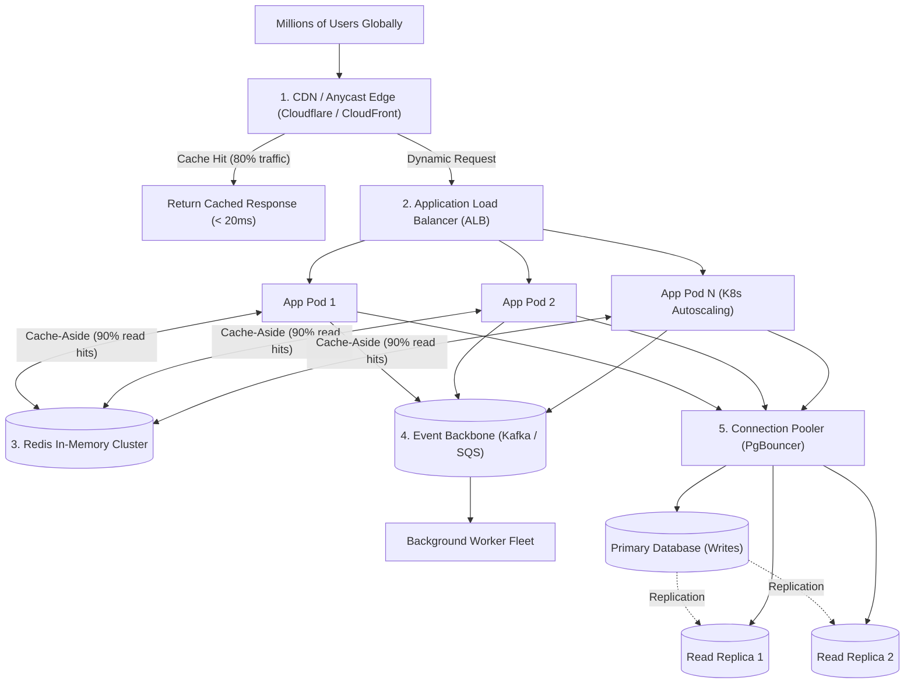

## Scenario

> **How would you design a backend service to handle millions of users?**

Serving millions of users requires evolving beyond a simple monolithic server and single database. A single database will hit disk I/O and connection ceilings, a single server will run out of memory, and synchronous inter-service calls will cause cascading failures. The interviewer expects an end-to-end **distributed architectural blueprint covering caching, stateless horizontal scaling, data partitioning, and asynchronous decoupling**.


## Fast Revision (10-Second Recall)

- **The Core Rule:** **Stateless at the Application Tier, Partitioned at the Database Tier, Cached at Every Tier.**
- **The 5-Tier High-Scale Blueprint:**
  1. **Edge Tier (CDN & Anycast DNS):** Terminate SSL at Cloudflare/CloudFront; cache static assets and semi-static GET APIs close to users.
  2. **Stateless Compute Tier (Kubernetes HPA):** Run horizontally scaled stateless containers behind Application Load Balancers; scale automatically on request latency and CPU.
  3. **In-Memory Caching Tier (Redis Cluster):** Cache hot database rows using Cache-Aside; achieve 90%+ cache hit ratio.
  4. **Database Tier (Read/Write Splitting & Sharding):** Route writes to primary; distribute reads across 3+ Read Replicas. Shard horizontally by `user_id` when table size exceeds 100M rows.
  5. **Asynchronous Backbone (Kafka / SQS):** Decouple heavy writes and side effects into background worker pools.
- **Key Metrics:** High Availability (99.99%), sub-100ms p95 latency, zero single point of failure (SPOF).


## The 30-Second Spoken Script

If asked this in an interview, deliver this structured response:

> *I design a backend service for millions of users using a layered, decoupled architecture where every tier scales horizontally and has zero single points of failure.*
>
> *At the edge, we use Anycast DNS and a CDN like Cloudflare to terminate TLS, absorb DDoS traffic, and cache public read responses close to global users.*
>
> *At the application tier, services are completely stateless and containerized. They run on Kubernetes behind an Application Load Balancer with Horizontal Pod Autoscaling, allowing the fleet to scale elastically from 10 to 100 pods based on traffic demand.*
>
> *At the data tier, to protect the database from millions of queries, we place a distributed Redis Cluster in front of it using the Cache-Aside pattern, absorbing up to 90% of read traffic in RAM.*
>
> *For remaining database queries, we split reads and writes: writes go to an active primary database, while reads are distributed across read replicas. As data scales into hundreds of millions of rows, we shard tables horizontally using a hash of the user ID.*
>
> *Finally, any non-blocking or write-heavy operation is decoupled asynchronously into an Apache Kafka event streaming backbone.*


## Diagnostic Lifecycle



### 1. Scaling Progression: 1k $\rightarrow$ 100k $\rightarrow$ 10 Million Users

| User Scale | Bottleneck | Architectural Evolution |
| :--- | :--- | :--- |
| **1,000 Users** | Development velocity | Monolith + Single relational database (Postgres on 1 server). |
| **50,000 Users** | Single server memory & CPU | Split Web Server and DB onto separate VMs; add basic connection pooling. |
| **500,000 Users** | Database read saturation | Add Redis caching layer; add 2 Read Replicas for `SELECT` queries. |
| **2,000,000 Users** | Monolith deployment velocity & DB write limits | Extract microservices; introduce Kafka/RabbitMQ message queues. |
| **10,000,000+ Users** | Single database disk limits & global latency | Multi-region deployment; horizontal database sharding; GeoDNS. |


## Root Causes & Solutions Matrix

| Scaling Tier | Bottleneck at Millions of Users | Architectural Solution |
| :--- | :--- | :--- |
| **Edge / Network** | Global transit latency and DDoS attacks. | Anycast GeoDNS + Multi-Region CDN edge caching. |
| **Compute Tier** | Web servers run out of CPU/memory during spikes. | Stateless containers; Kubernetes HPA scaling on RPS and CPU. |
| **Read Saturation** | Database disk IOPS maxed out on `SELECT` queries. | Redis Cluster (Cache-Aside) + Database Read Replicas. |
| **Write Saturation** | Single primary database cannot handle 20,000 writes/sec. | Database Sharding (Horizontal Partitioning) by `user_id`. |
| **Session State** | Session loss across distributed pods. | Stateless JWTs or centralized Redis session store. |
| **Cross-Service Latency** | Synchronous REST calls between 15 microservices cascade into timeouts. | Event-Driven Architecture with Apache Kafka. |


## Practical Debugging Commands & Code

### 1. Read/Write Splitting Database Client Configuration
```typescript
import { Pool } from 'pg';

// Dedicated connection pools for primary and replicas
const writePool = new Pool({ connectionString: process.env.DATABASE_PRIMARY_URL });
const readPool = new Pool({ connectionString: process.env.DATABASE_REPLICA_URL });

export async function executeQuery(sql: string, params: any[] = [], isWrite: boolean = false) {
  // Direct writes to primary; distribute reads across replicas
  const targetPool = isWrite ? writePool : readPool;
  const client = await targetPool.connect();
  try {
    return await client.query(sql, params);
  } finally {
    client.release();
  }
}
```

### 2. Database Sharding by User ID Hash
```typescript
const SHARD_COUNT = 4;
const shardPools = [
  new Pool({ connectionString: process.env.SHARD_0_URL }),
  new Pool({ connectionString: process.env.SHARD_1_URL }),
  new Pool({ connectionString: process.env.SHARD_2_URL }),
  new Pool({ connectionString: process.env.SHARD_3_URL }),
];

// Consistent hashing to determine which database shard holds user data
export function getShardForUser(userId: string): Pool {
  const hash = crypto.createHash('md5').update(userId).digest();
  const shardIndex = hash.readUInt32BE(0) % SHARD_COUNT;
  return shardPools[shardIndex];
}
```


## Prevention & Senior Best Practices

1. **Design for Failure (Chaos Engineering):** Regularly simulate the failure of a primary database, Redis node, or entire availability zone using Chaos Monkey to verify automated failovers.
2. **Never Allow Unpaginated Database Queries:** Enforce hard database limits (`LIMIT 50`) on all collection endpoints to prevent queries from scanning millions of records.
3. **Monitor p99 Latency Across All Distributed Boundaries:** Never judge a high-scale system by average latency; monitor p95, p99, and p99.9 latency distributions continuously.

