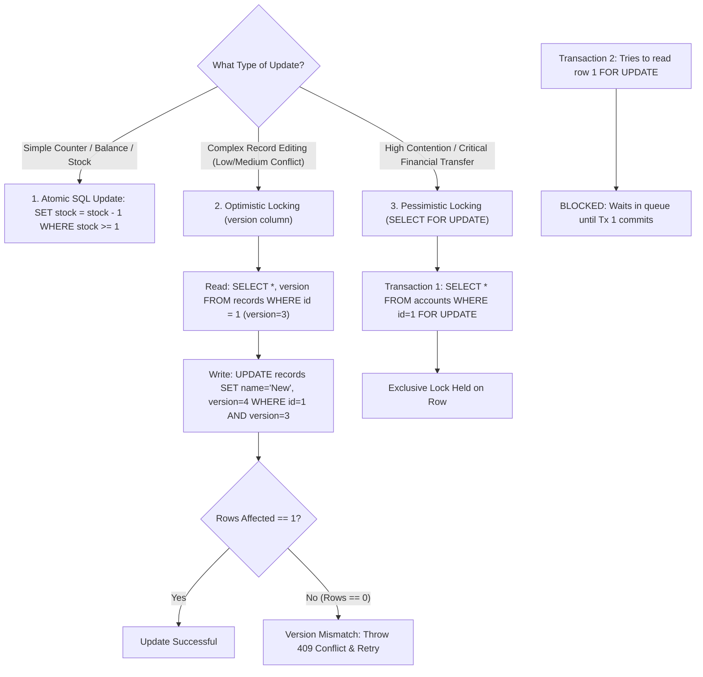

## Scenario

> **Two users update the same record simultaneously. How would you handle it?**

This is the classic **Lost Update Problem**: User A and User B both load Account balance ($100). User A deposits $50 (calculating $150). User B withdraws $30 (calculating $70). If both write back to the database concurrently, whichever transaction commits last overwrites and completely erases the other user's transaction. The interviewer expects a deep comparison between **Optimistic Locking and Pessimistic Locking**.


## Fast Revision (10-Second Recall)

- **The Problem:** Non-atomic Read-Modify-Write cycle causing lost updates.
- **Top 3 Solutions:**
  1. **Atomic In-Database Increment (Best for Counters/Balances):** `UPDATE accounts SET balance = balance - 30 WHERE id = 1 AND balance >= 30;` (Zero locking overhead!).
  2. **Optimistic Locking (Best for Low/Medium Contention):** Add a `version` column. Update only if version hasn't changed: `WHERE id = 1 AND version = 5`. If 0 rows updated, throw conflict and retry.
  3. **Pessimistic Locking (Best for High Contention / Financial Orders):** Explicitly lock the row during read: `SELECT * FROM accounts WHERE id = 1 FOR UPDATE;`. Blocks all other transactions until commit.
- **Key Tools:** SQL `version` column, `SELECT ... FOR UPDATE`, Redis Redlock for distributed cross-database locking.


## The 30-Second Spoken Script

If asked this in an interview, deliver this structured response:

> *I choose how to handle concurrent updates based on the level of contention and the business operation.*
>
> *For simple balance or inventory updates, the fastest and safest approach is an Atomic In-Database Update: `UPDATE products SET stock = stock - 1 WHERE id = 10 AND stock >= 1`. This uses row-level database locks for mere microseconds, eliminating race conditions entirely without complex locking.*
>
> *For complex business records—like editing a wiki article or customer profile—I use Optimistic Locking. We add a `version` number column. When updating, the query specifies `WHERE id = :id AND version = :currentVersion`. If another user committed an update first, the version has changed, zero rows are affected, and the application detects the conflict, prompting the user or retrying.*
>
> *For high-contention, high-value financial operations where retries are expensive, I use Pessimistic Locking using `SELECT ... FOR UPDATE`. This places an exclusive row lock on read, forcing the second user to wait until the first transaction commits.*


## Diagnostic Lifecycle



### 1. The Lost Update Race Condition Illustrated
1. $T_1$: Alice reads balance: $\$100$.
2. $T_2$: Bob reads balance: $\$100$.
3. $T_3$: Alice adds $\$50$, writes: `UPDATE SET balance = 150`.
4. $T_4$: Bob subtracts $\$30$, writes: `UPDATE SET balance = 70`.
5. **Result:** Alice's $\$50$ deposit is permanently lost! Balance is $\$70$ instead of $\$120$.


## Root Causes & Solutions Matrix

| Strategy | Performance | Complexity | Best Use Case |
| :--- | :--- | :--- | :--- |
| **Atomic SQL Update** | **Fastest** (Microseconds) | Low | Decrementing stock, adding credits, counters. |
| **Optimistic Locking** | **High** (No locks held) | Medium (Requires retry loop) | CMS editing, user settings, low-contention CRUD. |
| **Pessimistic Locking** | **Medium** (Holds row locks) | High (Risk of deadlocks) | Booking last concert seats, high-stakes finance. |
| **Distributed Lock (Redis)** | High | Complex | Operations spanning across multiple microservices or databases. |


## Practical Debugging Commands & Code

### 1. Optimistic Locking Implementation (TypeORM / Prisma Pattern)
```typescript
export async function updateArticleWithOptimisticLock(
  articleId: string,
  newContent: string,
  expectedVersion: number
) {
  // Execute update matching the expected version
  const result = await db.query(
    `UPDATE articles 
     SET content = $1, version = version + 1, updated_at = NOW() 
     WHERE id = $2 AND version = $3 
     RETURNING *`,
    [newContent, articleId, expectedVersion]
  );

  // If 0 rows updated, another user already bumped the version!
  if (result.rowCount === 0) {
    throw new ConflictException(
      'The record was modified by another user while you were editing. Please refresh and try again.'
    );
  }

  return result.rows[0];
}
```

### 2. Pessimistic Locking Implementation (PostgreSQL Transaction)
```sql
BEGIN;

-- Acquire exclusive row lock; blocks any concurrent transaction attempting to read FOR UPDATE
SELECT balance 
FROM accounts 
WHERE id = 42 
FOR UPDATE;

-- Perform calculation safely without race conditions
UPDATE accounts 
SET balance = balance - 100 
WHERE id = 42;

COMMIT; -- Row lock released here
```


## Prevention & Senior Best Practices

1. **Always Set `NOWAIT` or Lock Timeouts with Pessimistic Locks:** Avoid indefinite blocking: `SELECT ... FOR UPDATE NOWAIT` or `SET lock_timeout = '2s';` to fail fast rather than hang server threads.
2. **Favor Atomic Updates Over Read-Modify-Write:** Whenever possible, let SQL do the math: `UPDATE inventory SET count = count - 1 WHERE id = :id AND count > 0;`.
3. **Use Jittered Retries for Optimistic Lock Failures:** If an optimistic lock conflict occurs in an automated process, retry 2–3 times with a randomized backoff delay.

