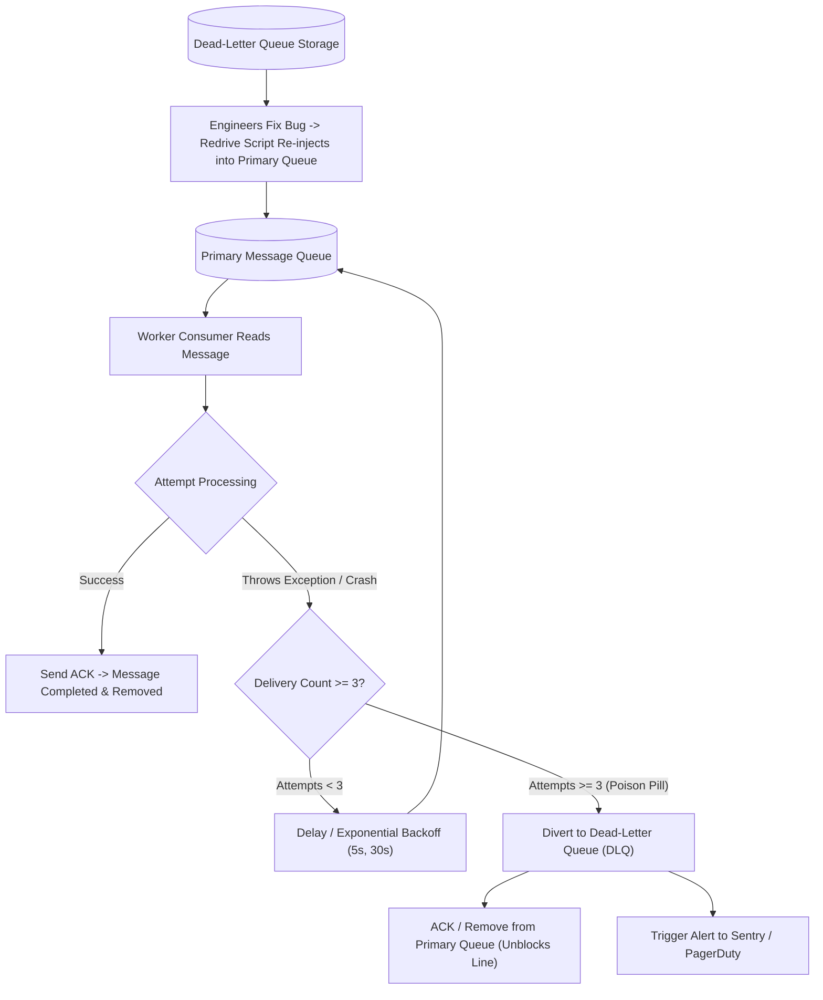

## Scenario

> **How would you handle messages that fail repeatedly?**

A "poison pill" is a malformed or edge-case message published to a queue (e.g., corrupted JSON, missing foreign key, unexpected null value) that causes the consumer worker to crash or throw an unhandled exception every time it is processed. If the worker rejects the message and requeues it back to the head of the queue, **the worker crashes again in an infinite loop**, blocking all subsequent healthy messages behind it. The interviewer is testing your **Dead-Letter Queue (DLQ), redrive, and quarantine architecture**.


## Fast Revision (10-Second Recall)

- **The Threat:** A single poison-pill message can take down an entire worker fleet and block thousands of healthy jobs behind it.
- **Top 4 Defensive Pillars:**
  1. **Maximum Delivery Count / Retry Limit:** Track attempt count on the message header (`x-delivery-count`). Never retry more than 3 to 5 times.
  2. **Exponential Backoff Between Retries:** Do not re-inject immediately; introduce a delay (e.g., 5s, 30s, 120s) so transient database locks can resolve.
  3. **Dead-Letter Queue (DLQ):** Once delivery count exceeds the threshold, divert the message to a DLQ and send an ACK to remove it from the primary queue.
  4. **DLQ Alerting & Redrive Tooling:** Send a PagerDuty alert when messages accumulate in the DLQ, and provide a CLI/dashboard to "redrive" (re-process) messages once the bug is patched.
- **Key Tools:** RabbitMQ Dead Letter Exchange (DLX), AWS SQS Redrive Policy, BullMQ Failed Queue, Kafka Error Topics.


## The 30-Second Spoken Script

If asked this in an interview, deliver this structured response:

> *I handle repeatedly failing messages by implementing a strict Dead-Letter Queue (DLQ) pattern combined with retry limits and automated alerting.*
>
> *When a message fails during processing, we catch the exception and inspect its delivery count. If the error is transient—like a temporary database connection timeout—we requeue the message with an exponential backoff delay, giving the downstream system time to recover.*
>
> *However, if the message fails repeatedly and reaches our maximum threshold—typically 3 attempts—we recognize it as a Poison Pill. The worker acknowledges the message from the main queue to unblock healthy traffic, and forwards the failed payload along with its error stack trace and metadata to a Dead-Letter Queue.*
>
> *We configure CloudWatch or Prometheus alerts on the DLQ depth. Once our engineering team deploys a fix for the underlying bug, we use a redrive script to pump the quarantined messages back into the main queue for clean processing.*


## Diagnostic Lifecycle



### 1. How a Poison Pill Blocks a Queue
Without a DLQ:
1. Message #1 is malformed: crashes Worker A.
2. Queue re-delivers Message #1 to Worker B: crashes Worker B.
3. Queue re-delivers Message #1 to Worker C: crashes Worker C.
4. **All worker pods are now in a crash loop**, and Messages #2 through #10,000 are completely stuck!


## Root Causes & Solutions Matrix

| Failure Mode | Behavior | Engineering Remedy |
| :--- | :--- | :--- |
| **Malformed JSON / Bad Schema** | Deterministic crash (permanent bug). | Fast-fail immediately to DLQ without wasting 3 retries. |
| **Downstream DB Locked** | Transient database lock or temporary network timeout. | Requeue with exponential backoff delay (e.g., 5s, 15s, 45s). |
| **Worker OOM on Large Payload** | Message exceeds memory limit; node kills worker with exit 137. | Limit message payload size to 256KB; offload large assets to S3. |
| **Undetected Poison Pills** | Messages failing quietly in DLQ with nobody noticing. | Prometheus alert: fire PagerDuty if `dlq_message_count > 0`. |


## Practical Debugging Commands & Code

### 1. AWS SQS Redrive Policy (Dead-Letter Queue Setup)
```json
// SQS Primary Queue Redrive Policy configuration
{
  "deadLetterTargetArn": "arn:aws:sqs:us-east-1:123456789012:orders-dlq",
  "maxReceiveCount": 3
}
// After 3 failed receives, AWS automatically moves the message to orders-dlq!
```

### 2. BullMQ Worker with Dead-Letter Quarantine & Logging
```typescript
import { Worker, Queue } from 'bullmq';

const dlqQueue = new Queue('orders-dlq', { connection: redisOptions });

export const orderWorker = new Worker(
  'orders-queue',
  async (job) => {
    // Business logic that might fail on bad data
    await processOrder(job.data);
  },
  {
    connection: redisOptions,
    attempts: 3,
    backoff: {
      type: 'exponential',
      delay: 2000, // 2s, 4s, 8s
    },
  }
);

// Listen for exhausted jobs
orderWorker.on('failed', async (job, err) => {
  if (!job) return;

  // If all 3 attempts have been exhausted, move to Dead-Letter Queue
  if (job.attemptsMade >= (job.opts.attempts || 3)) {
    console.error(`[POISON_PILL] Job ${job.id} failed permanently: ${err.message}. Moving to DLQ.`);

    await dlqQueue.add('poison-pill', {
      originalJobId: job.id,
      originalData: job.data,
      errorMessage: err.message,
      errorStack: err.stack,
      failedAt: new Date().toISOString(),
    });

    // Alert on-call team via monitoring webhook / Sentry
    await triggerSecurityAlert(`Poison pill detected in orders queue: Job ${job.id}`);
  }
});
```


## Prevention & Senior Best Practices

1. **Include Error Stack Traces in DLQ Payload:** When diverting a message to the DLQ, always attach the exception name, stack trace, and timestamp so developers can triage without guessing.
2. **Build a "Redrive" Admin CLI:** Provide an administrative script or UI button to re-inject messages from the DLQ back into the active queue once the bug is resolved.
3. **Validate Schemas on Ingestion:** Enforce schema validation (Zod / JSON Schema) at the Producer level before publishing to the queue, rejecting malformed messages before they ever reach workers.

