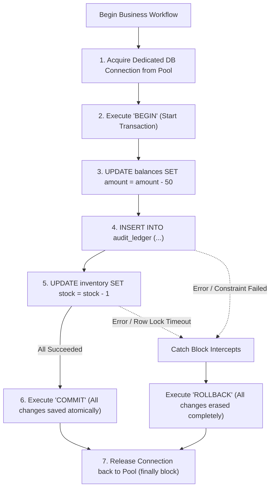

## Scenario

> **How would you handle transactions involving multiple database operations?**

In enterprise backends, a single business action frequently touches 3 to 5 separate tables: (1) Deduct balance, (2) Insert ledger row, (3) Decrement product stock, and (4) Update user reward points. If an uncaught exception, network drop, or server crash occurs at Step 3, **your database is left in a corrupted, half-mutated state**. The interviewer expects a rigorous design around **ACID transaction boundaries, connection leasing, and isolation levels**.


## Fast Revision (10-Second Recall)

- **The Golden Rule:** **All or Nothing (Atomicity).** Either all operations commit successfully together, or none of them do.
- **Top 4 Transaction Rules:**
  1. **Strict Scoping (Single Connection Lease):** All SQL statements in a transaction MUST execute on the **exact same physical database connection client** (`client.query('BEGIN')` ... `client.query('COMMIT')`).
  2. **Automatic Rollback on Error:** Wrap transaction blocks in `try / catch / finally`, executing `ROLLBACK` in the `catch` block and `client.release()` in the `finally` block.
  3. **Choose Appropriate Isolation Level:** Default `Read Committed` is sufficient for 95% of use cases. Use `Repeatable Read` or `Serializable` only for high-concurrency ledger operations.
  4. **Keep Transactions Ultra-Short:** Never execute HTTP calls, slow email dispatches, or heavy computations *inside* a database transaction block.
- **Key Tools:** PostgreSQL Transactions, Prisma `$transaction`, TypeORM `QueryRunner`, Knex `knex.transaction`.


## The 30-Second Spoken Script

If asked this in an interview, deliver this structured response:

> *I handle multi-operation database workflows by encapsulating all related mutations inside an atomic ACID transaction executed over a single dedicated database connection.*
>
> *First, I acquire a connection from the pool and immediately issue `BEGIN`. If every query completes successfully, we issue `COMMIT`. If any single statement fails or throws an exception, the `catch` block intercepts it and issues an immediate `ROLLBACK`, restoring the database to its exact prior state.*
>
> *Crucially, in the `finally` block, I guarantee that the database connection is returned to the pool to prevent connection leaks.*
>
> *Second, I enforce a strict performance rule: transactions must hold database locks for mere milliseconds. I never make outbound external HTTP calls or perform heavy password hashing inside a transaction.*
>
> *Finally, I select the proper isolation level—standard `Read Committed` for general CRUD, or `Repeatable Read` / `Serializable` for financial balance calculations.*


## Diagnostic Lifecycle



### 1. The Connection Pool Leak Trap
If you don't release the leased client in a `finally` block, every failed transaction permanently consumes one database connection. After 20 errors, your entire pool is dead!
```typescript
// DANGEROUS ANTI-PATTERN:
const client = await pool.connect();
await client.query('BEGIN');
// If this throws, client is NEVER released! Connection pool leaks!
await client.query('INSERT INTO ...');
await client.query('COMMIT');
client.release();
```


## Root Causes & Solutions Matrix

| Risk / Flaw | Consequence | Engineering Remedy |
| :--- | :--- | :--- |
| **Partial State Mutation** | Order created, but inventory decrement failed. | Wrap all statements in an atomic SQL Transaction (`BEGIN / COMMIT / ROLLBACK`). |
| **Connection Pool Depletion** | DB pool runs out of connections; API hangs. | Always release connection in a mandatory `finally` block (`client.release()`). |
| **Long-Running Lock Contention** | Slow external API call inside transaction blocks other users for 5s. | Move HTTP calls and hashing **outside** the transaction boundary. |
| **Dirty Reads & Phantoms** | Concurrent transaction reads uncommitted balance. | Use appropriate Isolation Level (`REPEATABLE READ` or `SERIALIZABLE`). |
| **Deadlocks from Inconsistent Ordering** | Tx 1 locks User A then User B; Tx 2 locks User B then User A. | Enforce consistent lock acquisition order (e.g., sort IDs alphabetically). |


## Practical Debugging Commands & Code

### 1. Robust Production Multi-Operation Transaction (Node.js & PostgreSQL)
```typescript
import { Pool, PoolClient } from 'pg';

const pool = new Pool();

export async function transferFunds(
  senderId: string,
  receiverId: string,
  amount: number
) {
  // 1. Acquire dedicated client from connection pool
  const client: PoolClient = await pool.connect();

  try {
    // 2. Start atomic transaction
    await client.query('BEGIN');

    // 3. Operation A: Deduct from sender (check balance atomically)
    const debitResult = await client.query(
      `UPDATE accounts 
       SET balance = balance - $1, updated_at = NOW() 
       WHERE id = $2 AND balance >= $1 
       RETURNING balance`,
      [amount, senderId]
    );

    if (debitResult.rowCount === 0) {
      throw new Error('Insufficient funds or sender account not found.');
    }

    // 4. Operation B: Credit to receiver
    const creditResult = await client.query(
      `UPDATE accounts 
       SET balance = balance + $1, updated_at = NOW() 
       WHERE id = $2 
       RETURNING balance`,
      [amount, receiverId]
    );

    if (creditResult.rowCount === 0) {
      throw new Error('Receiver account not found.');
    }

    // 5. Operation C: Insert ledger audit record
    await client.query(
      `INSERT INTO ledger_transactions (sender_id, receiver_id, amount, status) 
       VALUES ($1, $2, $3, 'COMPLETED')`,
      [senderId, receiverId, amount]
    );

    // 6. Commit all operations together atomically
    await client.query('COMMIT');
    return { success: true };
  } catch (error) {
    // 7. Atomic rollback on ANY error: All operations completely undone!
    console.error('[TRANSACTION_FAILED] Rolling back transaction:', error);
    await client.query('ROLLBACK');
    throw error;
  } finally {
    // 8. CRITICAL: Release connection back to pool under all circumstances
    client.release();
  }
}
```


## Prevention & Senior Best Practices

1. **Keep Transactions Under 50ms:** Design transactions so that they execute pure, pre-validated in-database queries without waiting on slow application computation.
2. **Never Make External Calls Inside SQL Transactions:** Execute third-party APIs (Stripe, Twilio, S3) before or after the transaction, or manage them using the Saga pattern.
3. **Configure Statement Timeouts:** Always set `SET statement_timeout = '5s';` so runaway transactions cannot hold table locks indefinitely.

