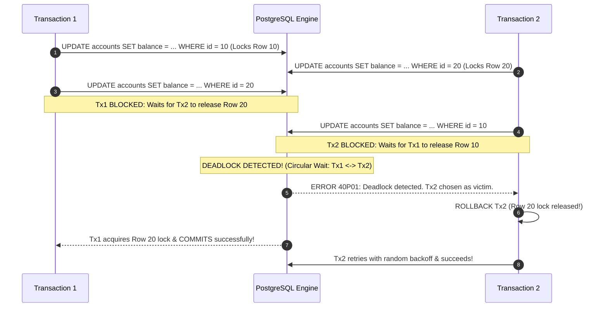

## Scenario

> **How would you handle deadlocks?**

A database deadlock occurs when two or more transactions hold locks that the other transactions need to proceed, creating an intractable circular dependency ($A \rightarrow \text{waits for } B \rightarrow \text{waits for } A$). Neither transaction can advance. The relational database engine must intervene, pick a "victim" transaction, kill it with error code `40P01 (deadlock_detected)`, and roll it back. The interviewer is testing your ability to **diagnose the deadlock graph, resolve lock ordering, and implement automated transaction retries**.


## Fast Revision (10-Second Recall)

- **The Mathematical Cause:** **Circular Wait Condition.** Transaction 1 locks Row A, then wants Row B. Transaction 2 locks Row B, then wants Row A.
- **Top 4 Solutions to Eliminate Deadlocks:**
  1. **Strict Lock Ordering (The Ultimate Cure):** Always acquire locks on rows in the exact same deterministic order across the entire codebase (e.g., sort primary key IDs ascending: `ORDER BY id ASC`).
  2. **Automated Transaction Retry with Jitter:** Catch PostgreSQL error `40P01` in application code, wait a randomized backoff (e.g., 50–200ms), and re-execute the transaction from the beginning.
  3. **Minimize Transaction Duration:** Keep transactions under 10–20ms; never put HTTP calls, file I/O, or complex computations inside a transaction block.
  4. **Lower Lock Level:** Use `SELECT ... FOR SHARE` or optimistic locking with a `version` column instead of heavy exclusive locks (`FOR UPDATE`).
- **Key Tools:** PostgreSQL `deadlock_timeout` (default 1s), Error Code `40P01`, `pg_stat_activity`, `pg_locks`.


## The 30-Second Spoken Script

If asked this in an interview, deliver this structured response:

> *I handle database deadlocks at two levels: preventing them architecturally through deterministic lock ordering, and handling them gracefully at runtime with automated retries.*
>
> *Deadlocks are almost always caused by inconsistent lock acquisition order—for example, Transaction 1 locks User A and requests User B, while Transaction 2 locks User B and requests User A.*
>
> *To eliminate the circular wait condition, I enforce a strict global ordering rule: whenever an operation needs to lock multiple rows—like transferring money between two accounts—we always sort the IDs and acquire locks in ascending order. Both transactions will attempt to lock the lower ID first, turning a deadlock into a safe sequential wait.*
>
> *At the application level, because distributed edge cases can still occur, our database driver wraps transactions in a retry loop. When PostgreSQL detects a cycle and terminates the victim transaction with error code `40P01`, our catch block rolls back, waits a randomized backoff delay with jitter, and retries the entire transaction automatically.*


## Diagnostic Lifecycle



### 1. The Mathematical Solution: Deterministic Sorting
To guarantee deadlocks are impossible between two accounts:
```typescript
// ALWAYS lock smaller ID first, then larger ID:
const [firstId, secondId] = [fromId, toId].sort((a, b) => a.localeCompare(b));

await client.query('SELECT * FROM accounts WHERE id = $1 FOR UPDATE', [firstId]);
await client.query('SELECT * FROM accounts WHERE id = $2 FOR UPDATE', [secondId]);
```
Both Transaction 1 and Transaction 2 will now contend for `firstId`. The winner gets both; the loser waits cleanly. Circular wait is eliminated!


## Root Causes & Solutions Matrix

| Cause of Deadlock | Mechanism | Prevention Technique |
| :--- | :--- | :--- |
| **Inconsistent Update Order** | Tx 1 updates table A then B; Tx 2 updates B then A. | Enforce consistent access order across all codebase handlers. |
| **Multi-Row Batch Updates** | Concurrent transactions updating overlapping rows in arbitrary order. | Sort row IDs ascending before issuing `UPDATE ... WHERE id IN (...)`. |
| **Foreign Key Cascades** | Updating child table locks parent row unexpectedly. | Add indexes to all foreign key columns to avoid table-level locks. |
| **Long-Running Transactions** | Locks held for seconds while doing heavy computation. | Move non-DB logic outside the transaction boundary. |


## Practical Debugging Commands & Code

### 1. Inspecting Active Locks and Blocked Processes
```sql
-- View all currently blocked processes and who is blocking them
SELECT 
    blocked_activity.pid AS blocked_pid,
    blocked_activity.usename AS blocked_user,
    blocking_activity.pid AS blocking_pid,
    blocking_activity.usename AS blocking_user,
    blocked_activity.query AS blocked_query,
    blocking_activity.query AS blocking_query
FROM pg_catalog.pg_locks blocked_locks
JOIN pg_catalog.pg_stat_activity blocked_activity ON blocked_activity.pid = blocked_locks.pid
JOIN pg_catalog.pg_locks blocking_locks 
    ON blocking_locks.locktype = blocked_locks.locktype
    AND blocking_locks.database IS NOT DISTINCT FROM blocked_locks.database
    AND blocking_locks.relation IS NOT DISTINCT FROM blocked_locks.relation
    AND blocking_locks.page IS NOT DISTINCT FROM blocked_locks.page
    AND blocking_locks.tuple IS NOT DISTINCT FROM blocked_locks.tuple
    AND blocking_locks.virtualxid IS NOT DISTINCT FROM blocked_locks.virtualxid
    AND blocking_locks.transactionid IS NOT DISTINCT FROM blocked_locks.transactionid
    AND blocking_locks.classid IS NOT DISTINCT FROM blocked_locks.classid
    AND blocking_locks.objid IS NOT DISTINCT FROM blocked_locks.objid
    AND blocking_locks.objsubid IS NOT DISTINCT FROM blocked_locks.objsubid
    AND blocking_locks.pid != blocked_locks.pid
JOIN pg_catalog.pg_stat_activity blocking_activity ON blocking_activity.pid = blocking_locks.pid
WHERE NOT blocked_locks.granted;
```

### 2. Transaction Wrapper with Automatic Deadlock Retry
```typescript
export async function runWithDeadlockRetry<T>(
  operation: (client: PoolClient) => Promise<T>,
  maxRetries = 3
): Promise<T> {
  let attempts = 0;

  while (true) {
    const client = await pool.connect();
    try {
      await client.query('BEGIN');
      const result = await operation(client);
      await client.query('COMMIT');
      return result;
    } catch (error: any) {
      await client.query('ROLLBACK');
      attempts++;

      // PostgreSQL error code '40P01' is deadlock_detected
      if (error.code === '40P01' && attempts < maxRetries) {
        // Full jitter backoff: random delay between 50ms and 200ms
        const delay = Math.floor(Math.random() * 150) + 50;
        console.warn(`[DEADLOCK] Deadlock detected. Retrying attempt ${attempts} in ${delay}ms...`);
        await new Promise((resolve) => setTimeout(resolve, delay));
        continue;
      }

      throw error;
    } finally {
      client.release();
    }
  }
}
```


## Prevention & Senior Best Practices

1. **Sort Primary Keys Before Multi-Row Locking:** Whenever a batch update or transfer locks multiple rows, sort the primary keys ascending (`[idA, idB].sort()`) before acquiring locks.
2. **Tune PostgreSQL `deadlock_timeout`:** The default is `1s`. Setting it too low causes unnecessary false-positive deadlock checks; setting it too high causes blocked queries to hold server connections open.
3. **Index All Foreign Keys:** Missing indexes on foreign key columns cause PostgreSQL to acquire full table locks during `DELETE` or `UPDATE` on parent tables, triggering massive deadlock spikes.

