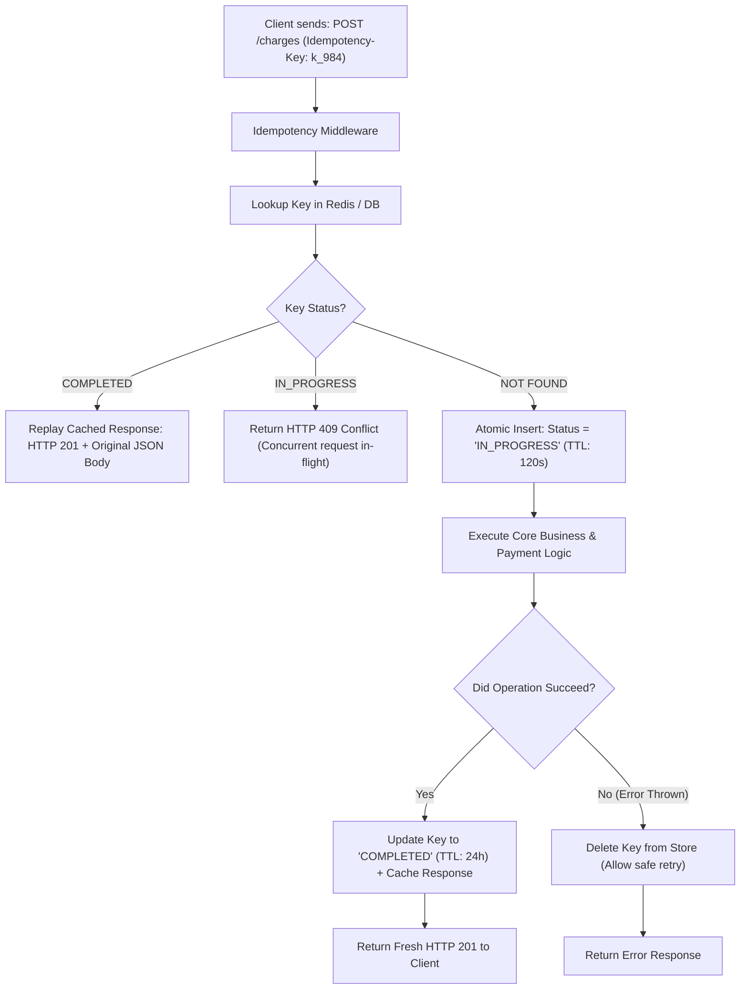

## Scenario

> **How would you implement idempotency?**

In mathematics and computer science, an operation is **idempotent** if applying it multiple times produces the identical result as applying it once ($f(f(x)) = f(x)$). While HTTP `GET`, `PUT`, and `DELETE` are inherently idempotent by specification, `POST` is non-idempotent. In distributed networks where timeouts and retries are routine, a non-idempotent `POST /charges` will cause catastrophic double-billing. The interviewer expects an implementation adhering to the **IETF Idempotency-Key specification**.


## Fast Revision (10-Second Recall)

- **The Standard:** **IETF Draft: The Idempotency-Key HTTP Header Field**.
- **Top 4 States of an Idempotent Request:**
  1. `NEW`: First time seeing the key $\rightarrow$ acquire lock and begin processing.
  2. `IN_PROGRESS`: Key is currently executing in a worker or thread $\rightarrow$ return `409 Conflict` or wait.
  3. `COMPLETED`: Key was successfully executed previously $\rightarrow$ return the cached response (exact same HTTP status, headers, and JSON body).
  4. `FAILED`: Key execution failed $\rightarrow$ evict key so the client can safely retry.
- **Deduplication Window:** Typically 24 hours (keys expire automatically via Redis/PostgreSQL TTL).
- **Key Tools:** Redis `SET key value NX EX 86400`, PostgreSQL `idempotency_keys` table.


## The 30-Second Spoken Script

If asked this in an interview, deliver this structured response:

> *I implement API idempotency using the IETF `Idempotency-Key` specification, leveraging a centralized Redis or PostgreSQL persistence store.*
>
> *When a client issues a mutating request like `POST /payments`, it includes a unique UUID in the `Idempotency-Key` header.*
>
> *Our API Gateway or middleware intercepts the request and performs an atomic check. If the key exists with status 'COMPLETED', we immediately return the cached response payload and HTTP status code without re-running business logic.*
>
> *If the key does not exist, we insert it with status 'PROCESSING' and an expiration of 24 hours using an atomic `SETNX`. The request executes its database operations within a transaction.*
>
> *Once the transaction commits, we update the idempotency record to 'COMPLETED' and save the serialized response.*
>
> *If the request fails with a 500 or network drop, we purge the processing key so the client is free to retry.*


## Diagnostic Lifecycle



### 1. The IETF Specification Compliance
- If a client sends an `Idempotency-Key` with a **different payload** than the original request, the server must reject it with `422 Unprocessable Entity` or `400 Bad Request` (payload mismatch).
- Store a SHA-256 hash of the request body alongside the key to detect payload tampering!


## Root Causes & Solutions Matrix

| Risk / Failure Mode | Scenario | Architectural Prevention |
| :--- | :--- | :--- |
| **Double Billing on Retry** | Client network times out after backend charged card; client retries. | Return cached order from idempotency record; do not re-charge card. |
| **Payload Tampering** | Attacker uses same key but changes amount from $10 to $1,000. | Store `request_hash = SHA256(body)`; reject if hashes do not match. |
| **Worker Crash During Processing** | Server crashes mid-execution; key stuck in `IN_PROGRESS` forever. | Set an aggressive TTL (e.g., 60 seconds) on `IN_PROGRESS` state. |
| **Memory Bloat** | Billions of idempotency keys accumulate over years. | Enforce a 24-hour expiration window; archive older keys or let Redis auto-evict. |


## Practical Debugging Commands & Code

### 1. Robust Production Idempotency Middleware (TypeScript & Redis)
```typescript
import { Request, Response, NextFunction } from 'express';
import crypto from 'crypto';
import Redis from 'ioredis';

const redis = new Redis();

export function idempotencyMiddleware(ttlSeconds: number = 86400) {
  return async (req: Request, res: Response, next: NextFunction) => {
    const key = req.headers['idempotency-key'] as string;

    // Skip if not a mutating request or no key provided
    if (!['POST', 'PATCH'].includes(req.method) || !key) {
      return next();
    }

    const redisKey = `idempotency:${req.user?.id || 'anon'}:${key}`;
    const requestPayloadHash = crypto
      .createHash('sha256')
      .update(JSON.stringify(req.body || {}))
      .digest('hex');

    // 1. Check existing record
    const recordRaw = await redis.get(redisKey);
    if (recordRaw) {
      const record = JSON.parse(recordRaw);

      // Security check: Payload must match original request
      if (record.payloadHash !== requestPayloadHash) {
        return res.status(422).json({
          error: 'Idempotency key was previously used with a different request payload.',
        });
      }

      if (record.status === 'COMPLETED') {
        // Return identical cached response
        res.setHeader('X-Cache-Lookup', 'HIT - IDEMPOTENT REPLAY');
        return res.status(record.statusCode).json(record.body);
      }

      if (record.status === 'IN_PROGRESS') {
        return res.status(409).json({
          error: 'A request with this idempotency key is currently being processed.',
        });
      }
    }

    // 2. Lock key with IN_PROGRESS state (short 60s TTL in case of crash)
    const acquired = await redis.set(
      redisKey,
      JSON.stringify({ status: 'IN_PROGRESS', payloadHash: requestPayloadHash }),
      'EX',
      60,
      'NX'
    );

    if (!acquired) {
      return res.status(409).json({ error: 'Concurrent conflicting request in-flight.' });
    }

    // 3. Intercept response to record result
    const originalJson = res.json.bind(res);
    res.json = (body: any) => {
      if (res.statusCode >= 200 && res.statusCode < 300) {
        // Update to COMPLETED with 24-hour TTL
        redis.set(
          redisKey,
          JSON.stringify({
            status: 'COMPLETED',
            statusCode: res.statusCode,
            payloadHash: requestPayloadHash,
            body,
          }),
          'EX',
          ttlSeconds
        );
      } else {
        // Failed: Delete lock so client can retry
        redis.del(redisKey);
      }
      return originalJson(body);
    };

    next();
  };
}
```


## Prevention & Senior Best Practices

1. **Verify Payload Fingerprints:** Always hash the incoming request body and verify that retries with the same `Idempotency-Key` match the initial body to detect accidental key reuse.
2. **Standardize Client Key Generation:** Instruct client SDKs to generate cryptographically random UUIDv4 keys once per user intent (not once per network attempt).
3. **Persist Mission-Critical Keys in PostgreSQL:** For banking/financial operations, store idempotency records inside the primary relational database within the same ACID transaction as the financial ledger.

