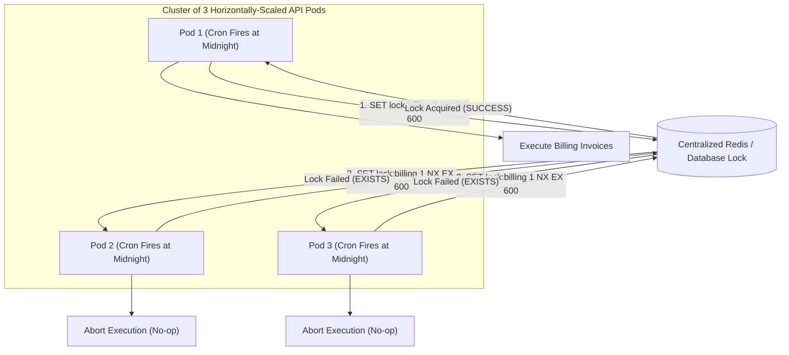

## Scenario

> **How would you implement a scheduled job?**

Running an in-process cron scheduler (e.g., `node-cron` or `setInterval`) works fine on a single development server. However, in production with 10 horizontally-scaled pods behind a load balancer, **the scheduled job will fire simultaneously on all 10 instances**, charging customers 10 times, sending duplicate emails, and locking the database. The interviewer is testing your **distributed scheduled execution strategy**.


## Fast Revision (10-Second Recall)

- **The Problem:** In a cluster of $N$ instances, an in-process cron fires $N$ times concurrently.
- **Top 3 Production Solutions:**
  1. **Platform-Level Schedulers (Recommended):** Kubernetes `CronJob` or AWS EventBridge triggering an isolated container/lambda that executes once and terminates.
  2. **Distributed Mutex Locking (ShedLock / Redlock):** In-process cron fires on all pods, but the first pod to acquire a Redis/Postgres lock runs the job; all other pods immediately abort.
  3. **Queue-Based Schedulers (BullMQ Repeatable Jobs):** Redis-backed job queue manages schedule timestamps atomically; exactly one worker receives the job.
- **Key Tools:** Kubernetes CronJob, ShedLock / Redlock, BullMQ Repeatable Jobs, AWS EventBridge.


## The 30-Second Spoken Script

If asked this in an interview, deliver this structured response:

> *I implement scheduled jobs depending on our infrastructure architecture, ensuring that tasks execute exactly once regardless of how many instances are running.*
>
> *In containerized Kubernetes environments, the cleanest approach is an external Platform-Level CronJob. Instead of running a scheduler inside our application servers, Kubernetes provisions an isolated pod on schedule (e.g., at midnight), executes the batch script, and tears down the pod. This keeps our web servers completely stateless and eliminates duplicate execution.*
>
> *If the schedule must be managed within application code, I use Distributed Locking via Redis or ShedLock. When the cron triggers across all 10 instances, every instance attempts to acquire an exclusive lock with an expiration window—for example, `SET lock:daily-report 1 NX EX 300`.*
>
> *Only the single instance that successfully acquires the lock executes the job; the other 9 instances immediately exit without doing any duplicate work.*


## Diagnostic Lifecycle



### 1. The Distributed Locking Algorithm (Redis `NX EX`)
To ensure a cron job runs once across $N$ instances:
```bash
# Atomic command: Only set key if it does NOT exist (NX) with 10-minute expiry (EX 600)
SET lock:daily-payouts instance_id_1 NX EX 600
```
- **Returns `OK`:** You hold the exclusive lock. Run the job!
- **Returns `nil`:** Another instance already grabbed the lock. Exit immediately!


## Root Causes & Solutions Matrix

| Scheduling Model | Architecture | Pros & Cons |
| :--- | :--- | :--- |
| **In-Process (`node-cron` without locks)** | Anti-Pattern | **Dangerous**: Fires duplicate times on every deployed pod; crashes DB. |
| **Kubernetes `CronJob`** | Cloud-Native | **Optimal**: Zero server overhead; isolated resources; automatic retries. |
| **Distributed Lock (Redlock / ShedLock)** | Application-Level | **Flexible**: Runs in existing code; requires reliable Redis / DB lock table. |
| **Cloud EventBridge + Lambda** | Serverless | **Highly Reliable**: Zero infrastructure to maintain; pay only per trigger. |


## Practical Debugging Commands & Code

### 1. Distributed Lock Cron Implementation (Node.js & Redis)
```typescript
import cron from 'node-cron';
import Redis from 'ioredis';

const redis = new Redis();

export function scheduleDistributedJob(
  cronExpression: string,
  lockKey: string,
  lockTtlSeconds: number,
  task: () => Promise<void>
) {
  cron.schedule(cronExpression, async () => {
    const instanceId = process.env.HOSTNAME || `instance_${Math.random()}`;
    const fullLockKey = `lock:cron:${lockKey}`;

    // 1. Try to acquire exclusive lock atomically
    const acquired = await redis.set(fullLockKey, instanceId, 'EX', lockTtlSeconds, 'NX');

    if (!acquired) {
      // Another instance won the race: exit silently
      console.log(`[CRON] Lock ${fullLockKey} held by another instance. Skipping.`);
      return;
    }

    console.log(`[CRON] Lock acquired by ${instanceId}. Executing ${lockKey}...`);
    try {
      await task();
    } catch (error) {
      console.error(`[CRON] Error executing ${lockKey}:`, error);
    }
    // Do NOT immediately delete the lock; let TTL expire so other instances don't re-trigger in same minute!
  });
}

// Usage: Run every night at midnight (Lock lasts for 55 seconds to prevent re-triggering)
scheduleDistributedJob('0 0 * * *', 'midnight-billing', 55, async () => {
  await processDailyBilling();
});
```

### 2. Kubernetes CronJob Manifest Example
```yaml
apiVersion: batch/v1
kind: CronJob
metadata:
  name: daily-cleanup-job
spec:
  schedule: "0 2 * * *" # Every day at 2:00 AM
  concurrencyPolicy: Forbid # Prevent overlapping jobs if previous run is slow
  jobTemplate:
    spec:
      template:
        spec:
          restartPolicy: OnFailure
          containers:
          - name: cleanup-task
            image: my-backend-api:latest
            command: ["npm", "run", "job:cleanup"]
```


## Prevention & Senior Best Practices

1. **Set `concurrencyPolicy: Forbid` in Kubernetes:** Ensure that if a scheduled job takes 65 minutes, the next scheduled job does not launch and conflict with the active run.
2. **Make Scheduled Jobs Idempotent:** Even with distributed locks, design jobs so that if they are accidentally executed twice, the duplicate run produces zero negative side effects.
3. **Alert on Missed Executions (Dead Man's Snitch):** Use heartbeat monitoring services (like Healthchecks.io or Cronitor) where the scheduled job pings an endpoint upon completion. If no ping is received within the expected window, on-call is alerted.

