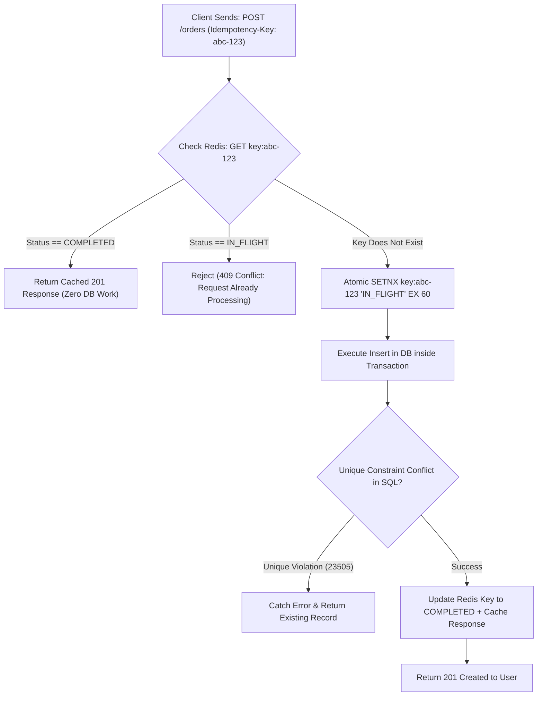

## Scenario

> **How would you prevent duplicate requests from creating duplicate records?**

A user on a slow mobile connection clicks "Submit Order", notices nothing happened for 2 seconds, and clicks the button two more times. If the backend handles each click concurrently, three separate orders are inserted into the database and the customer is billed three times. The interviewer expects a **multi-tiered deduplication defense combining database constraints, application idempotency, and distributed locks**.


## Fast Revision (10-Second Recall)

- **The Golden Rule:** **The Database is the ultimate source of truth.** Application code race conditions will always leak duplicates unless backed by a unique constraint.
- **Top 4 Layers of Deduplication:**
  1. **Database Unique Constraints (The Foundation):** `UNIQUE (user_id, idempotency_key)` or `UNIQUE (user_id, order_reference)`. The database engine guarantees exactly one insert ($O(1)$ rejection).
  2. **Idempotency Key Header (`Idempotency-Key: uuid`):** Store key in Redis/DB with status `PROCESSING` $\rightarrow$ `COMPLETED` + cached response.
  3. **Distributed Lock during Processing:** Acquire a Redis mutex lock (`SET lock:checkout:userId 1 NX EX 10`) so parallel requests are rejected immediately.
  4. **Client-Side Form Disabling:** Disable the submit button immediately upon the first click and show a spinner.
- **Key Tools:** PostgreSQL `UNIQUE INDEX`, `ON CONFLICT DO NOTHING`, Redis `SETNX`, IETF Idempotency-Key.


## The 30-Second Spoken Script

If asked this in an interview, deliver this structured response:

> *I prevent duplicate records using a defense-in-depth strategy across the client, API gateway, and database layers.*
>
> *First, at the database layer—which is the only infallible barrier against race conditions—I enforce Unique Constraints on natural business keys, such as `UNIQUE(user_id, external_transaction_id)` or an explicit `idempotency_key` column.*
>
> *Second, at the API layer, all mutating endpoints require an `Idempotency-Key` header generated by the frontend. When a request arrives, we execute an atomic `SETNX` in Redis.*
>
> *If the key already exists and is marked 'COMPLETED', we immediately return the cached response without touching business logic or the database. If it is marked 'PROCESSING', we return a 409 Conflict, telling the client a duplicate request is currently in-flight.*
>
> *Finally, on the frontend, we disable the submission button upon the first click to prevent accidental double-taps.*


## Diagnostic Lifecycle



### 1. Why Application Checks Alone Fail (The Race Condition)
```typescript
// FLAWED LOGIC: Prone to race conditions!
const exists = await db.order.findFirst({ where: { orderRef: req.body.ref } });
if (!exists) {
  // If Request 1 and Request 2 arrive at the same millisecond,
  // BOTH evaluate exists as false, and BOTH execute the insert!
  await db.order.create({ data: req.body });
}
```
**Fix:** The database MUST have a `UNIQUE(order_ref)` constraint. When Request 2 attempts to insert, PostgreSQL throws error code `23505 (unique_violation)`.


## Root Causes & Solutions Matrix

| Vector | Failure Mode | Architectural Defense |
| :--- | :--- | :--- |
| **Double Button Click** | User rapidly clicks "Pay" twice within 300ms. | Client-side button disable + Backend atomic Redis lock (`SETNX`). |
| **Network Timeout Retry** | Client retries because response timed out, but server already created record. | **Idempotency Keys**: Server returns the existing record instead of creating another. |
| **Parallel Concurrent Webhooks** | Stripe sends 2 identical webhook events concurrently across 2 pods. | Database unique constraint on `stripe_event_id` (`ON CONFLICT DO NOTHING`). |
| **Distributed Multi-Pod Insert** | Pod A and Pod B both insert identical records at same second. | Unique Index in PostgreSQL / MySQL. |


## Practical Debugging Commands & Code

### 1. PostgreSQL Safe Upsert / Idempotent Insert (`ON CONFLICT`)
```sql
-- Insert only if the idempotency key hasn't been used yet; otherwise do nothing
INSERT INTO orders (id, user_id, idempotency_key, total, status)
VALUES (gen_random_uuid(), 42, 'client-req-94821', 199.99, 'PAID')
ON CONFLICT (idempotency_key) 
DO NOTHING;

-- Check rows affected: If 0, it was a duplicate request!
```

### 2. Atomic Deduplication Guard via Redis (TypeScript)
```typescript
import { Request, Response, NextFunction } from 'express';
import Redis from 'ioredis';

const redis = new Redis();

export async function deduplicationGuard(req: Request, res: Response, next: NextFunction) {
  const key = req.headers['idempotency-key'] as string;
  if (!key) return next();

  const redisKey = `idempotency:${key}`;

  // 1. Check existing state
  const existing = await redis.get(redisKey);
  if (existing) {
    const parsed = JSON.parse(existing);
    if (parsed.status === 'COMPLETED') {
      // Replay identical response without executing controller!
      return res.status(parsed.statusCode).json(parsed.body);
    }
    // Still in flight from parallel click
    return res.status(409).json({ error: 'Duplicate request currently processing. Please wait.' });
  }

  // 2. Lock key with 60-second TTL
  await redis.set(redisKey, JSON.stringify({ status: 'PROCESSING' }), 'EX', 60, 'NX');

  // 3. Intercept response to cache upon completion
  const originalJson = res.json.bind(res);
  res.json = (body: any) => {
    if (res.statusCode >= 200 && res.statusCode < 300) {
      redis.set(redisKey, JSON.stringify({ status: 'COMPLETED', statusCode: res.statusCode, body }), 'EX', 86400); // 24h
    } else {
      redis.del(redisKey); // Clear lock if failed so user can legitimately retry
    }
    return originalJson(body);
  };

  next();
}
```


## Prevention & Senior Best Practices

1. **Always Add Unique Constraints:** Never deploy a table where duplicate records are forbidden without backing it with a composite `UNIQUE` index in the database migration.
2. **Standardize on IETF Idempotency-Key:** Use the standard `Idempotency-Key` header across all mutating REST endpoints.
3. **Clean Up Locks on Failure:** If a transaction fails with a 500 error, delete the processing lock immediately from Redis so legitimate client retries are not blocked.

