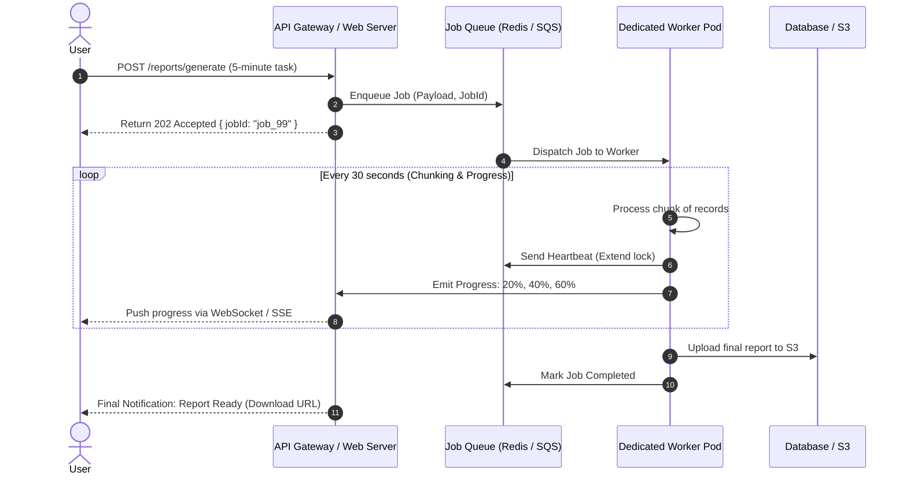

## Scenario

> **How would you process a task that takes 5 minutes?**

Running a 5-minute task (e.g., training a machine learning model, compiling a massive analytics report, generating video renders, or migrating a 100,000-row dataset) over a synchronous HTTP connection is impossible: the client browser will drop, the reverse proxy will time out at 60 seconds, and if the container restarts at minute 4, all progress is permanently lost. The interviewer expects a **resilient asynchronous worker pipeline with progress tracking, heartbeats, and checkpointing**.


## Fast Revision (10-Second Recall)

- **The Core Rule:** Long-running tasks **must never execute inside the web server process**. They belong in independent worker pools with persistent job state.
- **Top 5 Architectural Pillars:**
  1. **Immediate `202 Accepted` Handshake:** Client submits request $\rightarrow$ server generates Job UUID $\rightarrow$ returns 202 in < 15ms.
  2. **Dedicated Background Worker Queue:** Workers pick jobs from Redis/SQS/RabbitMQ.
  3. **Periodic Checkpointing & Chunking:** Break the 5-minute task into 50 smaller 6-second sub-chunks. Commit progress to the database after each chunk so a crash only restarts the failed chunk.
  4. **Job Heartbeats & Visibility Timeouts:** Worker continuously sends heartbeats; if a worker node dies, the queue reassigns the job to a healthy node.
  5. **Real-Time Client Updates:** Push progress percentage (e.g., `45% complete`) via WebSockets or Server-Sent Events (SSE).
- **Key Tools:** BullMQ, Celery, Temporal.io, AWS Step Functions, WebSockets / SSE.


## The 30-Second Spoken Script

If asked this in an interview, deliver this structured response:

> *A 5-minute task cannot run inside a synchronous HTTP request because standard reverse proxies timeout after 30 to 60 seconds.*
>
> *I architect this as an asynchronous pipeline using an event-driven worker pool.*
>
> *First, the client initiates the task via an API endpoint that validates input, writes a job record to PostgreSQL and Redis, and returns an immediate `202 Accepted` with a Job UUID and status URL.*
>
> *Second, a dedicated background worker picks up the job. To make the 5-minute task resilient against spot instance terminations or pod restarts, I break the workload into smaller chunks and checkpoint progress to the database after each chunk. If the worker crashes at minute 4, the replacement worker resumes from the last checkpoint rather than starting from scratch.*
>
> *Third, the worker sends periodic heartbeats to the queue to keep its lease alive and emits progress events.*
>
> *Finally, the client tracks progress either by listening to a WebSocket or Server-Sent Events channel, or by polling `/api/jobs/:id` every 5 seconds. Once finished, the worker uploads the final asset to S3 and notifies the user.*


## Diagnostic Lifecycle



### 1. The Checkpointing Pattern (Surviving Worker Crashes)
If processing 100,000 rows takes 5 minutes:
- Process in batches of 1,000 rows.
- After each batch: `UPDATE jobs SET last_processed_id = 42000, progress = 42;`.
- If the worker pod is killed by Kubernetes autoscaling at row 42,800, the new worker picks up the job, inspects `last_processed_id`, and resumes from 42,001!


## Root Causes & Solutions Matrix

| Risk / Failure Mode | Consequence | Architectural Solution |
| :--- | :--- | :--- |
| **HTTP Gateway Timeout** | User sees 504 error after 60s; doesn't know if task finished. | Immediate `202 Accepted` response; decouple compute from HTTP request. |
| **Worker OOM / Pod Crash** | Worker dies 4 minutes in; task lost permanently. | **Job Heartbeats & Checkpointing**: Queue detects missing heartbeat and reassigns job. |
| **Duplicate Execution** | Queue thinks worker died because task took too long without heartbeat. | Extend queue **Visibility Timeout** periodically via background heartbeats. |
| **Poor User Experience** | User stares at a static spinner for 5 minutes with zero feedback. | Stream real-time progress percentage via Server-Sent Events (SSE). |


## Practical Debugging Commands & Code

### 1. Resilient 5-Minute Worker with Progress and Checkpointing (BullMQ)
```typescript
import { Worker, Job } from 'bullmq';

export const reportWorker = new Worker(
  'reports-queue',
  async (job: Job) => {
    const totalRecords = 50000;
    const batchSize = 1000;
    let processed = job.data.lastProcessedIndex || 0;

    console.log(`Starting 5-minute task for Job ${job.id} from record ${processed}`);

    while (processed < totalRecords) {
      // 1. Process batch of 1,000 records
      await processRecordBatch(processed, batchSize);
      processed += batchSize;

      // 2. Calculate and update progress (0 to 100)
      const progressPercent = Math.floor((processed / totalRecords) * 100);
      await job.updateProgress(progressPercent);

      // 3. Checkpoint state into job data so worker can resume if killed
      await job.updateData({ lastProcessedIndex: processed });

      // 4. Send heartbeat so BullMQ knows worker is alive
      // (Handled automatically by BullMQ as long as event loop isn't completely frozen)
    }

    // 5. Upload final file to S3
    const downloadUrl = await uploadReportToS3(job.id);
    return { downloadUrl };
  },
  {
    connection: { host: 'localhost', port: 6379 },
    lockDuration: 30000, // 30s lock duration renewed automatically
    concurrency: 2,      // Dedicated heavy compute
  }
);
```


## Prevention & Senior Best Practices

1. **Never Run Long Tasks on Application Web Servers:** Separate web pods (which handle HTTP requests) from worker pods (which consume queues) into distinct Kubernetes deployments so heavy processing cannot degrade web response latency.
2. **Use Temporal / Step Functions for Complex Workflows:** If the 5-minute task involves multiple disparate steps (e.g., extract $\rightarrow$ transform $\rightarrow$ train $\rightarrow$ notify), use an orchestrator like Temporal to guarantee durable execution across multi-host failures.
3. **Set Realistic Job Retention Policies:** Configure queue backends to retain completed job metadata for 24 hours so clients can retrieve download URLs even if they closed their browser tab.

