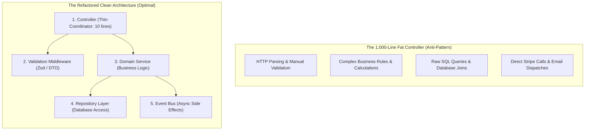

## Scenario

> **Your controller contains 1,000 lines of code. How would you refactor it?**

A 1,000-line controller (the "Fat Controller" anti-pattern) is a maintenance nightmare: it mixes HTTP parsing, database queries, business rules, external API calls, email sending, and transaction management in a single untestable file. The interviewer expects a structured **step-by-step refactoring plan following Single Responsibility and Layered Architecture principles**.


## Fast Revision (10-Second Recall)

- **The Golden Rule:** **Controllers should be thin coordinators.** A controller should only: (1) Accept HTTP request, (2) Validate DTO, (3) Delegate to a Service, and (4) Return HTTP response.
- **The 4 Refactoring Layers:**
  1. **Validation Layer (DTOs):** Move manual `if (!req.body.email)` checks into declarative schema validators (Zod / class-validator).
  2. **Service Layer (Domain Logic):** Extract business rules, calculations, and external API orchestration into dedicated Service classes.
  3. **Repository / Data Access Layer:** Extract raw SQL queries and ORM operations out of handlers into reusable data repositories.
  4. **Event / Message Dispatchers:** Move side-effects (welcome emails, audit logging, analytics) out of the handler into asynchronous event listeners.
- **Key Tools:** Zod / Joi, Dependency Injection (NestJS / Inversify), Domain Events.


## The 30-Second Spoken Script

If asked this in an interview, deliver this structured response:

> *I refactor a 1,000-line fat controller by applying the Single Responsibility Principle and decomposing it into a Layered Architecture.*
>
> *First, I peel away input validation. I replace 200 lines of manual `if-else` body checking with declarative DTO schemas using Zod or class-validator middleware, ensuring invalid data never enters the controller.*
>
> *Second, I extract database queries into Repositories, encapsulating SQL logic and making database operations reusable.*
>
> *Third, I move the core business logic into domain Services. The controller method becomes a 5-to-10 line coordinator: it extracts validated input, calls `this.orderService.createOrder()`, and maps the result to an HTTP status code.*
>
> *Finally, I decouple non-critical side effects—like sending confirmation emails or pushing analytics—by emitting domain events that are processed asynchronously.*
>
> *This slashes the controller from 1,000 lines to under 100 lines and allows us to unit test business logic in isolation without mocking HTTP request and response objects.*


## Diagnostic Lifecycle



### 1. The Controller Before and After

#### Before: 1,000-Line Monolith Handler
```typescript
// BAD: Controller doing EVERYTHING
app.post('/orders', async (req, res) => {
  if (!req.body.email || !req.body.items) return res.status(400).send('Invalid');
  const user = await db.query('SELECT * FROM users WHERE email = $1', [req.body.email]);
  let total = 0;
  for (const item of req.body.items) { /* calculate discount */ }
  const charge = await stripe.charges.create({ amount: total });
  await db.query('INSERT INTO orders ...');
  await sendgrid.sendEmail({ to: req.body.email, subject: 'Order confirmed' });
  return res.json({ success: true });
});
```

#### After: Clean 8-Line Thin Controller
```typescript
// GOOD: Controller coordinates; does not execute
export class OrderController {
  constructor(private readonly orderService: OrderService) {}

  async createOrder(req: Request, res: Response) {
    const dto: CreateOrderDto = req.body; // Pre-validated by Zod middleware
    const order = await this.orderService.checkout(req.user.id, dto);
    return res.status(201).json(order);
  }
}
```


## Root Causes & Solutions Matrix

| Code Smell | Architectural Flaw | Refactoring Technique |
| :--- | :--- | :--- |
| **Manual `if (!req.body.x)` checks** | Controller acts as input validator. | Move to DTO schema validation middleware (Zod/Joi). |
| **Raw SQL / ORM calls in controller** | Tightly couples HTTP layer to database schema. | Extract to Repository pattern (`orderRepository.create()`). |
| **Inline Email / Notification calls** | Blocks HTTP response on slow third-party network I/O. | Emit domain event (`eventBus.emit('OrderCreated', order)`). |
| **Untestable Business Logic** | Cannot test discounts without mocking `req` and `res`. | Move logic to pure domain service functions tested via Jest. |


## Practical Debugging Commands & Code

### 1. Decoupling Side Effects with Domain Events
```typescript
// OrderService.ts: Focuses strictly on business logic
export class OrderService {
  constructor(
    private readonly orderRepo: OrderRepository,
    private readonly paymentGateway: PaymentGateway,
    private readonly eventBus: EventEmitter
  ) {}

  async checkout(userId: string, dto: CreateOrderDto) {
    // 1. Calculate pricing & execute business logic
    const total = this.calculateTotal(dto.items);

    // 2. Charge payment
    const payment = await this.paymentGateway.charge(userId, total);

    // 3. Save order to database
    const order = await this.orderRepo.create({ userId, total, paymentId: payment.id });

    // 4. Emit event: Side-effects happen asynchronously!
    this.eventBus.emit('order.created', { order, userEmail: dto.email });

    return order;
  }
}

// EmailListener.ts: Independent, testable listener
eventBus.on('order.created', async ({ order, userEmail }) => {
  await emailQueue.add('send-receipt', { to: userEmail, orderId: order.id });
});
```


## Prevention & Senior Best Practices

1. **Enforce Static Analysis Limits:** Configure ESLint rules (`max-lines-per-function: [warn, 30]`, `max-lines: [warn, 150]`) to flag bloated controllers during pull requests.
2. **Never Inject Database Connections into Controllers:** Controllers should only ever inject Service interfaces, never database connections or raw ORM instances.
3. **Write Unit Tests Against Services First:** If testing a feature requires mocking Express `req`, `res`, and `next`, the business logic is improperly placed in the controller.

