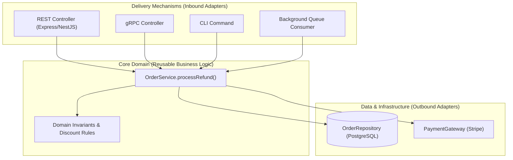

## Scenario

> **How would you separate business logic from controller logic?**

If business rules (e.g., "calculate tier discount", "apply coupon limits", "validate eligibility") live inside HTTP controllers, you cannot reuse that logic in a CLI command, background cron worker, or gRPC endpoint without duplicating code. The interviewer is testing your understanding of **Clean Architecture, Hexagonal Architecture (Ports and Adapters), and Pure Domain Services**.


## Fast Revision (10-Second Recall)

- **The Golden Litmus Test:** Can you invoke your core business logic from a CLI script or unit test without creating a fake HTTP `req` and `res` object? If no, your business logic is coupled to the transport layer.
- **Controller Responsibilities (HTTP Adapter):**
  - Extract route params, query strings, headers, and body.
  - Call domain service with plain language arguments (`service.refundOrder(orderId, reason)`).
  - Return appropriate HTTP status codes (`200`, `201`, `204`).
- **Service Responsibilities (Domain Core):**
  - Enforce business rules and domain invariants.
  - Orchestrate database transactions and third-party APIs.
  - Completely agnostic to HTTP, Express, headers, or cookies.
- **Key Tools:** Clean Architecture, Hexagonal Architecture, NestJS Services.


## The 30-Second Spoken Script

If asked this in an interview, deliver this structured response:

> *I separate business logic from controller logic by treating HTTP as merely one delivery mechanism among many, following Hexagonal Architecture principles.*
>
> *The controller is an inbound transport adapter. Its sole purpose is protocol translation: it parses HTTP headers, cookies, and parameters, passes raw data to a domain service, and maps the service's result or exception into an HTTP status code.*
>
> *The Service layer contains pure business logic. It has zero knowledge of `Request`, `Response`, cookies, or HTTP status codes. It accepts plain TypeScript objects or primitives, enforces domain rules—like checking subscription limits or calculating taxes—and interacts with databases via repository interfaces.*
>
> *This separation ensures that if we tomorrow need to expose the same functionality via a gRPC interface, a background queue consumer, or a CLI command, we reuse the exact same service without modifying a single line of domain code.*


## Diagnostic Lifecycle



### 1. The Controller vs Service Responsibility Matrix

| Feature / Responsibility | Belongs in Controller | Belongs in Service |
| :--- | :---: | :---: |
| Read cookie or `Authorization` header | **YES** | NO |
| Calculate discount rate based on user tier | NO | **YES** |
| Determine HTTP status code (`200 OK`, `201 Created`) | **YES** | NO |
| Verify inventory stock is sufficient | NO | **YES** |
| Parse pagination query parameters (`?limit=50&page=2`) | **YES** | NO |
| Atomic database transaction rollback | NO | **YES** |


## Root Causes & Solutions Matrix

| Coupling Anti-Pattern | Consequence | Architectural Remedy |
| :--- | :--- | :--- |
| **Passing `req` into Service** | `orderService.create(req)` couples service directly to Express. | Pass plain typed DTOs: `orderService.create(dto, userId)`. |
| **Throwing HTTP Errors in Domain** | `throw new HttpException(404)` leaks HTTP concepts into domain core. | Throw domain errors (`EntityNotFoundException`); map to HTTP status in filter. |
| **Duplicated Logic in Cron** | Need to recalculate subscriptions in a cron job; had to copy controller code. | Invoke the shared `SubscriptionService` from the cron job runner. |
| **Direct ORM Access in Controller** | Controller executes Prisma/TypeORM queries directly. | Restrict ORM access to Repository classes injected into Services. |


## Practical Debugging Commands & Code

### 1. Hexagonal Service Implementation (Pure TypeScript)
```typescript
// Core Domain Service: Zero Express / HTTP imports!
export interface IOrderRepository {
  findById(id: string): Promise<Order | null>;
  save(order: Order): Promise<void>;
}

export class OrderService {
  constructor(private readonly orderRepo: IOrderRepository) {}

  async applyDiscount(orderId: string, couponCode: string): Promise<Order> {
    const order = await this.orderRepo.findById(orderId);
    if (!order) {
      throw new DomainEntityNotFoundException(`Order ${orderId} does not exist.`);
    }

    // Pure domain logic:
    if (order.status !== 'DRAFT') {
      throw new InvalidBusinessRuleException('Discounts can only be applied to draft orders.');
    }

    const discountPercentage = this.calculateCouponValue(couponCode);
    order.total = order.total * (1 - discountPercentage);

    await this.orderRepo.save(order);
    return order;
  }

  private calculateCouponValue(code: string): number {
    return code === 'SUMMER20' ? 0.2 : 0.05;
  }
}
```

### 2. HTTP Adapter Controller (Coordinates Transport)
```typescript
import { Request, Response } from 'express';

export class OrderController {
  constructor(private readonly orderService: OrderService) {}

  async applyCoupon(req: Request, res: Response) {
    const { orderId } = req.params;
    const { couponCode } = req.body;

    // Transport adapter delegates to domain service
    const updatedOrder = await this.orderService.applyDiscount(orderId, couponCode);

    return res.status(200).json(updatedOrder);
  }
}
```


## Prevention & Senior Best Practices

1. **The Dependency Inversion Rule:** High-level domain logic must never depend on low-level transport frameworks. Express depends on your Service; your Service never depends on Express.
2. **Never Import Express Types in Service Files:** Configure ESLint with `no-restricted-imports` to forbid importing `express` or `@nestjs/common` in domain folders.
3. **Unit Test Services with In-Memory Mocks:** Test all business edge cases against plain service instances without spinning up mock HTTP servers.

