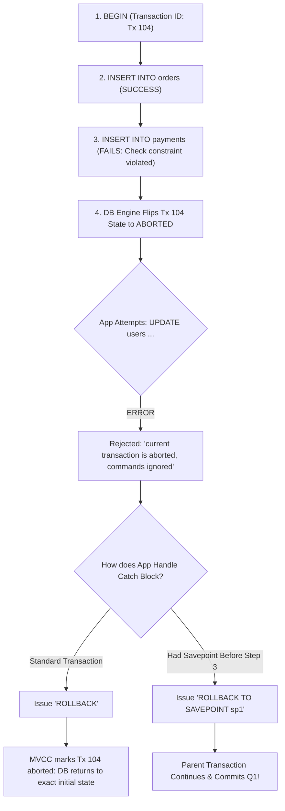

## Scenario

> **What happens if one operation in a transaction fails?**

When a single query within an ongoing SQL transaction fails (e.g., violates a foreign key constraint, fails a check constraint, or divides by zero), the database enters an **aborted transaction state**. What happens under the hood? How does the database guarantee that no partial data leaks, and how can an application use **Savepoints** for partial rollbacks without abandoning the entire transaction?


## Fast Revision (10-Second Recall)

- **The Database Engine Rule (PostgreSQL):** Once any SQL command within a transaction errors, the transaction state flips to `ABORTED`. All subsequent queries in that transaction are rejected with `current transaction is aborted, commands ignored until end of transaction block`.
- **Under the Hood (Write-Ahead Log - WAL):** Changes were written to memory buffers and the WAL. On `ROLLBACK`, the database marks the transaction as uncommitted in the commit log (`pg_xact`), making all modified rows invisible to all other transactions (MVCC).
- **Savepoints (Nested Transactions):** Use `SAVEPOINT my_savepoint` and `ROLLBACK TO SAVEPOINT my_savepoint` to recover from a failed optional sub-operation without rolling back the entire parent transaction.
- **Key Tools:** SQL `SAVEPOINT`, PostgreSQL `pg_xact`, MVCC (Multi-Version Concurrency Control).


## The 30-Second Spoken Script

If asked this in an interview, deliver this structured response:

> *When a single operation in a transaction fails, modern relational databases like PostgreSQL immediately transition the transaction into an Aborted state.*
>
> *Any subsequent query issued on that connection will be rejected by the database engine until an explicit `ROLLBACK` is issued.*
>
> *Under the hood, thanks to Multi-Version Concurrency Control (MVCC) and the Write-Ahead Log (WAL), the changes written during the failed transaction are never permanently applied to the database state. When `ROLLBACK` executes, the transaction ID is marked as aborted in the commit log, making every row inserted or modified by that transaction invisible to all other readers.*
>
> *If we have an optional sub-step—like attempting to apply a loyalty discount that might fail—we can use database Savepoints. A Savepoint acts like a checkpoint: if the sub-query fails, we rollback to the savepoint and continue the rest of the parent transaction to commit.*


## Diagnostic Lifecycle



### 1. The PostgreSQL "Transaction Aborted" Signature
If a statement fails and your application code mistakenly tries to execute another query without issuing `ROLLBACK` or using a Savepoint:
```text
ERROR: current transaction is aborted, commands ignored until end of transaction block
```
The connection is rendered completely unusable for further queries until `ROLLBACK` is sent.


## Root Causes & Solutions Matrix

| Scenario | Database State | Application Handling |
| :--- | :--- | :--- |
| **Unhandled Query Error** | Transaction marked `ABORTED`. | Catch error and issue `ROLLBACK`; release connection. |
| **Connection Drops Mid-Tx** | Server crashes or network drops. | Database backend process terminates; server engine auto-rolls back uncommitted WAL changes. |
| **Optional Sub-Step Fails** | Need to rollback sub-step without losing previous steps. | Wrap sub-step in a `SAVEPOINT` and `ROLLBACK TO SAVEPOINT`. |
| **Deadlock Encountered** | Database kills one of the transactions with error `40P01`. | Catch deadlock code, issue rollback, and retry transaction after random backoff delay. |


## Practical Debugging Commands & Code

### 1. Using SQL Savepoints for Partial Rollbacks
```sql
BEGIN;

-- Critical Step 1: Must succeed
INSERT INTO orders (id, user_id, total) VALUES (1, 42, 100);

-- Establish Savepoint before risky optional operation
SAVEPOINT reward_discount;

-- Risky Step 2: Might fail due to constraint
UPDATE reward_points SET balance = balance - 500 WHERE user_id = 42;
-- (Suppose balance check constraint fails!)

-- Rollback ONLY the failed reward points step
ROLLBACK TO SAVEPOINT reward_discount;

-- Critical Step 3: Continues cleanly!
INSERT INTO order_audit (order_id, status) VALUES (1, 'CREATED_WITHOUT_DISCOUNT');

COMMIT; -- Order and Audit commit successfully!
```

### 2. Node.js Transaction with Savepoint (Prisma / Raw SQL)
```typescript
export async function executeWithSavepoint(client: PoolClient) {
  await client.query('BEGIN');
  try {
    await client.query('INSERT INTO orders (id) VALUES ($1)', [1]);

    // Create savepoint
    await client.query('SAVEPOINT before_coupon');
    try {
      await client.query('UPDATE coupons SET used = true WHERE code = $1', ['EXPIRED_CODE']);
    } catch (couponError) {
      console.warn('Coupon failed, rolling back to savepoint...');
      await client.query('ROLLBACK TO SAVEPOINT before_coupon');
    }

    await client.query('COMMIT');
  } catch (fatalError) {
    await client.query('ROLLBACK');
    throw fatalError;
  }
}
```


## Prevention & Senior Best Practices

1. **Always Handle Rollback in Catch Blocks:** Ensure every single transaction has a bulletproof `catch` block that issues `ROLLBACK` to prevent orphaned aborted connections in the pool.
2. **Use Savepoints Sparingly:** Savepoints add memory overhead in database transaction trees; use them only for legitimate business fallback paths, not for routine control flow.
3. **Monitor Aborted Transaction Rates:** Track the ratio of `ROLLBACK` to `COMMIT` in PostgreSQL (`pg_stat_database.xact_rollback`). A sudden spike indicates failing constraints or unhandled code bugs.

