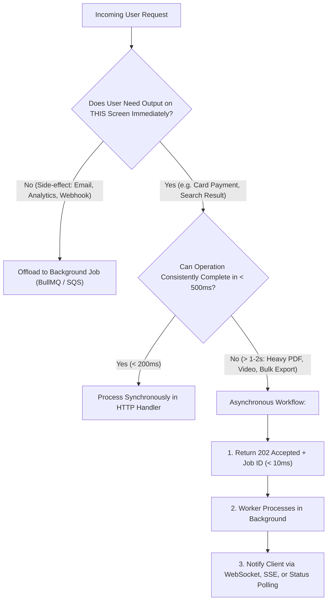

## Scenario

> **When would you use background jobs instead of synchronous API calls?**

Synchronous HTTP calls require the client to maintain an open TCP connection while the server computes the response. If an endpoint takes 10 seconds to generate an invoice, resize 5 images, or sync records with Salesforce, the user's browser locks up, gateway proxies time out, and server thread pools become saturated. The interviewer is testing your **architectural heuristics for asynchronous task offloading**.


## Fast Revision (10-Second Recall)

- **The Golden Rule of Latency Budgets:** Any operation that takes **longer than 500ms** or does not need to return an immediate result for the current screen should be moved to a background job.
- **Top 5 Triggers to Move to Background Workers:**
  1. **Slow External Network I/O:** Sending emails via SendGrid, dispatching SMS, or syncing CRM data with HubSpot.
  2. **Heavy CPU Processing:** PDF/invoice generation, video transcoding, image thumbnailing, ZIP archiving.
  3. **Bulk Data Processing:** Importing CSV files with 10,000 rows or bulk sending notifications to 50,000 users.
  4. **High Burst Rate Absorption:** Ingesting 20,000 analytics events per second into an append-only queue (Kafka/SQS) to protect the database.
  5. **Scheduled / Delayed Execution:** Reminders, subscription renewals, or retrying failed payments after 24 hours.
- **Key Tools:** BullMQ (Redis), Celery (Python), AWS SQS + Lambda, Kafka.


## The 30-Second Spoken Script

If asked this in an interview, deliver this structured response:

> *I decide between synchronous API calls and background jobs based on two criteria: the user's immediate cognitive requirement and our latency budget.*
>
> *If the user strictly needs the return data to render the immediate next screen—like checking out a shopping cart or verifying credentials—the operation must be synchronous, targeting under 200 milliseconds.*
>
> *However, if an operation exceeds a 500-millisecond latency budget, involves non-critical third-party network calls like sending emails, or performs heavy compute like PDF generation or bulk database updates, I move it to a background job.*
>
> *The synchronous API validates the payload, pushes a job to a message queue like BullMQ or SQS, and returns an immediate `202 Accepted` with a job ID in under 15 milliseconds.*
>
> *This decouples user responsiveness from slow external services, ensures automatic retry resilience if downstream workers fail, and prevents thread pool starvation under high concurrency.*


## Diagnostic Lifecycle



### 1. Synchronous vs Background Job Comparison

| Characteristic | Synchronous API Call | Background Worker Job |
| :--- | :--- | :--- |
| **Response Latency** | Direct (User waits: 50ms – 500ms) | Instant `202 Accepted` (< 15ms) |
| **Failure Handling** | Fails immediately back to user | Automatic exponential retry with Dead-Letter Queue |
| **System Resilience** | Downstream outage crashes user experience | Downstream outage queues work safely in memory/disk |
| **Throughput Scaling** | Limited by HTTP connection pool | Workers scale independently based on queue depth |


## Root Causes & Solutions Matrix

| Scenario | Anti-Pattern (Synchronous) | Architectural Remedy (Background Job) |
| :--- | :--- | :--- |
| **User Registration Email** | Controller awaits `sendgrid.send()`; user waits 2s. | Push to `email-queue`; return `201 Created` in 25ms. |
| **Bulk CSV Import (5,000 rows)** | Loop inserts in request; hits NGINX 60s timeout. | Stream file to S3; push job `import-csv`; notify via WebSocket upon completion. |
| **Payment Webhook Handling** | Synchronous complex DB reconciliations cause webhook timeout (Stripe re-sends 5x). | Write raw webhook to queue; return `200 OK` to Stripe in 5ms; process in worker. |
| **Image / Video Uploads** | Resizing 4 image resolutions inside `POST /upload`. | Save original to S3; trigger background worker to generate resized thumbnails. |


## Practical Debugging Commands & Code

### 1. Asynchronous Job Enqueueing with BullMQ
```typescript
import { Queue } from 'bullmq';
import { Request, Response } from 'express';

const pdfQueue = new Queue('pdf-generation', {
  connection: { host: 'localhost', port: 6379 },
});

export async function generateInvoiceHandler(req: Request, res: Response) {
  const { orderId } = req.body;

  // 1. Enqueue job immediately with automatic retry policy
  const job = await pdfQueue.add(
    'render-pdf',
    { orderId, userId: req.user.id },
    {
      attempts: 3,
      backoff: { type: 'exponential', delay: 2000 },
      removeOnComplete: true,
    }
  );

  // 2. Return immediate 202 Accepted with polling URL
  return res.status(202).json({
    status: 'QUEUED',
    jobId: job.id,
    pollUrl: `/api/invoices/status/${job.id}`,
  });
}
```


## Prevention & Senior Best Practices

1. **Establish a Strict 500ms Latency SLA:** Conduct architecture reviews for any synchronous endpoint exceeding 500ms p95 latency and mandate asynchronous offloading.
2. **Always Configure Queue Dead-Letter Queues:** Never deploy a background worker without a Dead-Letter Queue (DLQ) to isolate poisonous jobs.
3. **Scale Workers Based on Queue Latency / Depth:** Configure Kubernetes KEDA (Kubernetes Event-driven Autoscaling) to automatically scale worker pods up when queue backlog grows.

